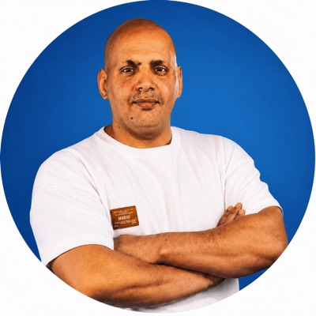

## Mohanad Hamed

{.about-photo fig-alt="Photo of Mohanad Hamed"}

I am a lecturer in the **Mobile Game Development and Design** diploma at the
Technical College, Al-Israa University, Jordan.

I am also a senior software engineer with **18 years of experience**.
I worked for companies in Jordan, Sweden and the USA.
I build games and apps with C#, Unity, C/C++ and .NET.
Now I teach what I use at work every day.

[LinkedIn](https://www.linkedin.com/in/mohanadhamed) ·
[GitHub](https://github.com/mohanadhamed)

## Education

- **Bachelor of Science in Computer Engineering**,
  Al-Balqa Applied University, Jordan, 2008. Grade: Very Good.

## Game development

| Years | Work |
|--|----------|
| 2025–2026 | **Tamatem Games**, Jordan. Senior software engineer, Unity mobile games. I built game systems in C# for mobile games with many players, made the games faster, and led code reviews. |
| 2017–2022 | **Tobii**, Sweden. Senior C#/Unity engineer. I built virtual reality (VR) and mixed reality (MR) apps in Unity, with eye tracking. |
| 2015–2017 | **Mixed Dimensions**, Jordan. Team leader for 3D technology. I led a team that worked on 3D tools and on speed in Unity. |

Some of my games:

- **Glypho**: a free memory card game in Arabic and English.
  Up to eight friends play together online.
  Play it at [glyphogg.com](https://glyphogg.com).
- **VIP Baloot**: an online card game for mobile, made with Unity.
  I worked on the game rules and on the online play between players.
- **Soccer Power Hero**: a football game for 1–4 players, for PC and Xbox, made with Unity.
- **Mercury Attack**: a 3D game made with Unity.
- **Struggling Tanks 2**: a PC game for 1–2 players, made with GameMaker Studio.

## Other software work

- **Mobile apps**: I led mobile teams and built apps for Android and iOS
  (Unifonic, Samsung R&D, Nextwo).
- **Real-time video and audio**: C++ work for live video calls (Vonage, Sweden).
- **3D and web**: 3D simulation tools (Istari Digital, USA) and web apps with
  ASP.NET Core and Blazor.
- **Graphics files**: C/C++ libraries to read and draw images and documents
  (Lead Technologies, Jordan).

## Teaching and training

At Samsung R&D, I gave training on mobile systems.
I also gave workshops for developers and computer science students in the
Middle East and North Africa.

I speak Arabic, English and some Swedish.

## These lessons

This website has the lessons for all my courses.
The lessons are free for everyone.

- Each lesson is a web page with small simulators you can try.
- Each lesson is also a PDF. You can print it and study at home.
- The lessons use simple English. A short English–Arabic word list starts every lesson.

Your weekly topics and assignments are on the university e-learning platform.

::: {.credit-note}
Lesson materials are prepared with AI assistance and reviewed by the instructor.
:::
