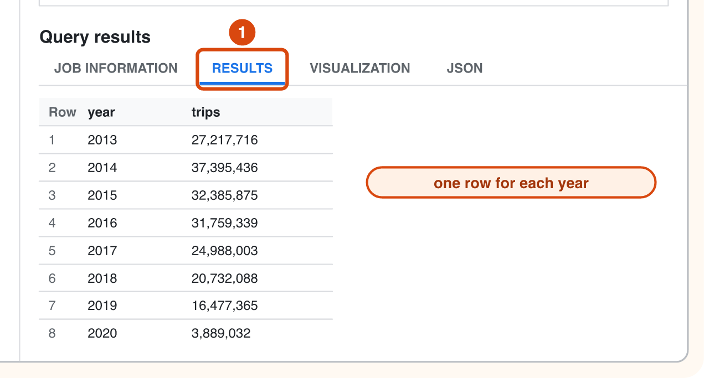

## Today in the lab

::: {.lab-plan}
1. **15 minutes, here:** each idea on a simulator.
2. **35 minutes, in BigQuery:** the **worksheet**, step by step, with your
   own Google account.
3. **At the end:** show your result, then **sign out**.
:::

{width=48%}

## Key terms



## 1.1 Why one computer is not enough

### On the simulator

- **Big data:** too big or too fast for one computer.
- A **platform** cuts a table into **blocks** on many computers: a
  **cluster**.
- Each computer reads its own blocks, **at the same time**.
- Each block is on **3 computers**: no data is lost.

::: {.sim-part}

:::

### In BigQuery: worksheet Task 1

:::: {.word-part data-app="BigQuery (Chrome)"}
**Google BigQuery** is a big data platform in the cloud: Google's computers
do the work, you use a browser. The **sandbox** is free, with no card.

::: {.screens}
![**console.cloud.google.com/bigquery**: [1]{.step-n} your Gmail, [2]{.step-n} **Next**, then your password.](images/bq-signin-1.png)

![First time: [1]{.step-n} **Jordan**. [2]{.step-n} Tick the terms. [3]{.step-n} **Agree and continue**.](images/bq-welcome-1.png)

![**Create project**: [1]{.step-n} **big-data-lab**. [2]{.step-n} **No organization**. [3]{.step-n} **Create**.](images/bq-project-1.png)
:::
::::

::: {.callout-tip title="Try it 1 · Many computers"}
Choose the right answer.

::: {.match extra="13 minutes|1 hour"}
One computer reads a 75 GB table in about 13 minutes. A platform uses 100 computers, each with its own blocks. About how long now?
:   8 seconds

    Why: 100 computers read at the same time, so the time is about 100 times shorter: 780 seconds ÷ 100 ≈ 8 seconds.
:::
:::

## 1.2 A table of 200 million rows

### On the simulator

- A **project** (your space) holds **datasets**; a dataset holds
  **tables**.
- A **public dataset** is free to read: every Chicago taxi trip since 2013.
- **Schema** (columns), **Details** (size) and **Preview** (first rows) are
  **free**: no query.

::: {.sim-part}

:::

### In BigQuery: worksheet Task 2

:::: {.word-part data-app="BigQuery (Chrome)"}
::: {.screens}
![[1]{.step-n} **+ Add data**. [2]{.step-n} **Public datasets**.](images/bq-add-1.png)

![[1]{.step-n} **chicago taxi**. [2]{.step-n} The result. [3]{.step-n} **View dataset**.](images/bq-market-1.png)

![[1]{.step-n} **chicago_taxi_trips**. [2]{.step-n} **taxi_trips**.](images/bq-tree-1.png)

![[1]{.step-n} **Details**. [2]{.step-n} Number of rows and size.](images/bq-details-1.png)
:::

Not found? [Open the taxi table in BigQuery](https://console.cloud.google.com/bigquery?p=bigquery-public-data&d=chicago_taxi_trips&t=taxi_trips&page=table){target="_blank" rel="noopener"}
(sign in first).
::::

::: {.callout-tip title="Try it 2 · Free or not?"}
Choose the right answer.

::: {.match extra="Run a query|SELECT * on the table"}
You want to see the first rows of taxi_trips, and pay nothing. Which tab?
:   Preview

    Why: Preview shows the first rows without a query, so it reads nothing and costs nothing.
:::
:::

## 1.3 A query: the platform does the work

### On the simulator

- A **query** asks the table a question in **SQL**.
- Before **Run**, BigQuery shows how much it will read.
- **Job information:** **Bytes processed** and **Duration**.
- `SELECT *` reads the whole table (75 GB): ask only for the columns you
  need.

::: {.sim-part}

:::

### In BigQuery: worksheet Task 3

:::: {.word-part data-app="BigQuery (Chrome)"}
The query of the worksheet, to copy (the button at the top right of the
box):

```sql
SELECT EXTRACT(YEAR FROM trip_start_timestamp) AS year,
  COUNT(*) AS trips
FROM `bigquery-public-data.chicago_taxi_trips.taxi_trips`
GROUP BY year
ORDER BY year;
```

Finished early? How do people pay?

```sql
SELECT payment_type, COUNT(*) AS trips
FROM `bigquery-public-data.chicago_taxi_trips.taxi_trips`
GROUP BY payment_type
ORDER BY trips DESC;
```

::: {.screens}
![[1]{.step-n} The query. [2]{.step-n} The estimate. [3]{.step-n} **Run**.](images/bq-query-1.png)

![[1]{.step-n} **Results**: one row for each year.](images/bq-results-1.png)

![[1]{.step-n} **Job information**. [2]{.step-n} Duration and bytes processed.](images/bq-job-1.png)

![At the end: [1]{.step-n} your picture, [2]{.step-n} **Sign out**.](images/bq-signout-1.png)
:::
::::

::: {.callout-tip title="Try it 3 · Read the result"}
Choose the right answer. You can use an answer more than once.

::: {.match extra="Number of rows|Schema"}
After Run, where do you see how much data the query read?
:   Job information

    Why: Job information shows Bytes processed and Duration of the query that ran.

The query by year gives one row for each year, from 2013 to 2023. How many rows does the result have?
:   11

    Why: 2013 to 2023 is 11 years, so 11 rows: the platform turned 200 million rows into 11.
:::
:::

## Now: your worksheet

::: {.lab-go}
Do the three tasks of your **worksheet** in BigQuery, in order (less than
30 minutes). Tick each step.
Stuck? Raise your hand. At the end: **sign out** of Google.
:::

{width=48%}

## Summary {.summary}

- Big data is too big for one computer: a platform splits it into blocks on a cluster.
- The computers of a cluster read their blocks at the same time; each block is kept on 3 computers.
- In BigQuery a project holds datasets, and a dataset holds tables; a public dataset is free to read.
- Schema, Details and Preview are free; a query shows before Run how much it will read.
- An SQL query turns millions of rows into a short answer; Job information shows the bytes processed.
