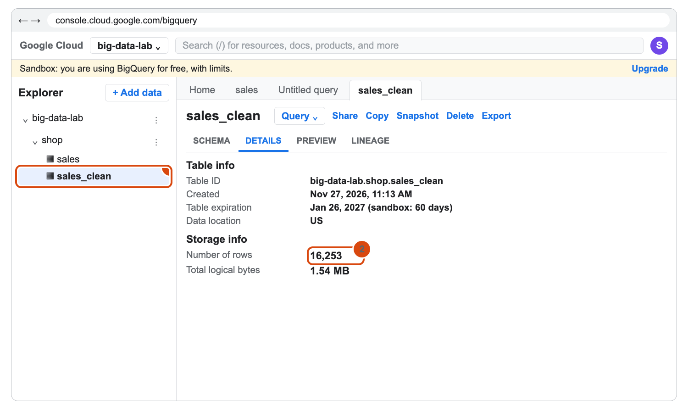

## Before the lab: the video

::: {.prep-video}
Watch it **before the lab**: the ideas of today, then what you do in the
lab. In Arabic, with the words of the lab in English.


:::

## Today in the lab

::: {.lab-plan}
1. **Here:** each idea on a simulator.
2. **Then:** your **worksheet** on the **BigQuery Lab** of this page: no
   Google account, nothing to sign in.
3. **At the end:** show your result to your teacher.
:::

{width=60%}

## Key terms



## 2.1 Data comes as files

### On the simulator

- Shops, card machines and apps **collect** data in **files**.
- **CSV**: one **line** for each row, a **comma** between the values; line
  1, the **header**, holds the column names.
- Each column has a **type**: STRING, INTEGER, FLOAT, TIMESTAMP. An empty
  value is **null**.

::: {.sim-part}

:::

::: {.callout-tip title="Try it 1 · The type of a column"}
Choose the right answer.

::: {.match extra="INTEGER|FLOAT"}
The column Invoice holds 489434, 489436 … and C489459 (a return). Which type does Auto detect give it?
:   STRING

    Why: one value has a letter (C), so the column cannot be a number: the whole column is text, STRING.
:::
:::

## 2.2 Your dataset and your table

### On the simulator

- A **dataset** is your folder of tables: **shop**.
- **Create table** › **Upload**: a **load job** writes the file into a
  table; **Auto detect** finds the columns and types.
- Check it: **Schema** and **Details** (the rows).

::: {.sim-part}

:::

### In the BigQuery Lab: worksheet Tasks 1 and 2

:::: {.word-part data-app="BigQuery Lab (this page)"}
The worksheet is done on the **BigQuery Lab**: [open it on a full
page](sims/bq-lab2.html){target="_blank" rel="noopener"}. It looks like
BigQuery and runs real SQL; your work stays in this browser.

::: {.screens}
![[1]{.step-n} **⋮** next to **big-data-lab**. [2]{.step-n} **Create dataset**.](images/bq2-menu-ds.png)

![[1]{.step-n} **Dataset ID:** **shop**. [2]{.step-n} **Create dataset**.](images/bq2-dataset.png)

![[1]{.step-n} **⋮** next to **shop**. [2]{.step-n} **Create table**.](images/bq2-menu-tbl.png)

![[1]{.step-n} **Upload**. [2]{.step-n} **Browse**: the CSV file. [3]{.step-n} **CSV**.](images/bq2-upload.png)

![[1]{.step-n} **Table:** **sales**. [2]{.step-n} **Auto detect**. [3]{.step-n} **Create table**.](images/bq2-table.png)

![[1]{.step-n} **Details**. [2]{.step-n} **Number of rows**.](images/bq2-details.png)
:::
::::

::: {.callout-tip title="Try it 2 · Is the load complete?"}
Choose the right answer.

::: {.match extra="Preview|Schema"}
The file has 21,019 rows of sales. Where do you see that the table has all of them, without a query?
:   Details

    Why: Details shows the Number of rows of the table; it must be the same as the rows of the file.
:::
:::

## 2.3 ELT: a clean table from a query

### The query, line by line

**ETL** cleans data **before** the load. **ELT** loads the raw data first,
then cleans it **inside** the platform with a query:

```sql
CREATE TABLE shop.sales_clean AS
SELECT *, Quantity * Price AS revenue
FROM `big-data-lab.shop.sales`
WHERE Quantity > 0
  AND Customer_ID IS NOT NULL;
```

::: {.code-explain}
| Line | What it does |
|------|-------------------------------|
| `CREATE TABLE shop.sales_clean AS` | Save the answer as a **new table**, sales_clean, in shop. |
| `SELECT *, Quantity * Price AS revenue` | All the columns (`*`), and a new one: quantity × price = **revenue**. |
| ``FROM `big-data-lab.shop.sales` `` | From the table you loaded. |
| `WHERE Quantity > 0` | Keep only sales: a negative quantity is a **return**. |
| `AND Customer_ID IS NOT NULL;` | And only known customers (**null** = no value). `;` ends it. |
:::

::: {.sim-part}

:::

### On the simulator

- The BigQuery Lab of 2.2: **Run**, then **Try a change** (any query runs).

### In the BigQuery Lab: worksheet Task 3

:::: {.word-part data-app="BigQuery Lab (this page)"}
The query of the worksheet, to copy (the button at the top right of the
box), or click **Type for me** in the BigQuery Lab:

```sql
CREATE TABLE shop.sales_clean AS
SELECT *, Quantity * Price AS revenue
FROM `big-data-lab.shop.sales`
WHERE Quantity > 0
  AND Customer_ID IS NOT NULL;
```

Finished early? A table of the sales in the United Kingdom only: the
same idea, from the clean table, with a text value in quotes.

```sql
CREATE TABLE shop.sales_uk AS
SELECT *
FROM `big-data-lab.shop.sales_clean`
WHERE Country = 'United Kingdom';
```

::: {.screens}
![[1]{.step-n} The query. [2]{.step-n} **Run**. [3]{.step-n} A new table.](images/bq2-clean.png)

![[1]{.step-n} **sales_clean** in the Explorer. [2]{.step-n} Its **Number of rows**.](images/bq2-clean-details.png)
:::
::::

::: {.callout-tip title="Try it 3 · ELT"}
Choose the right answer.

::: {.match extra="The table sales loses its returns|Nothing: a query only shows an answer"}
You run CREATE TABLE shop.sales_clean AS SELECT … WHERE Quantity > 0. What happens?
:   A new table holds the rows with Quantity > 0

    Why: CREATE TABLE … AS saves the answer of the query as a new table; the raw table sales stays as it was (ELT).
:::
:::

## Now: your worksheet

::: {.lab-go}
Do the three tasks of your **worksheet**, in order, on the
[**BigQuery Lab**](sims/bq-lab2.html){target="_blank" rel="noopener"}.
Tick each step. At the end: show your teacher the table **sales_clean**.
:::

{width=60%}

## Summary {.summary}

- Data is collected in files; a CSV file has one line for each row and a comma between the values.
- A table has a schema: the name and the type of each column (STRING, INTEGER, FLOAT, TIMESTAMP); a missing value is null.
- A load job writes the rows of a file into a table of your dataset; Details shows the number of rows.
- ETL cleans data before the load; ELT loads it first and cleans it in the platform with a query.
- CREATE TABLE … AS SELECT saves the answer of a query as a new table; the raw table stays as it was.
