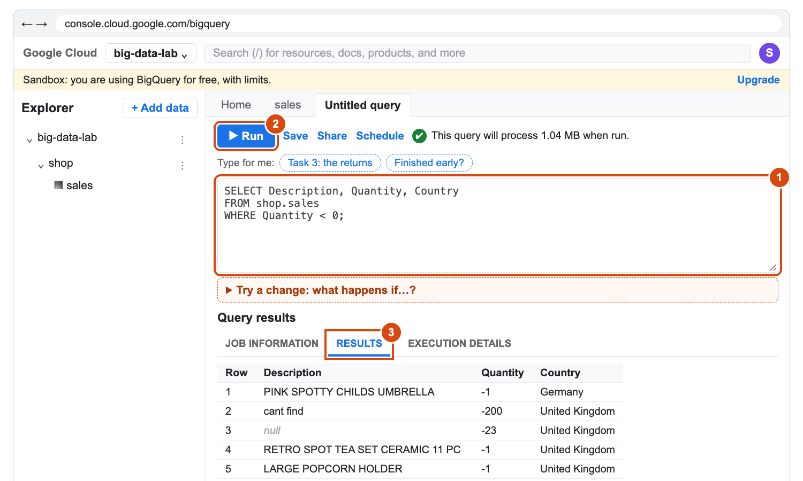

## Before the lab: the video

::: {.prep-video}
Watch it **before the lab**: the ideas of today, then what you do in the
lab. In Arabic, with the words of the lab in English.


:::

## Today in the lab

::: {.lab-plan}
1. **The big picture** (your teacher, 5–10 minutes): the whole lab in
   three clicks.
2. **Step by step, together** (about 30 minutes): the same steps on the
   **BigQuery Lab** of this page. No Google account, nothing to sign in.
3. **At the end:** show your teacher your answer.
:::

{width=60%}

## Key terms



## 2.1 The big picture: collect, store, ask

### On the simulator

- **Collect:** a shop saves every sale in a **file** (CSV: one line for
  each sale).
- **Store:** the platform loads the file into a **table**.
- **Ask:** a short question in **SQL** gives the answer at once.

::: {.sim-part}

:::

::: {.callout-tip title="Try it 1 · Collect, store or ask?"}
Choose the right answer.

::: {.match extra="Collect|Ask"}
You load the sales file of the shop into a table of BigQuery. Which step is it?
:   Store

    Why: the data is already collected in a file; loading it into a table keeps it on the platform, ready for questions.
:::
:::

## 2.2 From a file to a table

### The idea

- A **dataset** is a folder of tables: **shop**.
- **Create table** › **Upload** the file; **Auto detect** finds the
  columns and their **types**.
- **Schema** (the columns), **Details** (the number of rows), **Preview**
  (the first rows).

### The steps, screen by screen: Tasks 1 and 2

:::: {.word-part data-app="BigQuery Lab (this page)"}
Where to click, before you do it in 2.4. The **orange numbers** show the
order.

::: {.screens}
![[1]{.step-n} **⋮** next to **big-data-lab**. [2]{.step-n} **Create dataset**.](images/bq2-menu-ds.png)

![[1]{.step-n} **Dataset ID:** **shop**. [2]{.step-n} **Create dataset**.](images/bq2-dataset.png)

![[1]{.step-n} **⋮** next to **shop**. [2]{.step-n} **Create table**.](images/bq2-menu-tbl.png)

![[1]{.step-n} **Upload**. [2]{.step-n} **Browse**: the CSV file. [3]{.step-n} **CSV**.](images/bq2-upload.png)

![[1]{.step-n} **Table:** **sales**. [2]{.step-n} **Auto detect**. [3]{.step-n} **Create table**.](images/bq2-table.png)

![[1]{.step-n} The table **sales**. [2]{.step-n} **Schema**: the columns and their types.](images/bq2-schema.png)

![[1]{.step-n} **Details**. [2]{.step-n} **Number of rows**.](images/bq2-details.png)

![[1]{.step-n} **Preview**: the first rows.](images/bq2-preview.png)
:::
::::

::: {.callout-tip title="Try it 2 · The type of a column"}
Choose the right answer.

::: {.match extra="STRING|INTEGER"}
The column Price holds 6.95, 2.10, 0.65 … Which type does Auto detect give it?
:   FLOAT

    Why: the prices are numbers with a decimal point: FLOAT. A whole number is INTEGER; text is STRING.
:::
:::

## 2.3 Ask a question: SELECT, FROM, WHERE

### The query, line by line

Which sales are **returns**? A return has a negative quantity.

```sql
SELECT Description, Quantity, Country
FROM shop.sales
WHERE Quantity < 0;
```

::: {.code-explain}
| Line | What it does |
|------|-------------------------------|
| `SELECT Description, Quantity, Country` | Show these three **columns** (a comma between them). |
| `FROM shop.sales` | From the table **sales** in the dataset **shop**. |
| `WHERE Quantity < 0;` | Only the **rows** with a quantity less than 0. `;` ends it. |
:::

::: {.sim-part}

:::

### The steps, screen by screen: Task 3

:::: {.word-part data-app="BigQuery Lab (this page)"}
On the table **sales**: **Query**, then the query (or **Type for me**), then
**Run**. Then open **Try a change** under the editor: another country, no
quotes, a name spelled wrong …

::: {.screens}
![[1]{.step-n} The query. [2]{.step-n} **Run**. [3]{.step-n} **Results**: the returns.](images/bq2-where.png)
:::

Finished early? Make an **empty table** of your own: its name, then its
columns and their types.

```sql
CREATE TABLE shop.customers (
  customer_id INTEGER,
  name STRING,
  city STRING
);
```
::::

::: {.callout-tip title="Try it 3 · WHERE"}
Choose the right answer.

::: {.match extra="The column Country only|All the rows, sorted by country"}
A query has WHERE Country = 'France'. What does the answer show?
:   Only the rows of France

    Why: WHERE is a filter of rows: it keeps only the rows where the condition is true.
:::
:::

## 2.4 Do it: the BigQuery Lab

Now each student does Tasks 1 to 3, together with the teacher. Under the
simulator, every step has its details, and **Show me** opens its screen. A
[full page](sims/bq-lab2.html){target="_blank" rel="noopener"} is bigger;
your work stays in this browser. The same steps are on your
**worksheet**.

::: {.sim-part}

:::

## Summary {.summary}

- Collect, store, ask: a shop collects its sales in a file, the platform stores them in a table, and SQL asks the table.
- A dataset is a folder of tables; Upload with Auto detect makes a table from a CSV file.
- Schema shows the columns and their types (STRING, INTEGER, FLOAT, TIMESTAMP); Details shows the number of rows.
- SELECT chooses the columns, FROM the table, and WHERE the rows; text goes in quotes.

::: {.lab-score}
Your score in this lab appears here: open the page in a browser.
:::
