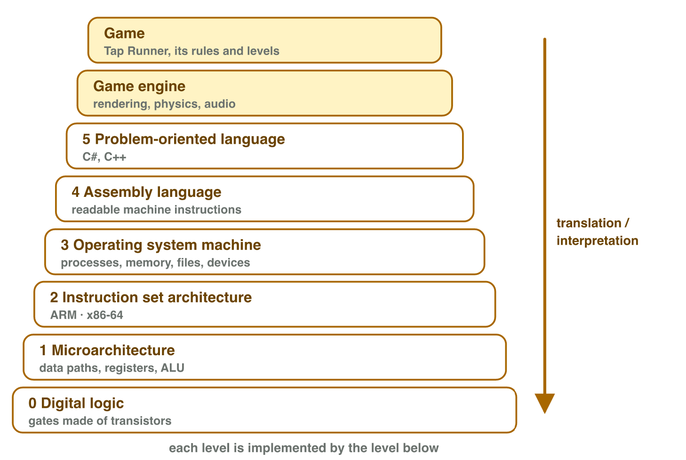
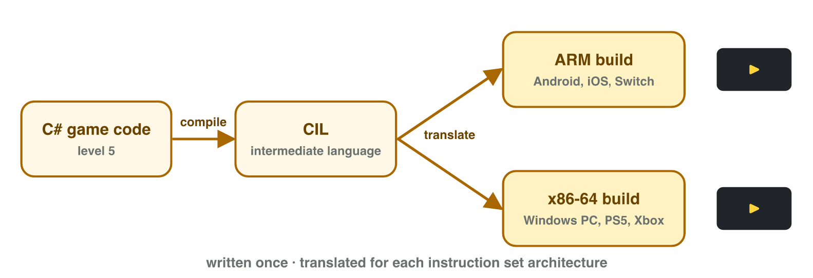
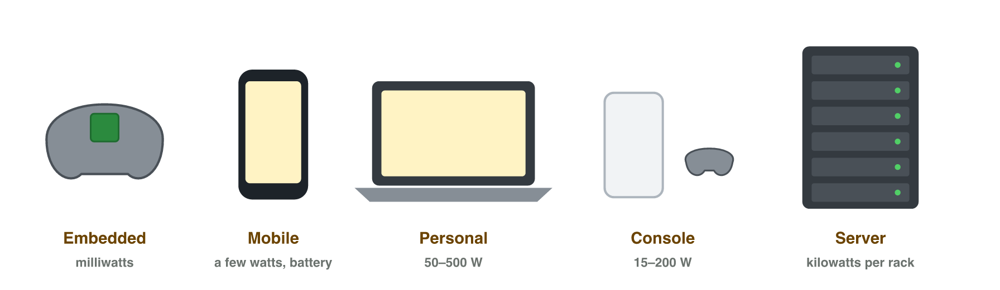

## Keywords



## Think · One phone, thousands of games

The same phone runs a racing game, then a puzzle game.
**How is that possible without new hardware?**

::: {.answer}
The program is **data in memory**: load a new program, get a new machine.
:::

## 1.1 The stored-program model

:::: {.columns}
::: {.column width="38%"}
- CPU: control, ALU, registers
- RAM: fast, volatile
- storage: permanent
- bus connects them
:::
::: {.column width="62%"}

:::
::::

## The instruction cycle

:::: {.columns}
::: {.column width="38%"}
- fetch → decode → execute
- 3 GHz = 3 billion ticks/s
- 60 fps → 50 million ticks per frame
:::
::: {.column width="62%"}

:::
::::

## Live demo · Tap Runner



## Try it 1 · Inside the computer

a) loses data when off?
b) the three steps?
c) ticks per frame, 3 GHz, 60 fps?

::: {.answer}
a) RAM
b) fetch, decode, execute
c) 50 million
:::

## 1.2 A multilevel machine

:::: {.columns}
::: {.column width="38%"}
- each level: a simpler language below
- **compiler**: translate first
- **interpreter**: step by step
:::
::: {.column width="62%"}

:::
::::

## The ISA: where hardware meets software

:::: {.columns}
::: {.column width="38%"}
- phones: **ARM**
- PC, PS5, Xbox: **x86-64**
- written once, translated per ISA
:::
::: {.column width="62%"}

:::
::::

## Try it 2 · Levels and languages

a) hardware meets software?
b) converts before it runs?
c) ISA of smartphones?

::: {.answer}
a) the ISA
b) compiler
c) ARM
:::

## 1.3 Classes of computers

:::: {.columns}
::: {.column width="38%"}
- embedded · mobile · personal · console · server
- energy decides
- Moore's law
:::
::: {.column width="62%"}

:::
::::

## 1.4 Digital platforms

:::: {.columns}
::: {.column width="38%"}
- hardware + OS + SDK + store
- the owner sets the rules
- cross-platform engines
- **fragmentation**
:::
::: {.column width="62%"}

:::
::::

## Try it 3–4 · Classes and platforms

a) battery, no fan, largest platform?
b) Android's main store?
c) thousands of Android models?

::: {.answer}
a) mobile
b) Google Play
c) fragmentation
:::

## Game challenge · Tap Runner

- endless runner · tap to jump · 60 fps
- saves the best distance
- Android · iPhone · Windows PC
- test phone core: 2.4 GHz

## Try it 5 · Tap Runner on three platforms (harder)

a) ticks per frame at 2.4 GHz, 60 fps?
b) ISA of the Windows build?
c) best distance when the phone is off?

::: {.answer}
a) 40 million
b) x86-64
c) storage
:::

## Summary

- input · processing · storage · output
- stored program · fetch–decode–execute
- RAM volatile · storage permanent
- levels of abstraction · the ISA
- five classes of computers
- platform = hardware + OS + SDK + store
