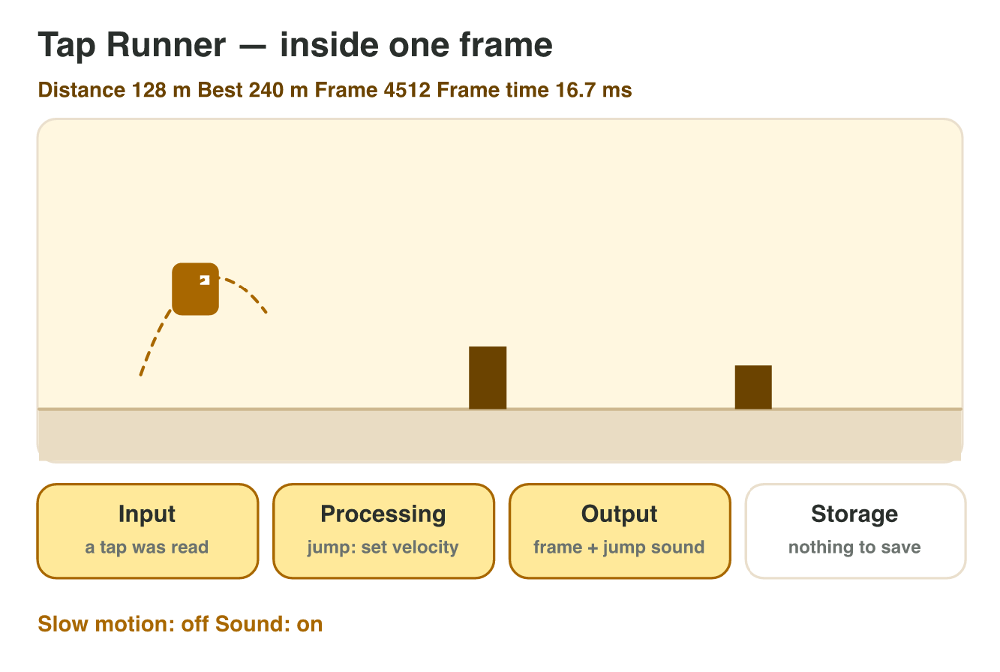

## Keywords



## Think · What happens when you tap?

You tap the screen and the character jumps.
**Which parts of the phone work?**

::: {.answer}
Touch screen (input) → **CPU** (processing) → display and speaker (output) →
storage (the best score).
:::

## 1.1 Four jobs, four parts

:::: {.columns}
::: {.column width="38%"}
- input · processing · storage · output
- **CPU** runs instructions
- **RAM**: fast, forgets at power off
- **storage**: keeps data
- **Do it together:** four jobs in a game
:::
::: {.column width="62%"}

:::
::::

## Try it 1 · Four jobs and four parts

a) tilt the phone to turn the car?
b) best lap time after a restart?
c) forgets its data at power off?

::: {.answer}
a) input
b) storage
c) main memory (RAM)
:::

## 1.2 How the CPU runs a game

:::: {.columns}
::: {.column width="38%"}
- **fetch** → **decode** → **execute**
- billions of times per second
- 3 GHz = 3 billion ticks per second
- one frame = one short time
:::
::: {.column width="62%"}

:::
::::

## Example · Work in one frame

3 GHz core · 60 frames per second.

::: {.reveal}
1. 3 000 000 000 ticks per second
2. ÷ 60 = **50 million ticks** per frame
3. input, movement, collisions, sound: all in these ticks
:::

## Live demo · Tap Runner



## Try it 2 · The instruction cycle

a) get the next instruction?
b) add 10 to the score?
c) 2 GHz at 50 frames per second?

::: {.answer}
a) fetch
b) execute
c) 40 million ticks
:::

## 1.3 One game, many processors

:::: {.columns}
::: {.column width="38%"}
- CPU cannot read C#
- **ISA**: the CPU's instructions
- phones: **ARM** · PCs: **x86-64**
- **compiler** → one build per ISA
- **Do it together:** System type of the lab PC
:::
::: {.column width="62%"}

:::
::::

## Try it 3 · Builds and processors

a) Snapdragon phone: which ISA?
b) Android build on a Windows PC?
c) Android + iPhone + Windows: how many ISAs?

::: {.answer}
a) ARM
b) no, a different ISA
c) 2
:::

## 1.4 Digital platforms

:::: {.columns}
::: {.column width="38%"}
- devices + system + tools + store
- the owner makes the rules
- mobile ≈ half of game revenue
- Android: thousands of models
- **Do it together:** platforms at home
:::
::: {.column width="62%"}

:::
::::

## Try it 4 · Platforms

a) the store of iOS?
b) phone game to Switch: new input?
c) who decides what a game may contain?

::: {.answer}
a) App Store
b) buttons and sticks
c) the platform owner
:::

## Game challenge · Tap Runner

:::: {.columns}
::: {.column width="38%"}
- endless runner: tap to jump
- 60 frames per second
- Android · iPhone · Windows
- test phone: 2.4 GHz core
:::
::: {.column width="62%"}

:::
::::

## Try it 5 · Tap Runner (harder)

a) ticks per frame on the test phone?
b) ISA of the Windows build?
c) how many builds?

::: {.answer}
a) 40 million
b) x86-64
c) 3
:::

## Summary

- four jobs: input, processing, storage, output
- CPU · RAM · storage
- fetch → decode → execute · GHz
- ARM and x86-64: one build each
- platform = devices + system + tools + store
