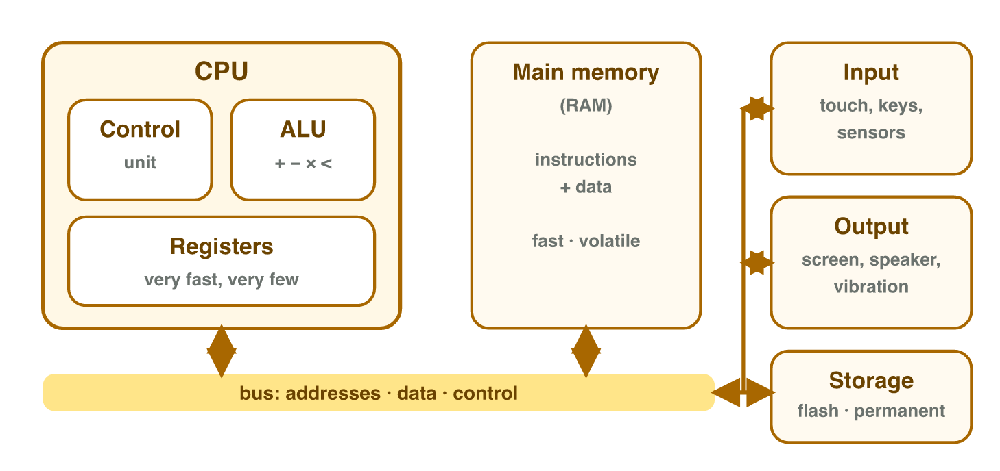
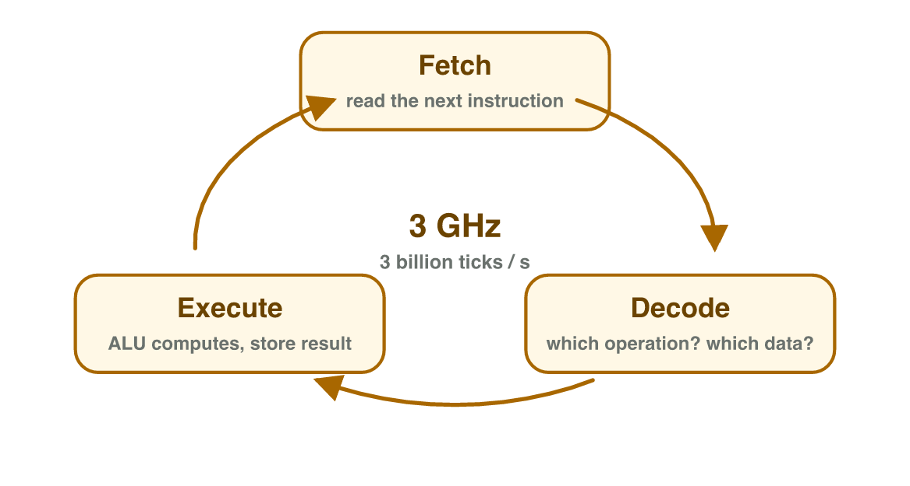
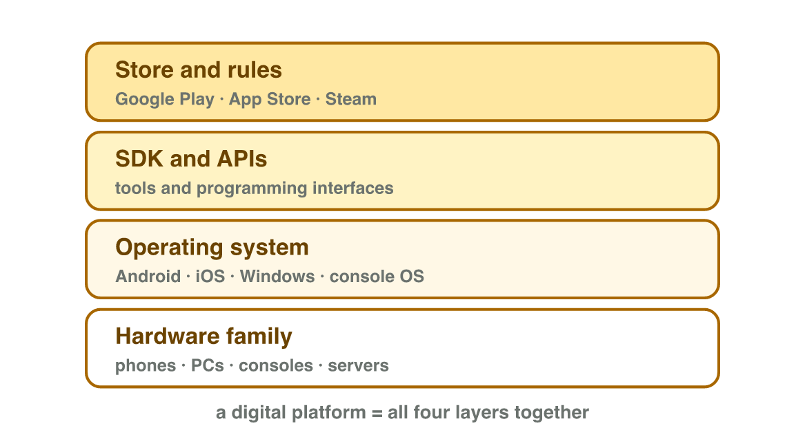

## Keywords



## 1.1 Four jobs, four parts

:::: {.columns}
::: {.column width="50%"}
- A computer does four jobs: input, processing, storage and output.
- The **CPU** runs the instructions of the game.
- **RAM** is fast, but it forgets everything when the power is off.
- **Storage** keeps apps and files when the power is off.
- **Do it:** Play a game for one minute. Write one thing for each of the four jobs.
:::
::: {.column width="50%"}

:::
::::

## Try it 1 · Four jobs and four parts

a) In a racing game, you tilt the phone to turn the car. Which job is the tilt?
b) The best lap time is still there after the phone restarts. Which job kept it?
c) Which part of the phone forgets its data when the power is off?

::: {.answer}
a) input
b) storage
c) main memory (RAM)
:::

## 1.2 How the CPU runs a game

:::: {.columns}
::: {.column width="50%"}
- A game is a long list of simple instructions.
- For each one, the CPU repeats three steps: **fetch**, **decode**, **execute**.
- The clock rate sets the speed: 3 GHz means 3 billion ticks per second.
- All the work for one frame must be done in a very short time.
:::
::: {.column width="50%"}

:::
::::

## Live demo · Tap Runner



## Try it 2 · The instruction cycle

a) The CPU gets the next instruction from memory. Which step is this?
b) The CPU adds 10 to the score. Which step is this?
c) How many clock ticks per second does 3 GHz mean?

::: {.answer}
a) fetch
b) execute
c) 3 billion
:::

## 1.3 Digital platforms

:::: {.columns}
::: {.column width="50%"}
- A platform has devices, a system, tools and a store with rules.
- The platform owner decides what a game may contain.
- One project needs one **build** for each platform.
- A move to a console needs new input, a new screen layout and new rules.
- **Do it:** Name three devices at home that run games. Which platform is each one?
:::
::: {.column width="50%"}

:::
::::

## Try it 3 · Platforms

a) What is the name of the store of the iOS platform?
b) A phone game moves to the Nintendo Switch. What new input must it support?
c) Who decides what a game may contain on a platform?

::: {.answer}
a) the App Store
b) buttons and sticks
c) the platform owner
:::

## Game challenge · Tap Runner



## Try it 4 · Tap Runner (harder)

The facts: Tap Runner runs at 60 frames per second. It has one build each for Android, iPhone and Windows. The test phone has a 2.4 GHz core and 4 GB of RAM.

a) What does "2.4 GHz" tell us about the test phone?
b) Where is Tap Runner while the player is playing it?
c) How many builds does the studio need?

::: {.answer}
a) the speed of one core
b) in the RAM (main memory)
c) 3
:::

## Summary

- A computer does four jobs: input, processing, storage and output.
- The CPU runs instructions, RAM holds the running game, storage keeps data.
- The CPU repeats fetch, decode and execute; GHz sets its speed.
- A platform has devices, a system, tools and a store with rules.
- Every platform needs its own build of the game.
