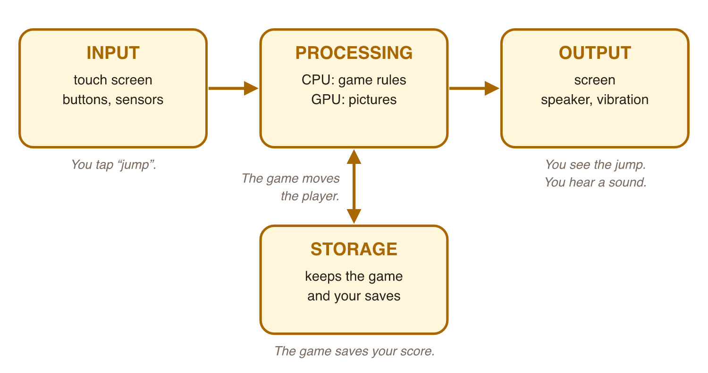

## New words



## 1. A game is a computer at work

Open a game on your phone. You tap. The player jumps. You hear a sound.
Tomorrow, your score is still there.

Your phone is a **computing system**. Every computing system does four jobs:

{width=95%}

| Job | What it means | In a game |
|---|---|---|
| **Input** | Data goes **in**. | You tap the jump button. |
| **Processing** | The device **works** with the data. | The game moves the player up. |
| **Output** | The device gives data **out** to you. | You see the jump. You hear a sound. |
| **Storage** | The device **keeps** data for later. | The game saves your score. |

A computer, a phone, a tablet and a game console all do these four jobs.

Now try it. Sort each card: input, processing, output or storage?



::: {.callout-tip title="Try it 1"}
Input, processing, output or storage? You can use an answer more than once.

::: {.match}
You press the jump button.
:   input

The phone vibrates when you lose.
:   output

The game checks if the ball is in the goal.
:   processing

The game keeps your level for tomorrow.
:   storage

The music plays.
:   output
:::
:::

## 2. Hardware and software

A computing system has two sides:

- **Hardware**: the parts you can touch. The screen, the battery, the chips.
- **Software**: the programs. A game is software. Android is software too.

Software needs hardware to run. Hardware needs software to do something useful.

Here are the main hardware parts. We learn each one in weeks 2–4.

| Part | Its job | In a game |
|---|---|---|
| **CPU** (processor) | Runs the steps of the program. | Game rules, enemies, score |
| **GPU** (graphics processor) | Draws the pictures. | The 3D world, light, effects |
| **Memory** (RAM) | Keeps the programs that run now. | The level you play now |
| **Storage** | Keeps apps and files, also when the power is off. | The installed game, your saves |
| **Input devices** | Bring data in. | Touch screen, buttons, microphone, sensors |
| **Output devices** | Give data out. | Screen, speaker, vibration |

::: {.callout-tip title="Try it 2"}
Hardware or software? You can use an answer more than once.

::: {.match}
the touch screen
:   hardware

a racing game
:   software

Android
:   software

the battery
:   hardware

the speaker
:   hardware
:::
:::

::: {.callout-tip title="Try it 3"}
Which part does this job?

::: {.match extra="memory (RAM)|speaker"}
It draws the 3D world of the game.
:   GPU

It keeps the game when you turn off the phone.
:   storage

It runs the game rules, for example "if health is 0, game over".
:   CPU
:::
:::

## 3. Digital platforms: where games live

A **platform** is the kind of system a game runs on.
A platform is hardware + its main software + its store.

| Platform | Devices | Where you get games |
|---|---|---|
| **Mobile: Android** | Many phone brands, tablets | Google Play |
| **Mobile: iOS** | iPhone, iPad | App Store |
| **PC** | Laptops and desktop computers | For example, Steam |
| **Console** | PlayStation, Xbox, Nintendo Switch | The console's own store |
| **Cloud gaming** | Any screen with fast Internet | The game runs on a far computer. You get the video. |

One game can come out on many platforms.
But each platform is different: different hardware, different software, different rules.
So game developers must build and **test** the game for each platform.

In this diploma, we start with **mobile**: Android and iOS.

::: {.callout-tip title="Try it 4"}
Which platform?

::: {.match}
You play on an iPhone.
:   mobile: iOS

You play on a laptop.
:   PC

You play on a PlayStation.
:   console

You play on a Samsung phone.
:   mobile: Android

You play a big game on an old phone. The game runs on a far computer, and you only get the video.
:   cloud gaming
:::
:::

## Class activity {.activity}

**One game, four jobs** (pairs, about 10 minutes).

1. Choose a game you both know.
2. Choose one action in the game, for example "jump", "shoot" or "buy an item".
3. Fill the table: what is the **input**, the **processing**, the **output** and the **storage**?
4. Look in the store: on which **platforms** is this game?
5. Tell the class your game and one row of your table.

## Summary {.summary}

- Every computing system does four jobs: **input → processing → output**, and **storage** keeps data.
- **Hardware** = parts you can touch. **Software** = programs. A game is software.
- Main parts: **CPU** (rules), **GPU** (pictures), **memory** (now), **storage** (later).
- A **platform** is where a game runs: Android, iOS, PC, console, cloud.
