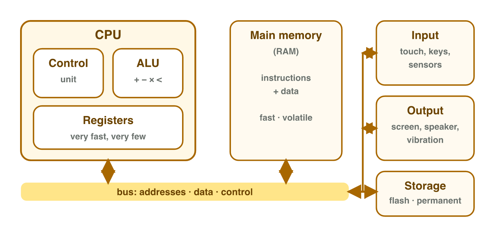
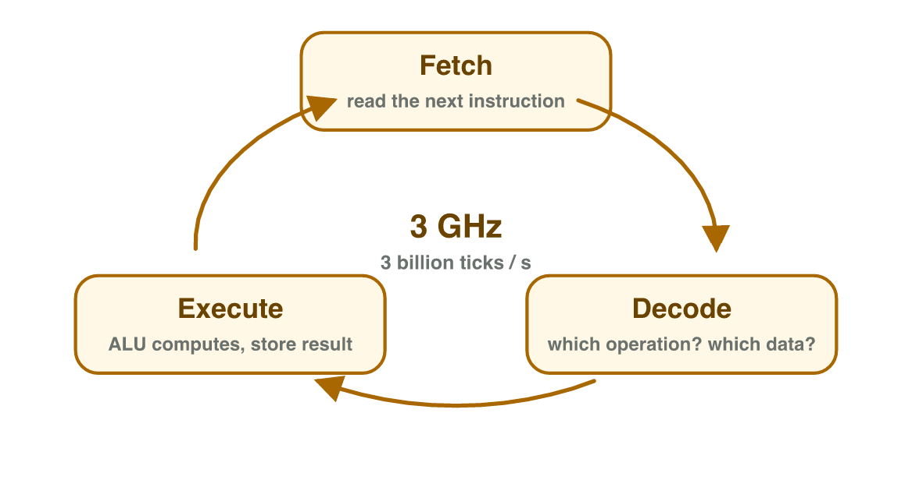
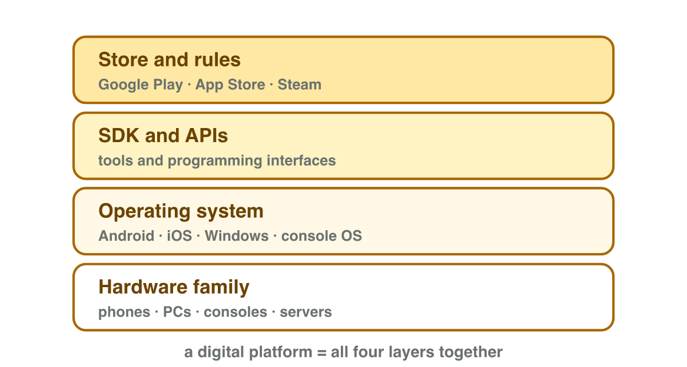
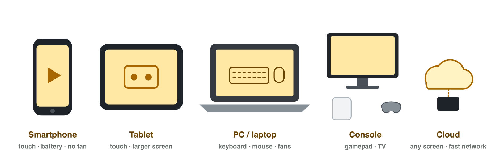

This page is the interactive version of the lesson notes (PDF). Each section
starts with a problem in a game. Then it explains the idea behind it. It
ends with a **Do it** task and one set of questions. Tap, sort or type your
answer: the page checks it at once and tells you why.

## Key terms



## 1.1 What a game needs from a computer

- A **computing system** = **hardware** + **software** + data.
- It does four jobs: **input**, processing, storage, **output**.
- The **CPU** runs the instructions.
- **Main memory (RAM)** holds what is running now. It is fast, but it forgets
  everything when the power is off.
- **Storage** keeps apps and files when the power is off.
- The program is kept in memory like data. So one phone can run thousands of
  games.

{width=86%}

::: {.callout-warning title="Watch out!"}
Memory is not storage. Installing games fills the **storage**. Running many
games at once fills the **memory**.
:::

::: {.callout-note title="Do it · Four jobs in your game"}
Play a game on your phone for one minute and find one thing for each job:
input, processing, output, storage. Sara played *Fruit Slash* and wrote six
things.

::: {.sort}
Which job is each thing of Fruit Slash? Sort them.

Input
:   a swipe of the finger

    Why: The touch screen reads the swipe: it goes into the computer.

:   a tap on the pause button

    Why: Another touch: input.

Processing
:   the game decides that the fruit is cut

    Why: The CPU runs the instructions that decide it.

Output
:   the picture and the sound of the cut

    Why: The screen and the speaker give it to the player.

:   the score on the screen

    Why: Shown to the player: output.

Storage
:   the best score, still there after a restart

    Why: Storage keeps it when the power is off.
:::
:::

::: {.callout-tip title="Try it 1 · Four jobs and four parts"}
Choose the right answer.

::: {.match extra="output|the bus"}
In a racing game, you tilt the phone to turn the car. Which job is the tilt?
:   input

    Why: Tilting is information that goes into the phone, from its sensors.

The game checks if the car hit the wall. Which job is this?
:   processing

    Why: The CPU works with the data: it computes and decides.

The best lap time is still there after the phone restarts. Which job kept it?
:   storage

    Why: Storage keeps data when the power is off.

Which part forgets its data when the phone turns off?
:   main memory (RAM)

    Why: RAM loses its contents without power.

Which part runs the game's instructions?
:   the CPU

    Why: The CPU fetches, decodes and executes them.
:::
:::

## 1.2 How the CPU runs a game

- A game is a long list of simple **instructions**.
- For each one, the CPU repeats the **instruction cycle**: **fetch** (get it
  from memory), **decode** (find out what it asks), **execute** (do it).
- The **clock rate** sets the speed: 3 GHz = 3 billion ticks per second.
- The CPU makes a new picture (a **frame**) many times per second, so all the
  work for one picture must be done very fast.

{width=62%}



::: {.callout-note title="Do it · Watch one frame"}
In **Tap Runner**, turn on slow motion and jump. Watch the parts light up.

::: {.order}
Put the parts in the order they light up.

1. the touch screen (input)
2. the CPU (processing)
3. the screen (output)

Why: The tap goes in, the CPU runs the instructions, then the new picture comes out.
:::

::: {.choice}
Which part decides that the character jumps?

- [x] the CPU

  Why: The CPU runs the game's instructions and decides the jump.

- [ ] the touch screen

  Why: The touch screen only reads the tap.

- [ ] the screen

  Why: The screen only shows the new picture.
:::
:::

::: {.callout-tip title="Try it 2 · The instruction cycle"}
Choose the right answer.

::: {.match extra="the RAM|3 million"}
The CPU gets the next instruction from memory. Which step is this?
:   fetch

    Why: Fetch is the first step: bring the instruction from memory.

The CPU finds out that the instruction asks for an addition. Which step?
:   decode

    Why: Decode means finding out what the instruction asks.

The CPU adds 10 to the score. Which step is this?
:   execute

    Why: Doing the work is the execute step.

How many clock ticks per second does 3 GHz mean?
:   3 billion

    Why: Giga means billion: 3 GHz = 3 billion ticks per second.

Which part of the phone decides that the character jumps?
:   the CPU

    Why: The game logic, also the jump, runs on the CPU.
:::
:::

## 1.3 Digital platforms: where games run and are sold

- A **digital platform** = devices + operating system + tools + a store with
  rules.
- Main platforms: Android (Google Play), iOS (App Store), PC (Steam and
  others), consoles (the console maker's store).
- The platform owner makes the rules: what a game may contain, how players
  pay, how much of each sale it keeps.
- Mobile is about half of all game revenue.
- Engines are **cross-platform**: one project, one **build** for each
  platform. Phones use ARM processors, most PCs x86: a phone build cannot run
  on a PC.
- Android has thousands of phone models, so games need testing on many.
- A phone game on a console (Nintendo Switch) needs new input (buttons and
  sticks), a new layout for the big screen, and the console maker's rules.

{width=62%}

::: {.callout-note title="Do it · Platforms at home"}
Think of three devices at home that run games: the device, its platform,
its operating system and its store. Omar's family has four devices.

::: {.sort}
Where do the players of each device get their games? Sort the devices.

Google Play
:   an Android phone

    Why: Android phones get their apps from Google Play.

:   an Android tablet

    Why: The same platform as the phone: Android.

Steam
:   a Windows laptop

    Why: A PC with Windows: Steam is a common store for PC games.

PlayStation Store
:   a PlayStation console

    Why: A console has the store of the console maker.
:::

::: {.choice}
For most students, which platform is the most common?

- [x] the phone (mobile)

  Why: Almost everyone has a phone; mobile is about half of all game revenue.

- [ ] the console

  Why: Fewer homes have a console than a phone.

- [ ] cloud gaming

  Why: Cloud gaming needs a fast network all the time; it is still small.
:::
:::

::: {.callout-tip title="Try it 3 · Platforms"}
Choose the right answer.

::: {.match extra="Google Play|touch only|the player"}
The store of the iOS platform.
:   App Store

    Why: Apple sells iPhone apps in its App Store.

A game is sold on Steam. Which platform is it on?
:   PC

    Why: Steam is a store for PC games.

A phone game moves to the Nintendo Switch. What new input must it support?
:   buttons and sticks

    Why: The console is played with a gamepad, not a touch screen.

Who decides what a game may contain on a platform?
:   the platform owner

    Why: The owner of the platform makes its rules.

Why test an Android game on many phones?
:   thousands of different models

    Why: Android runs on thousands of models with different chips and screens.
:::
:::

## 1.4 Device classes for gaming

- **Smartphone, tablet**: touch, battery, no fan, short sessions.
- **PC or laptop**: keyboard, mouse or gamepad, long sessions at a desk.
- **Console**: gamepad, TV, long sessions at home.
- **Cloud gaming**: any screen, but a fast network.
- A game for one class must change for another: input, screen, play time,
  power.

{width=92%}

::: {.callout-note title="Do it · The right device for a game"}
Choose a game you know: its input, the screen it needs and the length of one
session. Here is *Tower Rush*: it is played with touch, on a small screen, in
5-minute sessions.

::: {.choice}
Which device class fits Tower Rush best?

- [x] a smartphone

  Why: Touch, a small screen and short sessions anywhere.

- [ ] a console

  Why: A console has a gamepad and a TV, for long sessions at home.

- [ ] cloud gaming

  Why: Cloud gaming needs a fast network; it adds nothing for a short touch game.
:::

::: {.choice}
Tower Rush comes to a console. What must change?

- [x] the input and the layout: buttons and sticks, and a big TV screen

  Why: A game for one class must change for another: input, screen, play time.

- [ ] nothing: the same build runs everywhere

  Why: Every platform needs its own build.

- [ ] only the price

  Why: The input and the screen change, and the console maker has its own rules.
:::
:::

::: {.callout-tip title="Try it 4 · Which device class?"}
Choose the device class.

::: {.match extra="embedded system"}
Gamepad, TV, long sessions at home.
:   console

    Why: A console is played at home on a TV with a gamepad.

Keyboard and mouse, long sessions at a desk.
:   PC

    Why: A PC stands at a desk, with a keyboard and a mouse.

Touch, battery, no fan, five-minute sessions on the bus.
:   smartphone

    Why: A phone has a touch screen, a battery and no fan.

Any screen, if the network is fast.
:   cloud gaming

    Why: The game runs on a server; any screen shows the video.
:::
:::

## Game challenge: Tap Runner {.challenge}

Work alone. Use every section of today.

**Tap Runner** is an endless runner: the character runs by itself, and the
player taps to jump over blocks. The game shows 60 frames per second and saves
the best distance. It is released on Android phones, on iPhones and on Windows
PCs, with one build for each. The test phone has a CPU core at 2.4 GHz and
4 GB of RAM. Play it in the **Tap Runner** mini-game of section 1.2.

::: {.callout-tip title="Try it 4 · Tap Runner on three platforms (harder)"}
Tap Runner: tap to jump; Android, iPhone and Windows, one build each; saves the
best distance; test phone with a 2.4 GHz core and 4 GB of RAM. Choose the right
answer.

::: {.match extra="the RAM|2|the display"}
The input device for jumping in the phone version.
:   touch screen

    Why: On a phone the player taps the touch screen.

Where the best distance is kept when the phone is off.
:   storage

    Why: Storage keeps data when the phone is off.

What does "2.4 GHz" tell about the test phone?
:   the speed of one core

    Why: The clock rate is the speed of one core.

Where is Tap Runner while the player is playing it?
:   in the 4 GB of RAM

    Why: A running game is in the RAM.

How many builds does the studio need?
:   3

    Why: One build for each platform: Android, iPhone, Windows.
:::
:::

## Summary {.summary}

- A computing system does four jobs: input, processing, storage, output.
- CPU runs instructions; RAM holds what is running; storage keeps data without power.
- The CPU repeats fetch, decode, execute; GHz sets the speed.
- A platform = devices + system + tools + store and rules.
- One project, one build for each platform.
- Each device class needs its own input, screen, play time and power plan.
