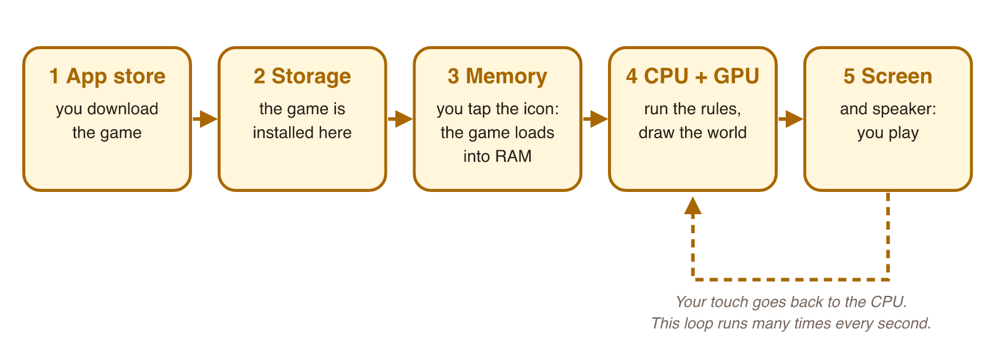

## New words



## 1. The devices we play on

We play games on many **devices**. Each device is good at some things.

| Device | Good for | Not so good for |
|---|---|---|
| **Phone** | Always with you. Touch screen. | Small screen. The battery runs out. |
| **Tablet** | Big touch screen. | Not in your pocket. |
| **PC or laptop** | Strong parts. Keyboard and mouse. | You cannot play on the bus. |
| **Game console** | Big TV. Controller. Play with friends. | Expensive. Only at home. |

::: {.callout-tip title="Try it 1"}
Which device fits best?

::: {.match extra="tablet"}
You play for 5 minutes on the bus.
:   phone

You play a big 3D game with a keyboard and a mouse.
:   PC or laptop

You play with three friends on one TV.
:   game console
:::

Talk with the class: **which device do you play on most? Why?**
:::

## 2. Find the information of your phone

Every device has **specifications** (specs): the list of its parts and how strong they are.
Your phone shows some of them. Let's find them. **Take out your phone.**

- **Android:** Settings → *About phone*.
  (Some phones call it *My phone* or *Device information*.)
- **iPhone:** Settings → *General* → *About*.
- **Storage** (on both): look for *Storage* in Settings.

Find these things and write them in a table:

| | My phone |
|---|---|
| Model name | |
| Operating system (OS) | Android or iOS |
| OS version | for example, Android 16 or iOS 26 |
| Storage: total | ___ GB |
| Storage: free | ___ GB |
| Memory (RAM) | ___ GB (Android only; iPhone does not show it) |

**GB** (gigabyte) is a unit for size. A big mobile game can need 2–5 GB.

Do **not** share private numbers: phone number, IMEI or serial number.

::: {.callout-tip title="Try it 2"}
Fill the table for your phone. If you do not have a phone, work with a friend.

Then check: where do you find each one?

::: {.match extra="the Battery page"}
The model name
:   the About page

The OS version
:   the About page

How much storage is free
:   the Storage page
:::
:::

::: {.callout-tip title="Try it 3"}
A new game needs **3 GB** of free storage. Your phone has **2.5 GB** free.

::: {.match extra="Yes: 2.5 GB is enough|Turn the phone off and on"}
Can you install the game?
:   No: 2.5 GB is less than 3 GB

What can you do?
:   Delete apps you do not use, or move photos and videos
:::
:::

## 3. How a game runs on your phone

What happens from the store to the first jump? Follow the steps.

{width=100%}

1. You find the game in the **app store** and you **install** it.
2. The game is now in **storage**. It stays there, also when the phone is off.
3. You tap the icon. The phone loads the game into **memory** (RAM).
4. The **CPU** runs the game rules. The **GPU** draws the world.
5. You see the game on the **screen** and hear it from the **speaker**.

Then you touch the screen. Your touch goes back to the CPU.
Steps 4 and 5 repeat many times every second, while you play.

The **operating system** (Android or iOS) controls all these steps.
It starts the game, gives it memory, and shows it on the screen.

Why is this important for game developers?

- Too little **storage** → the player cannot install the game.
- Too little **memory** → the game can be slow or close.
- A weak **GPU** → the pictures move slowly.

So the same game can run well on one phone and badly on another.
We learn more about this in weeks 3 and 4.

::: {.callout-tip title="Try it 4"}
Put the steps in the right order. What happens first, second, …?

::: {.match}
Step 1
:   You install the game from the store.

Step 2
:   You tap the game icon.

Step 3
:   The game loads into memory.

Step 4
:   The GPU draws the level.
:::
:::

## Class activity {.activity}

**Device survey** (groups of 4, about 10 minutes).

1. Put the tables from *Try it 2* together.
2. Count: how many Android phones? How many iPhones?
3. Find the newest OS version in your group.
4. Find the phone with the most free storage.
5. One student tells the class your group's results.

## Summary {.summary}

- We play on many **devices**: phone, tablet, PC, console.
- **Specifications** (specs) tell us the parts of a device. Find them in Settings → About.
- A game goes: **app store → storage → memory → CPU + GPU → screen**.
- The **operating system** controls the device and runs the game.
- Different devices → the same game can run differently.
