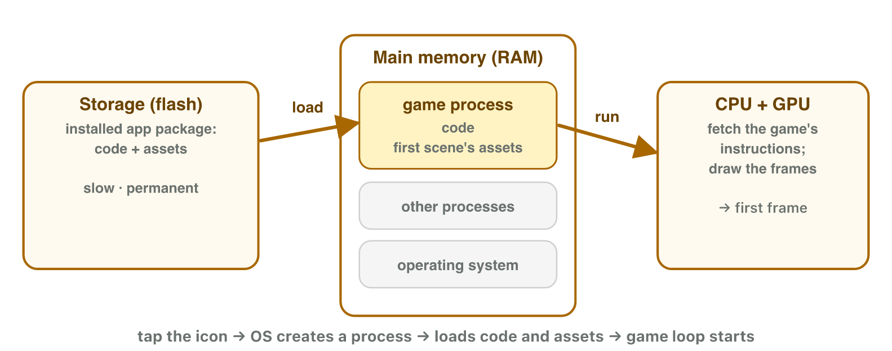
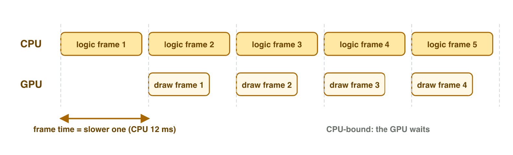
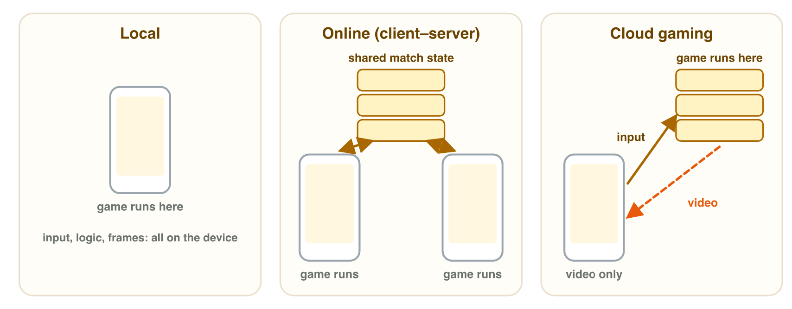
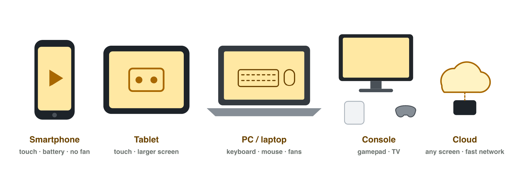

This page is the interactive version of the lesson notes (PDF). Each section
starts with a problem in a game. Then it explains the idea behind it. It ends
with a **Do it** task and one set of questions. The full explanations,
examples and exercises are in the notes.

## Key terms



## 2.1 From the store to the first frame

- A game comes as one file: an **app package** (Android: APK, iPhone: IPA).
- **Installing** copies it into storage. No memory is used yet.
- **Launching** creates a **process** and **loads** code and assets from
  storage into memory.
- Storage is slow (about 100–1000 MB per second), so there is a loading
  screen.
- Example: 1500 MB at 150 MB per second = 10 seconds.
- When memory is full, the system closes games in the background. The game
  then starts again from the title screen.

{width=88%}

::: {.callout-warning title="Watch out!"}
More storage does not mean faster loading. The **speed** of storage decides
the loading time.
:::

::: {.callout-note title="Do it · Time a game start"}
Close a game fully and time its start until the menu. Then go home, wait ten
seconds, and open it again from the recent apps. Time it again. Why is the
second start faster? Use the words *storage* and *memory*.
:::

::: {.callout-tip title="Try it 1 · Install, launch, load"}
Choose the right answer.

::: {.match extra="memory|1 second"}
A player installs a game. What does it fill?
:   storage

A running program with its own part of memory.
:   a process

1500 MB of assets at 150 MB per second. Loading time?
:   10 seconds

900 MB of assets at 300 MB per second. Loading time?
:   3 seconds

A game starts again from the title screen after a long break. Why?
:   the system closed it to free memory
:::
:::

## 2.2 The frame on real hardware

- The **CPU** runs the game logic. The **GPU** draws the pixels.
- They work at the same time on two frames. The slower one sets the pace.
- **Frame rate**: new pictures per second from the game (fps).
- **Refresh rate**: pictures per second on the screen (Hz).
- The player sees only as many new pictures as the slower of the two.
- **Resolution**: width × height pixels. More pixels = more work for the GPU.
- No fan in a phone: after some minutes it slows down (**thermal
  throttling**).

{width=94%}

::: {.callout-note title="Do it · Your screen in numbers"}
On a lab computer: Settings → System → Display. Write the resolution and
(under Advanced display) the refresh rate. What is the highest frame rate a
player can see on it?
:::

::: {.callout-tip title="Try it 2 · Frames, screens, heat"}
Choose the right answer.

::: {.match extra="the screen|120"}
Which processor runs the game logic (input, rules, movement)?
:   the CPU

Which processor colours the pixels of the picture?
:   the GPU

A 120 Hz screen and a game at 70 fps. New pictures per second?
:   70

The number of pixels, width × height.
:   resolution

The chip gets hot and the phone slows down. What is it called?
:   thermal throttling
:::
:::

## 2.3 Where the game is computed

- **Local**: everything on the device.
- **Online (client–server)**: each device runs the game; a server keeps the
  shared data of the match.
- **Cloud gaming**: the game runs on a server; the phone sends touches and
  shows a video.
- **Latency**: the delay between an action and the result (ms).
- Cloud gaming needs a fast Internet connection and adds latency: it suits
  slow games (cards, puzzles) better than fast ones (fighting, rhythm).

{width=94%}



::: {.callout-note title="Do it · Feel the lag"}
In **Lag Lab**, play 10 blocks in each mode. Write the percentage you cleared
in each mode. From which mode does the game get hard?
:::

::: {.callout-tip title="Try it 3 · Near or far?"}
Choose the right answer.

::: {.match extra="local|a card game|storage"}
The game runs on a server; the phone only shows the video.
:   cloud gaming

Each phone runs the game; a server keeps the score of the match.
:   client–server

The delay between a tap and the jump on the screen.
:   latency

Which game suffers most from 100 ms of lag?
:   a fighting game
:::
:::

## 2.4 Device classes for gaming

- **Smartphone, tablet**: touch, battery, no fan, short sessions.
- **PC or laptop**: keyboard, mouse or gamepad, long sessions at a desk.
- **Console**: gamepad, TV, long sessions at home.
- **Cloud gaming**: any screen, but a fast network.
- A game for one class must change for another: input, screen, play time,
  power.

{width=92%}

::: {.callout-note title="Do it · The right device for a game"}
Choose a game you know. Write its input, the screen it needs and the length of
one session. Which device class fits it best? Give one reason.
:::

::: {.callout-tip title="Try it 4 · Which device class?"}
Choose the device class.

::: {.match extra="embedded system"}
Gamepad, TV, long sessions at home.
:   console

Keyboard and mouse, long sessions at a desk.
:   PC

Touch, battery, no fan, five-minute sessions on the bus.
:   smartphone

Any screen, if the network is fast.
:   cloud gaming
:::
:::

## Game challenge: the class survey {.challenge}

Work alone. Use every section of today.

A first-year class lists the devices it plays on. Most students use Android
phones of different prices; the cheapest one reads its storage at 120 MB per
second. A few use iPhones and some use laptops. One student has a console. Two
play through a cloud gaming service; one of them has a slow connection. The
class wants one game that runs on all of these devices.

::: {.callout-tip title="Try it 5 · One game, many devices (harder)"}
The survey: the cheapest Android phone reads 120 MB per second; some students
use iPhones; one has a console; one cloud player has a slow connection. Choose
the right answer.

::: {.match extra="1 second|a puzzle game"}
Loading time of a 600 MB level on the cheapest phone.
:   5 seconds

The cloud player with the slow connection. What gets worse?
:   the latency (input lag)

The input device of the student with the console.
:   gamepad

The device class where heat matters most in a 30-minute session.
:   smartphone

The package type of the iPhone version.
:   IPA
:::
:::

## Summary {.summary}

- Install = copy to storage. Launch = create a process and load into memory.
- The speed of storage decides the loading time.
- CPU and GPU work together; the slower one sets the frame rate; the screen limits it too.
- Phones slow down when hot.
- Local, client–server, cloud: the cloud adds latency and needs fast Internet.
- Each device class needs its own input, layout and performance plan.
