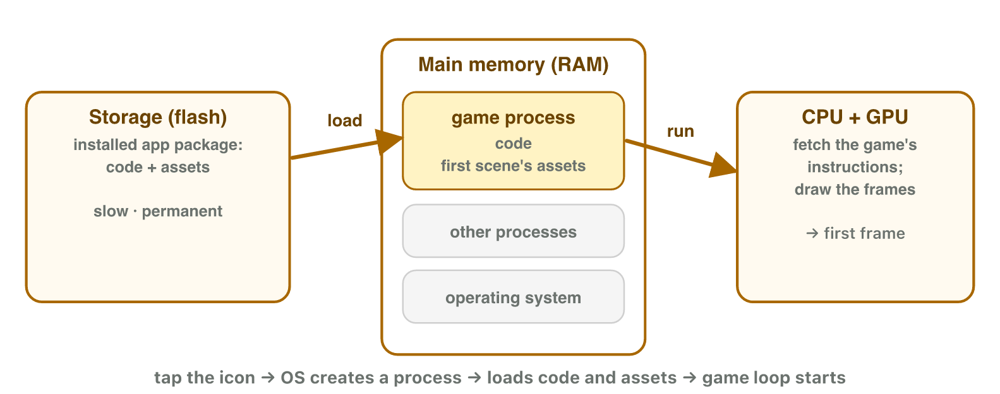
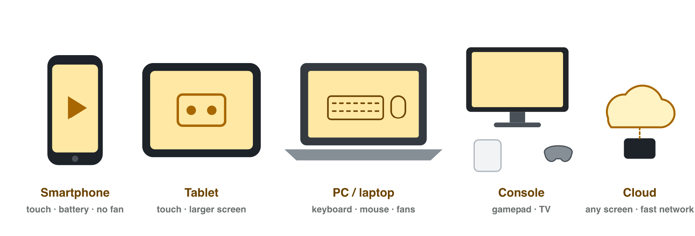

No new ideas today: two short problems on Lecture 1, with your own phone. Do
each one alone. Tap, sort or type your answer at every step: the page checks
it at once and tells you why.

## Recall

- A computing system does four jobs: input, processing, storage, output.
  The **CPU** runs the instructions; **RAM** holds what is running now;
  **storage** keeps apps and files.
- A **digital platform** is the devices, the operating system and a store
  with rules. Each platform needs its own **build** of a game.
- Device classes: smartphone, tablet, PC, console, cloud gaming.

::: {.callout-tip title="Try it 1 · Recall"}
Choose the right answer.

::: {.match extra="the CPU|output"}
A player installs ten games. Which part fills up?
:   storage

    Why: Installing copies the games into storage.

Which part forgets the running game when the phone turns off?
:   RAM

    Why: RAM keeps data only while it has power.

Which device class has a gamepad, a TV and long sessions at home?
:   console

    Why: A console is played at home on a TV.
:::
:::

## Activity 1 · Time a game start

When you start a game, the phone copies it from storage into RAM. Then the
CPU runs its instructions. A game that is still open is already in RAM.

{width=86%}

::: {.callout-note title="Activity 1 · Two starts · 15 min"}
1. Close a game on your phone fully (swipe it away from the recent apps).
   Start it and time it until the menu appears.
2. Go to the home screen, wait ten seconds, and open the game again from
   the recent apps. Time it again.
3. Why is the second start faster? Use the words *storage* and *RAM*.

*Your product:* two times and one sentence.

Lina timed her game: 8 seconds the first time, half a second the second
time.

::: {.order}
Step 1: put the steps of the first start in order.

1. The game is in the storage of the phone.
2. The phone copies it from storage into RAM.
3. The CPU runs its instructions.
4. The menu appears.

Why: A closed game must first be read from storage into RAM; that takes the seconds.
:::

::: {.choice}
Step 3: why is the second start faster?

- [x] The game is still in RAM, so the phone does not read it from storage again.

  Why: An app that is still open stays in RAM: the CPU goes on at once.

- [ ] The CPU is faster the second time.

  Why: The CPU has the same speed; the slow part is reading from storage.

- [ ] The game was downloaded again.

  Why: Nothing is downloaded: the game is already installed in storage.
:::
:::

::: {.callout-tip title="Try it 2 · Storage and RAM"}
Choose the right answer.

::: {.match extra="the screen|the store"}
The first start of a game is slow. Where does the phone read the game from?
:   storage

    Why: A closed game is only in storage.

You open a game again from the recent apps. Where is it already?
:   in RAM

    Why: An open game stays in RAM until the system closes it.

Which part runs the instructions of the game?
:   the CPU

    Why: The CPU fetches, decodes and executes each instruction.
:::
:::

## Activity 2 · The right device and store for three games

A studio has three game ideas:

- *Sky Puzzle*: 3-minute levels, played with one finger.
- *Iron Fleet*: 2-hour sea battles with many keys and a mouse.
- *Couch Kart*: four friends race on one TV with gamepads.

{width=86%}

::: {.callout-note title="Activity 2 · Device and store · 15 min"}
1. For each game, choose the device class where it works best. Give one
   reason: the input, the screen or the length of a session.
2. *Sky Puzzle* will also come to iPhones. Write the store where iPhone
   players get it, and why the studio needs a new build.

*Your product:* a table with three rows and one sentence.

::: {.sort}
Step 1: which device class fits each game best? Sort the games.

Smartphone
:   Sky Puzzle: 3-minute levels, one finger

    Why: Touch and short sessions anywhere.

PC
:   Iron Fleet: 2-hour sea battles, many keys and a mouse

    Why: Keyboard and mouse, long sessions at a desk.

Console
:   Couch Kart: four friends on one TV with gamepads

    Why: Gamepads and a TV at home.
:::

::: {.choice}
Step 2: Sky Puzzle comes to iPhones. Which store, and why a new build?

- [x] the App Store; the iPhone is another platform (iOS), so it needs its own build

  Why: One project, one build for each platform.

- [ ] Google Play; the same build works on every phone

  Why: iPhone players use the App Store, and an Android build does not run on iOS.

- [ ] the App Store; the Android build runs on an iPhone too

  Why: Each platform needs its own build.
:::
:::

::: {.callout-tip title="Try it 3 · Devices and platforms"}
Choose the right answer.

::: {.match extra="tablet|Google Play"}
2-hour battles with many keys and a mouse. Which device class?
:   PC

    Why: Long sessions at a desk with keyboard and mouse.

Any screen, but only with a fast network. Which device class?
:   cloud gaming

    Why: The game runs on a server and streams the video.

Where do iPhone players get a game?
:   the App Store

    Why: Apple sells iPhone apps in its own store.
:::
:::

## Wrap-up {.summary}

- You can explain a slow and a fast game start with storage, RAM and the
  CPU.
- You can choose a device class and a store for a game, with a reason.
