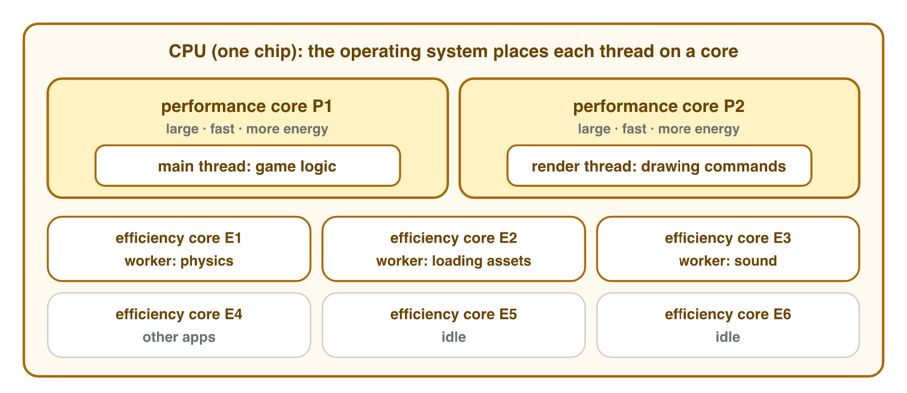
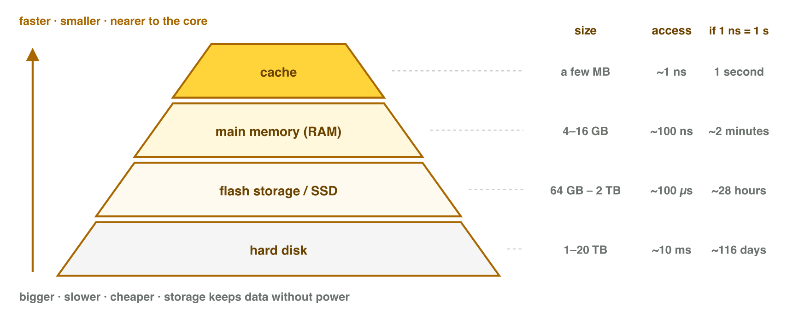
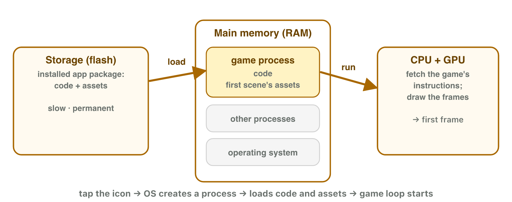
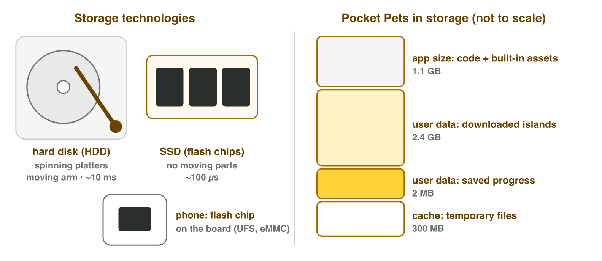

This page is the interactive version of the lesson notes (PDF). Each section
starts with a problem in a game. Then it explains the part of the device
behind the problem. It ends with a **Do it** task (on the lab computer, your
phone or the simulator) and one set of questions. Tap, sort or type your
answer: the page checks it at once and tells you why.

## Key terms



## 2.1 Why eight cores do not make a game eight times faster

- A **core** is a small processor inside the CPU.
- A core runs one list of instructions at a time: a **thread**.
- **Performance cores** are big and fast. **Efficiency cores** are small and
  save battery.
- The **clock rate** (GHz) tells how fast one core works.
- A game has one **main thread** for the game logic. It always runs on one
  core. Only other work (physics, loading, sound) can use more cores.
- Example: 10 ms main thread + 6 ms physics. With six cores: 10 + 1 = 11 ms.
  Faster, but not six times faster.

{width=94%}

::: {.callout-warning title="Watch out!"}
Cores do not add up: 8 cores at 3 GHz are **not** 24 GHz.
:::

::: {.callout-note title="Do it · Watch the cores at work"}
On a lab computer: press Ctrl + Shift + Esc → Task Manager →
**Performance → CPU**. Right-click the graph → **Change graph to → Logical
processors**, and watch it while the simulator of section 2.2 runs. One lab
computer shows **Cores: 6** and **Logical processors: 12**, and one graph is
much busier than the others.

::: {.choice}
Why is one graph much busier than the others?

- [x] The main thread of a program runs on one core at a time.

  Why: The game logic cannot be split over the cores; only other work can.

- [ ] The other cores are broken.

  Why: The other cores work too, but they get less work.

- [ ] The busy core has more GHz.

  Why: All cores have the same clock rate; the busy one just has the main thread.
:::

::: {.fill answer="14" unit="ms" hint="The main thread stays on one core; only the physics is shared by the cores."}
A frame needs 12 ms on the main thread and 8 ms of physics. With four
cores, how long does the frame take?

Why: 12 + 8 ÷ 4 = 12 + 2 = 14 ms: faster, but not four times faster.
:::
:::

::: {.callout-tip title="Try it 1 · Cores and threads"}
A frame needs 8 ms on the main thread and 4 ms of work that the cores can
share equally. Choose the right answer.

::: {.match extra="6 ms|a performance core|24 GHz"}
The frame time with one core.
:   12 ms

    Why: One core does it all: 8 + 4 = 12 ms.

The frame time with four cores.
:   9 ms

    Why: The main thread stays 8 ms; 4 ms ÷ 4 cores = 1 ms.

The work that only one core can do.
:   the game logic on the main thread

    Why: The game logic runs on one main thread, so on one core.

The best core for music in the background, with little battery.
:   an efficiency core

    Why: An efficiency core does light work with little energy.

A phone has 8 cores at 3 GHz. How fast is the core of the main thread?
:   3 GHz

    Why: Cores do not add up: one core still runs at 3 GHz.
:::
:::

## 2.2 Why the processor keeps a small memory next to it

- RAM is slow for the CPU: one value takes about 100 ns.
- So memory has levels: the **memory hierarchy**.
- Near the core: the **cache**. Small and very fast (about 1 ns).
- Then RAM, then storage (SSD, hard disk): bigger and slower.
- The cache keeps data that the game uses again and again, like the player's
  position.

{width=92%}



::: {.callout-note title="Do it · Fetch the data yourself"}
In **Data Trip**, get one value from the cache, from RAM and from flash
storage, and read the time and the human-scale time of each level.

::: {.order}
Put the levels in order, from the fastest to the slowest.

1. the cache: about 1 ns (1 second on the human scale)
2. RAM: about 100 ns (about 2 minutes)
3. flash storage: about 100 000 ns (about a day)

Why: Near the core memory is small and fast; farther away it is bigger and slower.
:::

::: {.choice}
What does the cache do?

- [x] It keeps copies of data used a short time ago next to the core, so the core waits less.

  Why: Data that the game uses again and again, like the player's position, stays in the cache.

- [ ] It keeps the games when the power is off.

  Why: That is storage; the cache forgets everything like RAM.

- [ ] It makes the clock rate higher.

  Why: The clock rate stays; the cache only shortens the waits for data.
:::
:::

::: {.callout-tip title="Try it 2 · The memory hierarchy"}
A read from the cache takes 1 ns. A read from RAM takes 100 ns. Choose the
right answer.

::: {.match extra="a hard disk|28 hours|1 second"}
The player's position is read 50 times in one frame. After the first read, where does the core find it?
:   in the cache

    Why: After the first read, a copy waits in the fast cache.

The best score must stay when the phone is off. Where is it kept?
:   in storage

    Why: Only storage keeps data without power.

A read takes about 100 ns. Which level is it?
:   RAM

    Why: RAM takes about 100 ns per read.

What does the cache keep?
:   copies of data used a short time ago

    Why: The cache keeps copies of data used a short time ago.

If 1 ns lasted 1 second, how long would a read from RAM last?
:   100 seconds

    Why: 100 ns are 100 times 1 ns.
:::
:::

## 2.3 Why the game shows a loading screen

- A game comes as an **app package** (Android: APK, iPhone: IPA).
- **Installing** copies it into storage. No memory is used yet.
- **Launching** creates a **process** and **loads** code and assets from
  storage into RAM.
- Storage is slow (about 100–1000 MB per second): 1500 MB at 150 MB per
  second = 10 seconds.
- RAM holds what the game needs **now**: code, textures, models, sounds and
  the state. When RAM is full, the system closes games in the background.
- Sizes count in steps of **1024**: 1 GB = 1024 MB, so a 2 GB update is
  2048 MB.

{width=88%}

::: {.callout-warning title="Watch out!"}
More storage does not mean faster loading: the **speed** of storage decides
the loading time.
:::

::: {.callout-note title="Do it · Watch the memory fill"}
On a lab computer: Task Manager → **Processes**, sorted by **Memory**. Look at
the browser's memory, open five pages with many pictures, wait ten seconds
and look again. On one lab computer the browser goes from **400 MB** to
**900 MB**.

::: {.fill answer="500" unit="MB" hint="The new value minus the old value."}
How much memory did the five pages add?

Why: 900 − 400 = 500 MB.
:::

::: {.choice}
What does the extra memory hold?

- [x] the open pages: their pictures, code and data

  Why: RAM holds what is used now; five open pages need room.

- [ ] the files saved on the SSD

  Why: Saved files stay in storage; RAM holds what is open now.

- [ ] nothing: it is a bug

  Why: Open pages need memory: the growth is normal.
:::
:::

::: {.callout-tip title="Try it 3 · Install, launch, load"}
Choose the right answer.

::: {.match extra="memory|1 second"}
A player installs a game. What does it fill?
:   storage

    Why: Installing copies the package into storage.

A running program with its own part of memory.
:   a process

    Why: The system creates a process when the game starts.

900 MB of assets at 300 MB per second. Loading time?
:   3 seconds

    Why: 900 ÷ 300 = 3.

A game update is 2 GB. How many MB is that?
:   2048 MB

    Why: 2 × 1024 = 2048.

A game starts again from the title screen after a long break. Why?
:   the system closed it to free memory

    Why: When RAM is full, the system closes games in the background.
:::
:::

## 2.4 Where the game lives when it is not running

- **Storage** keeps data when the power is off.
- **Hard disk (HDD)**: spinning disks and a moving arm. Cheap, but slow.
- **SSD**: flash chips, no moving parts, fast. Phones use flash chips too.
- A game in storage has three parts: the **app**, the **user data** (progress,
  downloads) and the **cache** (temporary files).
- A "1 TB" SSD shows about 931 GB in Windows. Nothing is missing: the maker
  counts in steps of 1000, and Windows in steps of 1024.

{width=94%}

::: {.callout-warning title="Watch out!"}
**Clear cache** deletes temporary files. **Clear storage** deletes the
player's data.
:::

::: {.callout-note title="Do it · A game in your phone's storage"}
**Android:** Settings → Apps → *(a game)* → Storage. **iPhone:** Settings →
General → iPhone Storage → *(a game)*. Do **not** press Clear storage,
Offload App or Delete App. *Pocket Pets* shows: App 1.1 GB, Documents and
data 2.4 GB, Cache 0.3 GB.

::: {.sort}
Which part of the game's storage holds each thing? Sort them.

App
:   the program of the game

    Why: The app part is what you installed from the store.

User data
:   a downloaded new level

    Why: Downloaded levels are user data: this part grows with a new level.

:   the player's progress and saves

    Why: Progress belongs to the player: user data.

Cache
:   temporary files that the game can make again

    Why: The cache holds temporary files; clearing it loses nothing important.
:::

::: {.choice}
Which button deletes the player's progress?

- [x] Clear storage

  Why: Clear storage deletes the user data, with the progress.

- [ ] Clear cache

  Why: Clear cache deletes only temporary files.

- [ ] Force stop

  Why: Force stop closes the app; it deletes nothing.
:::
:::

::: {.callout-tip title="Try it 4 · Storage"}
Choose the right answer.

::: {.match extra="an SSD|Clear cache|yes, 69 GB is lost"}
A laptop has a moving arm inside that reads the data. What is its storage?
:   a hard disk

    Why: A hard disk has spinning disks and a moving arm.

A player presses Clear cache. What do they lose?
:   nothing important

    Why: The cache holds only temporary files.

A player wants free space but wants to keep the pets. Which button is wrong?
:   Clear storage

    Why: Clear storage deletes the user data, the pets too.

A game uses: app 1.1 GB, islands 2.4 GB, cache 0.3 GB. How much is left after Clear cache?
:   about 3.5 GB

    Why: Only the cache goes: 1.1 + 2.4 = 3.5 GB.

A "1 TB" SSD shows 931 GB in Windows. Is space missing?
:   no, Windows counts with 1024

    Why: The maker counts in 1000s, Windows in 1024s.
:::
:::

## Game challenge: the Pocket Pets support desk {.challenge}

Work alone. Use every section of today.

*Pocket Pets* is a made-up mobile game. Version 2.0 adds an island of
900 MB. The support team receives five messages:

1. "My phone has eight cores, but only one is really busy."
2. "The island download needs 1.6 GB, and my phone has 1.2 GB free."
3. "I pressed Clear storage, and my pets are gone."
4. "My new 1 TB laptop SSD shows only 931 GB."
5. "My cheap phone reads 180 MB per second. The island takes long to load."



::: {.callout-tip title="Try it 5 · Answer the players (harder)"}
Use the five messages of the story above (island: 900 MB; the cheap phone
reads 180 MB per second). Choose the answer for each message.

::: {.match extra="the cache|1.6 GB|50 seconds"}
Message 1: what keeps one core very busy?
:   the game logic on the main thread

    Why: The game logic runs on one main thread.

Message 2: how much more free space does the player need?
:   0.4 GB

    Why: 1.6 − 1.2 = 0.4 GB.

Message 3: which part of storage was deleted?
:   the user data

    Why: Clear storage deletes the user data.

Message 4: why does the SSD show 931 GB?
:   Windows counts 1 GB as 1024 MB

    Why: The maker counts in 1000s, Windows in 1024s.

Message 5: how long does the island take to load?
:   5 seconds

    Why: 900 MB ÷ 180 MB per second = 5 seconds.
:::
:::

## Summary {.summary}

- A core runs one thread. The main thread uses one core, so cores do not add up.
- Memory hierarchy: cache → RAM → storage, from fast and small to slow and big.
- The cache keeps data that the game uses again and again.
- Launching loads the game from storage into RAM; the speed of storage sets the loading time.
- Storage holds the app, the user data and the cache. Clear storage deletes the player's data.
