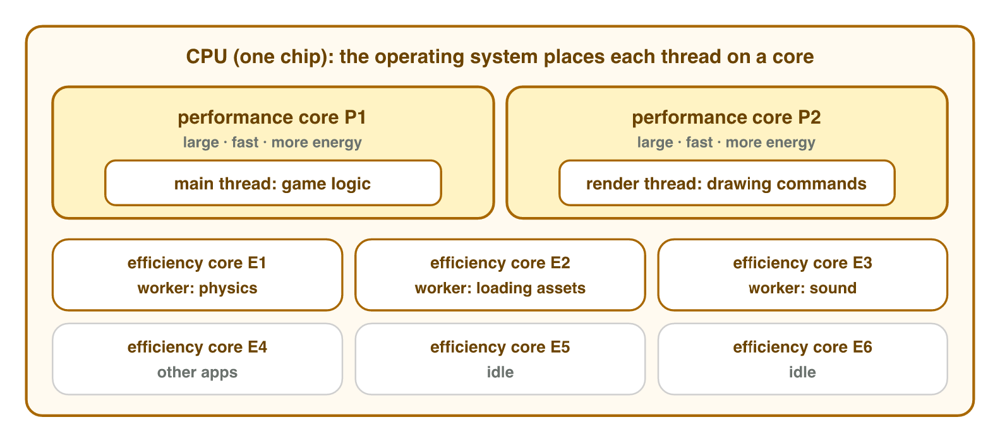
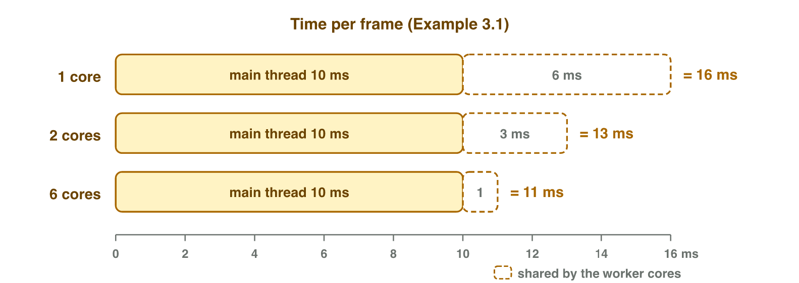
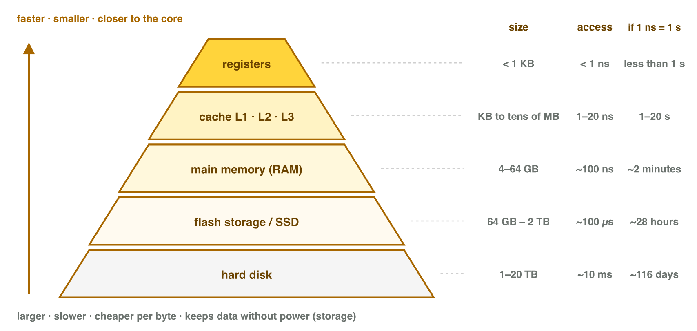
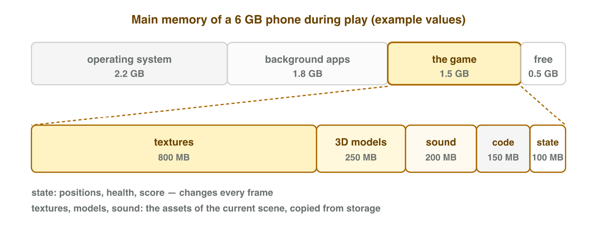
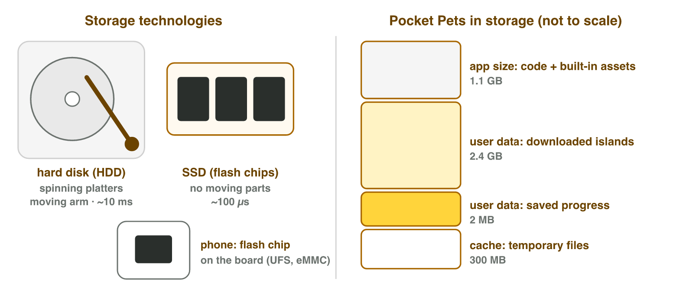
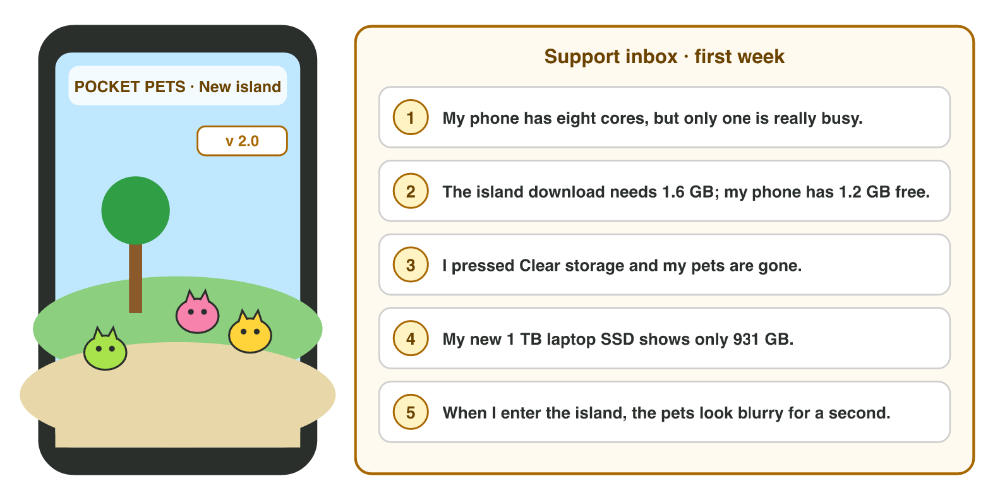

::: {.lead}
A small studio has just released version 2.0 of its mobile game *Pocket
Pets*, and the support inbox fills up. One player asks why an octa-core phone
uses only one core heavily. Another cannot download the new island. A third
pressed a button in the phone's settings and lost every pet. Each message is
about one of the three components that every game depends on: the
processor, the memory and the storage. This chapter describes each component
and its function in a running game, and each section ends with a short task
in which you observe that function yourself, on the lab computer, on your
phone or in a simulator. The previous week introduced the components as
parts of the stored-program model; this chapter looks inside them.
:::

## Key terms



## 3.1 Why eight cores do not make a game eight times faster

A phone advertisement promises an "octa-core 3 GHz processor". Week 1 showed
what the CPU does: it fetches, decodes and executes instructions at a pace set
by its **clock rate**. The advertisement adds a second number: the number of
**cores**.

A core is a complete processor: it has its own control unit, ALU and
registers, and it executes its own stream of instructions. A **multicore**
CPU places several cores on one chip, so several streams run at the same
time. Most phone processors combine two kinds of core (@fig-cores): a few
large **performance cores** for heavy work, and several small **efficiency
cores** that do light work with little energy. Arm, whose designs are used in
almost every phone, calls this arrangement *big.LITTLE*.

{#fig-cores width=94%}

::: {.callout-important title="Definition 3.1 — Core and thread"}
A **core** is a processing unit inside a CPU that executes one stream of
instructions. A **thread** is one such stream inside a program. The
operating system decides which thread runs on which core, and moves threads
between cores many times per second.
:::

Cores help a game only if its work is divided into threads. A game engine
usually has one **main thread**, which runs the game logic of every frame in
a fixed order (read input, move characters, check collisions, update the
score), and several *worker threads*, which load assets, mix sound, or
compute physics and animation in parallel. The steps of the main thread
depend on each other, so they cannot be shared among cores.

::: {.callout-note title="Example 3.1 — Splitting one frame across cores"}
On one core, a frame of a game needs 16 ms: 10 ms of game logic that must
run in order on the main thread, and 6 ms of physics and animation that can
be shared equally among worker cores.

1. One core: $10 + 6 = 16$ ms per frame (62.5 frames per second).
2. Two cores share the 6 ms: $10 + 6/2 = 13$ ms.
3. Six cores share it: $10 + 6/6 = 11$ ms.
4. Six cores make this frame only $16/11 \approx 1.5$ times faster, not six
   times: the 10 ms of the main thread stay on one core.
:::

{#fig-split width=86%}

The clock rate has a limit too. Two processors at 3 GHz can differ greatly in
speed, because a modern core completes several instructions per tick and some
designs complete more than others. A phone also lowers its clock when it gets
hot (week 1). The number of gigahertz describes the pace of one core; it does
not, on its own, describe how fast a game will run.

::: {.callout-warning title="Common mistake"}
"Eight cores at 3 GHz equal 24 GHz." Cores do not add up like this: each core
works on its own thread, and a game's main thread uses one core at a time.
:::

::: {.callout-note title="Do it · Watch the cores at work"}
On a lab computer (Windows):

1. Press Ctrl + Shift + Esc to open **Task Manager**, then choose
   **Performance → CPU**.
2. Right-click the graph and choose **Change graph to → Logical processors**.
   A PC core can run two threads at once, so there may be twice as many
   graphs as cores.
3. Open the lesson's simulator (section 3.2) or any browser game, and watch
   the graphs for 30 seconds.

*Your result:* the number of cores and of logical processors, and one
sentence that describes how the work is shared among them (one graph busy,
or all of them evenly).
:::

## 3.2 Why the processor keeps a small memory beside it

A core at 3 GHz can start an instruction every third of a nanosecond, but
main memory needs about 100 nanoseconds to deliver a value: about 300 ticks
of waiting. If every instruction waited for main memory, the core would be
idle most of the time. Computers solve this problem with a **memory
hierarchy** (@fig-hierarchy).

{#fig-hierarchy width=92%}

::: {.callout-important title="Definition 3.2 — Memory hierarchy and cache"}
A **memory hierarchy** arranges the memories of a computer in levels:
registers, cache, main memory and storage. Close to the core, memory is
small, fast and expensive per byte; far from it, memory is large, slow and
cheap. A **cache** is a small, fast memory beside the cores that keeps copies
of recently used data. When the core finds the data it needs in the cache, the
access is a **cache hit**; when it must fetch the data from main memory, it is
a **cache miss**.
:::

| Level | Typical size | Typical access time | Keeps data without power? |
|---|---|---|---|
| registers | a few hundred bytes per core | below 1 ns | no |
| cache (L1, L2, L3) | tens of KB (L1) to tens of MB (L3) | 1–20 ns | no |
| main memory (RAM) | 4–16 GB (phone), 8–64 GB (PC) | about 100 ns | no |
| storage (flash, SSD) | 64 GB – 2 TB | about 100 µs | yes |
| storage (hard disk) | 1–20 TB | about 10 ms | yes |

: The levels of the memory hierarchy (orders of magnitude). {#tbl-hierarchy}

The cache works because programs, and games in particular, use the same data
again and again: the loop of the main thread runs every frame, and the
player's position is read by the movement, the camera and the collision code
in the same frame. The cache keeps such data close to the core.

::: {.callout-note title="Example 3.2 — The hierarchy on a human scale"}
Imagine that one nanosecond lasts one second.

1. A cache access (about 1 ns) takes **1 second**: a glance at your desk.
2. A main-memory access (about 100 ns) takes **100 seconds**: a walk to
   the next room.
3. A flash-storage access (about 100 µs = 100 000 ns) takes
   **100 000 seconds**, about **28 hours**: a trip to another city.
4. A hard-disk access (about 10 ms) takes **10 million seconds**, about
   **116 days**.
:::

::: {.callout-note title="Example 3.3 — The cache in one frame"}
The code of one frame reads data from memory 1 000 000 times. A read from the
cache takes 1 ns; a read from main memory takes 100 ns.

1. 99 % hits: $990\,000 \times 1 + 10\,000 \times 100 = 1\,990\,000$ ns
   $\approx$ **2 ms**.
2. 90 % hits: $900\,000 \times 1 + 100\,000 \times 100 = 10\,900\,000$ ns
   $\approx$ **10.9 ms**, about two thirds of a 16.7 ms frame.
3. The same code with the same data: the only difference is how often the
   data was already in the cache.
:::



::: {.callout-note title="Do it · Fetch the data yourself"}
Open the **Data Trip** simulator above (or scan its QR code).

1. Fetch one value from each level and write the real time and the
   human-scale time in a table with four rows.
2. In **One frame**, set the cache hits to 99 %, 90 % and 80 %, and write
   the memory time of the frame each time.

*Your result:* the table, and one sentence that describes the function of
the cache in your own words.
:::

## 3.3 What a game keeps in memory while you play

Main memory holds everything the game needs *now*: its code, the assets of
the current scene (**textures**, 3D models, sounds), and its *state* — the
positions, health and score that change every frame (@fig-ram). The operating
system and the apps in the background share the same memory, so a game
receives only part of it.

{#fig-ram width=92%}

Sizes of data are measured in **bytes**. One byte holds 8 bits — enough for
one value from 0 to 255, such as one colour channel of a pixel.

::: {.callout-important title="Definition 3.3 — Multiples of the byte"}
Storage manufacturers count in powers of 1000: 1 KB = 1000 bytes,
1 MB = 1000 KB, 1 GB = 1000 MB, 1 TB = 1000 GB. Memory is built in powers
of 2 and counted in powers of 1024: 1 KiB = 1024 bytes, 1 MiB = 1024 KiB,
1 GiB = 1024 MiB. Some operating systems show binary sizes with the decimal
symbols, so a "GB" on screen may mean either.
:::

Textures usually take the largest share of a game's memory, and their size
follows directly from the image: width × height × bytes per pixel.

::: {.callout-note title="Example 3.4 — The memory of one texture"}
A texture of 2048 × 2048 pixels stores red, green, blue and transparency
(alpha) with one byte each.

1. Pixels: $2048 \times 2048 = 4\,194\,304$.
2. Bytes: $4\,194\,304 \times 4 = 16\,777\,216$ bytes $= 16$ MiB.
3. Phone GPUs read compressed texture formats directly. ASTC with
   4 × 4 blocks stores 1 byte per pixel: $4\,194\,304$ bytes $= 4$ MiB.
4. For the 40 textures of a new island: $40 \times 16 = 640$ MiB without
   compression, $40 \times 4 = 160$ MiB with it.
:::

::: {.callout-warning title="Common mistake"}
"The texture file is 2 MB, so it uses 2 MB of memory." A PNG file is
compressed for storage. Before the GPU can use it, it is decoded into raw
pixels (16 MiB for 2048 × 2048) or must be stored in a GPU format such as
ASTC. The size on disk does not describe the size in memory.
:::

::: {.callout-note title="Do it · Watch the memory fill"}
On a lab computer:

1. Open Task Manager → **Processes** and click the **Memory** column to sort
   by memory.
2. Write down the memory used by the browser.
3. Open five tabs with image-heavy pages (a picture gallery, a map, a video
   site) and wait ten seconds. Write down the browser's memory again.

*Your result:* the two numbers, and one sentence on what the extra memory
holds.
:::

## 3.4 Where the game lives when it is not running

When the phone is switched off, the game, its downloaded levels and the
player's progress must survive. They live in **storage**, which is
*non-volatile*: it keeps its data without power.

Two technologies are in use (@fig-storage). A **hard disk drive (HDD)**
stores bits as magnetic patterns on spinning platters, read by a head on a
moving arm; it is cheap per terabyte but slow, because the arm must move
before every read. A **solid-state drive (SSD)** stores bits in flash memory
chips and has no moving parts. Phones use the same flash memory, soldered
directly onto the board (standards called UFS and eMMC). Game consoles of
the current generation use fast SSDs as well.

{#fig-storage width=94%}

An installed game occupies storage in three parts, which phones list
separately in their settings.

::: {.callout-important title="Definition 3.4 — App size, user data and cache"}
The **app size** is the installed package: code and built-in assets. The
**user data** is what the app creates for this player: saved progress,
settings and downloaded content. The **cache** is a set of temporary files
that the app can download or compute again. (This storage cache is a
different thing from the processor cache of section 3.2; both keep copies
to save time.)
:::

::: {.callout-note title="Example 3.5 — Pocket Pets in storage"}
On one phone, *Pocket Pets* uses: app 1.1 GB, downloaded islands 2.4 GB,
saved progress 2 MB, cache 300 MB.

1. Total: $1.1 + 2.4 + 0.002 + 0.3 = 3.802$ GB, about **3.8 GB**.
2. **Clear cache** frees 300 MB; nothing important is lost — the game
   rebuilds the files when it needs them.
3. **Clear storage** (Android) deletes the user data: the islands
   (2.4 GB) and the progress. Unless the game saves progress online, the
   pets are gone.
:::

::: {.callout-note title="Example 3.6 — The missing gigabytes"}
A new laptop has a "1 TB" SSD, but Windows shows its capacity as 931 GB.

1. The manufacturer counts decimally: 1 TB = $10^{12}$ bytes.
2. Windows divides by $1024^3 = 1\,073\,741\,824$ but writes "GB":
   $10^{12} / 1\,073\,741\,824 \approx 931$.
3. No space is missing: it is the same number of bytes in two units.
   (On a phone the missing space has another cause: the operating system
   itself occupies part of the storage.)
:::

::: {.callout-warning title="Common mistake"}
Treating **Clear cache** and **Clear storage** as the same button. The first
deletes temporary files; the second deletes the player's data.
:::

::: {.callout-note title="Do it · A game in your phone's storage"}
On your phone, open the storage screen of one game:

- **Android:** Settings → Apps → *(the game)* → Storage (on some phones
  "Storage & cache"). The parts are called App size, User data and Cache
  (names vary by manufacturer).
- **iPhone:** Settings → General → iPhone Storage → *(the game)*. The
  parts are called App Size and Documents & Data.

Do **not** press Clear storage, Offload App or Delete App.

*Your result:* the size of each part, and which part would grow if you
downloaded a new level.
:::

## Case study: the Pocket Pets support desk

*Pocket Pets* is a made-up mobile game by a small studio. Version 2.0 adds a
new island with 40 textures of 2048 × 2048 pixels, stored in ASTC (1 byte per
pixel). In its first week the support desk receives five messages:
(1) "My phone has eight cores, but only one is really busy";
(2) "The island download needs 1.6 GB and my phone has 1.2 GB free";
(3) "I pressed Clear storage and my pets are gone";
(4) "My new 1 TB laptop SSD shows only 931 GB";
(5) "When I enter the island, the pets look blurry for a second". Each
message is about one component and one function. The Game challenge of the
interactive lesson asks you to answer them (@fig-case).

{#fig-case width=94%}

## Further reading

Tanenbaum and Austin, *Structured Computer Organization*, 6th ed., Chapter 2:
section 2.1 (processors), section 2.2 (primary memory, including cache
memory) and section 2.3 (secondary memory: the memory hierarchy, magnetic
disks and solid-state disks).

## Exercises

1. Describe the difference between a core and a thread.
2. A frame needs 12 ms of main-thread work and 8 ms of work that can be
   shared equally among cores. What is the frame time with one core and
   with four cores?
3. Explain why a phone processor has both performance cores and efficiency
   cores.
4. Put in order from fastest to slowest: main memory, L1 cache, hard disk,
   register, flash storage.
5. One frame makes 2 000 000 memory reads; 95 % are cache hits (1 ns) and
   the rest go to main memory (100 ns). What is the memory time of the frame?
6. How many bytes does a 1024 × 1024 texture take with 4 bytes per pixel,
   and with ASTC at 1 byte per pixel? Give both in MiB.
7. A player says: "The texture is a 1 MB PNG file, so it takes 1 MB of
   memory." Describe the mistake.
8. A "512 GB" SSD: what capacity does Windows show? (512 × 10⁹ / 1024³)
9. For each part — app size, user data, cache — describe what is lost when
   it is deleted.
10. Message 5 of the case study: which two components are involved, and
    what happens between them during the blurry second?

## Answers to the exercises

::: {.answers}
1. A core is hardware that executes one instruction stream; a thread is a stream of instructions in a program that the OS places on a core.
2. 12 + 8 = 20 ms; 12 + 8/4 = 14 ms.
3. Performance cores run heavy work fast; efficiency cores run light work with little energy, which saves the battery.
4. Register, L1 cache, main memory, flash storage, hard disk.
5. 1 900 000 × 1 + 100 000 × 100 = 11 900 000 ns ≈ 11.9 ms.
6. 4 194 304 bytes = 4 MiB; 1 048 576 bytes = 1 MiB.
7. The PNG is compressed for storage; in memory the texture is decoded (4 MiB at 1024 × 1024) or kept in a GPU format.
8. About 477 GB.
9. App: the game itself (reinstall from the store); user data: progress and downloads; cache: nothing important (rebuilt).
10. Storage and main memory (and the GPU): the island's textures are still being copied from storage into memory, so the game first shows low-detail versions.
:::
