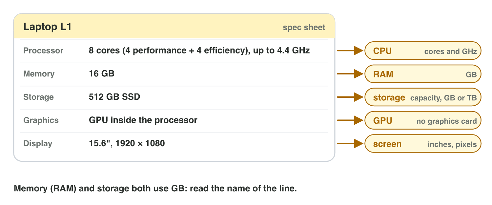

::: {.lead}
Today there are no new ideas. You use what Lecture 2 taught (the CPU and its
cores, RAM and storage) on real computers: you find the seven main parts
inside a desktop, write the spec sheet of the lab computer, and choose a
laptop for a game from two spec sheets. Do each activity alone. The results
of the activities are at the end of this worksheet: try first, then compare.
:::

## Recall

- The **CPU** runs the instructions; its cores run threads; GHz is the speed
  of one core.
- **RAM** holds the game while it runs; **storage** (SSD) keeps it when the
  power is off.
- Sizes count in steps of 1024: 1 GB = 1024 MB.

::: {.callout-tip title="Try it 1 · Recall"}
Choose the right answer.

::: {.match extra="24 GHz|the cache"}
A phone has 8 cores at 3 GHz. How fast is one core?
:   3 GHz

    Why: cores do not add up.

Which part keeps the saves when the power is off?
:   the storage

    Why: storage keeps data without power.

How many MB is 4 GB?
:   4096 MB

    Why: 4 × 1024.
:::
:::

## Activity 1 · What is inside the case?

Most parts of a desktop computer sit on the **motherboard**, which connects
them. The **CPU** is a square chip under its cooler; the **RAM** is long,
thin cards next to it; the **SSD** is a small card or a flat box; the
**graphics card** is a big card with fans; the **power supply** is a metal
box with cables; the **cooling system** is fans and metal blocks.

{width=86%}



::: {.callout-note title="Activity 1 · Parts Finder · 12 min"}
1. In **Parts Finder**, play round 1 (find the part by its name) and round 2
   (find the part by its job).
2. Make a table with seven rows: the part and its job.

*Your product:* your score and a table with seven rows.

::: {.check}
CPU: runs the instructions. RAM: holds the game while it runs. SSD: keeps
the game when the power is off. Graphics card: draws the images. Motherboard:
connects all the parts. Power supply: turns mains power into power for the
parts. Cooling fan: carries the heat away.
:::
:::

::: {.callout-tip title="Try it 2 · Parts and jobs"}
Choose the right part.

::: {.match extra="the keyboard|the display"}
It holds the game while it runs.
:   the RAM

    Why: RAM holds what is running now.

It connects the CPU, the memory and the storage.
:   the motherboard

    Why: every part plugs into the motherboard.

The big metal box with the cables and a fan.
:   the power supply

    Why: the CPU is a small chip under its own cooler.

The fans are loud, and the game gets slow after 10 minutes. Which part cannot keep up?
:   the cooling system

    Why: a hot chip slows down to protect itself.
:::
:::

## Activity 2 · The spec sheet of the lab computer

A **specification sheet** lists the technical values of a device line by
line: the processor (cores and GHz), the memory (RAM in GB), the storage
(capacity in GB or TB) and the graphics.

{width=80%}

::: {.callout-note title="Activity 2 · Four lines · 10 min"}
1. On a lab computer, open **Settings → System → About**: write the
   processor and the installed RAM.
2. Open **Task Manager → Performance**: write the cores and logical
   processors (**CPU**) and the type and capacity of **Disk 0**.
3. Write a spec sheet of the lab computer with four lines.

*Your product:* a spec sheet with four lines.

::: {.check}
A good sheet has four lines like these: Processor: Intel Core i5, 6 cores
(12 logical processors), up to 4.4 GHz · Memory: 16 GB · Storage: 512 GB SSD
· Graphics: GPU inside the processor (or the name of a graphics card). The
values of your lab computer may differ.
:::
:::

::: {.callout-tip title="Try it 3 · Read Laptop L1"}
Laptop L1: Processor 8 cores (4 performance + 4 efficiency), up to 4.4 GHz ·
Memory 16 GB · Storage 512 GB SSD · Graphics: GPU inside the processor.
Choose the right answer.

::: {.match extra="4 GB|1024 GB"}
How much RAM does L1 have?
:   16 GB

    Why: the Memory line gives the RAM.

What is the storage capacity of L1?
:   512 GB

    Why: the Storage line gives the SSD capacity.

Does L1 have a separate graphics card?
:   no, the GPU is inside the processor

    Why: the Graphics line says so.

Where does Windows show the logical processors?
:   Task Manager → Performance → CPU

    Why: the CPU page of Task Manager lists them.
:::
:::

## Activity 3 · Which laptop for the game?

A studio must test a game that needs **16 GB of RAM** and **60 GB of free
storage**. Two laptops are free:

- **Laptop L1:** 8 cores, up to 4.4 GHz; RAM 16 GB; storage 512 GB SSD
  (120 GB free); GPU inside the processor.
- **Laptop L2:** 4 cores, up to 3.0 GHz; RAM 8 GB; storage 256 GB SSD
  (40 GB free); GPU inside the processor.

{width=80%}

::: {.callout-note title="Activity 3 · Choose and explain · 10 min"}
1. Which laptop has enough RAM? Which one has enough free storage?
2. Which laptop do you choose? Give two reasons from the sheets.
3. L2 has "256 GB". Why can the game still not be installed on it?

*Your product:* one choice with two reasons, and one answer.

::: {.check}
1. Only L1 has 16 GB of RAM, and only L1 has 60 GB free (120 GB). 2. L1:
enough RAM and enough free storage (also faster cores). 3. The capacity is
256 GB, but only 40 GB is free, less than 60 GB.
:::
:::

::: {.callout-tip title="Try it 4 · Two laptops"}
L1: 8 cores up to 4.4 GHz, 16 GB RAM, 120 GB free. L2: 4 cores up to 3.0 GHz,
8 GB RAM, 40 GB free. Choose the right answer.

::: {.match extra="256 GB|L2, it has 256 GB"}
Which laptop has the faster core?
:   L1, up to 4.4 GHz

    Why: GHz is the speed of one core.

A 30 GB test build must be copied. Which laptop has room?
:   both

    Why: both have more than 30 GB free.

How much more RAM does L2 need for the game?
:   8 GB

    Why: 16 − 8 = 8 GB.
:::
:::

## Case study: the Byte Bay test lab

*Byte Bay* is a made-up game studio. Its test lab has three devices: Laptop
L1 (8 cores, up to 4.4 GHz; RAM 16 GB; 512 GB SSD with 120 GB free; GPU
inside the processor; Windows 11), Phone P1 (8 cores, up to 3.0 GHz; RAM
8 GB; 256 GB with 40 GB free; Android 14) and Phone P2 (6 cores; RAM not
given; 128 GB with 3 GB free; iOS 17). The Game challenge of the interactive
page asks which core is faster, why a 5 GB game does not fit on P2, which
part draws the images of L1, and which device has the most RAM.



## Exercises

1. Which part turns mains power into power for the other parts?
2. Which part is long and thin and sits next to the CPU?
3. A spec sheet says "Memory: 8 GB · Storage: 1 TB". Which line is the RAM?
4. A laptop shows 4 cores and 8 logical processors. Where did you read this?
5. A game needs 12 GB of RAM. Can it run well on a laptop with 8 GB?
6. A phone has 64 GB of storage and 6 GB free. Can it install a 10 GB game?

## Answers to the exercises

::: {.answers}
1. The power supply.
2. The RAM.
3. "Memory: 8 GB".
4. In Task Manager → Performance → CPU.
5. No: it has 4 GB too little RAM.
6. No: only 6 GB is free; it needs 4 GB more.
:::
