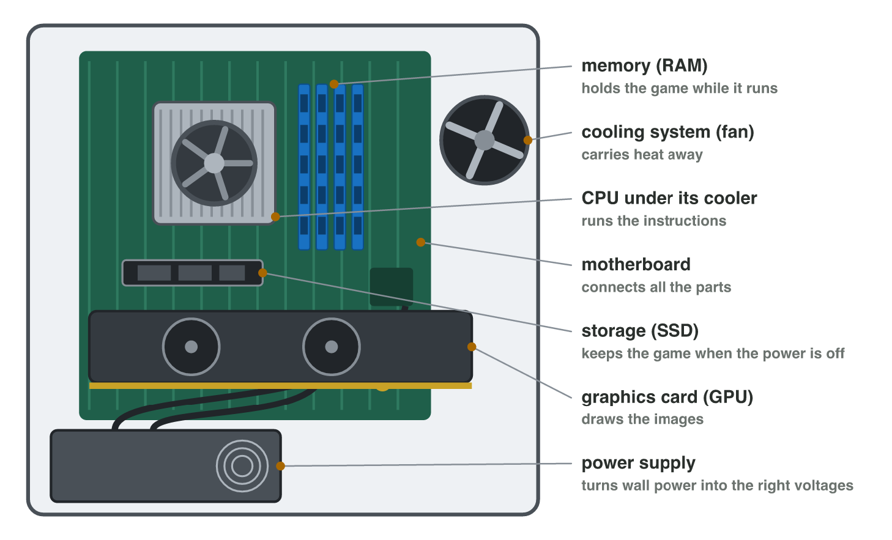

::: {.lead}
In Lecture 2 you learned the parts of a computer: the CPU and its cores, the
cache, RAM and storage. Today you find them in a real computer, write its
spec sheet, and choose a laptop for a game. There are no new ideas: two
short problems. Do each one alone. The results of the activities are at
the end of this worksheet.
:::

## Recall

- The **CPU** runs the instructions; its cores work at the same time; GHz
  is the speed of one core.
- The **cache** is small, fast memory next to the cores. **RAM** holds the
  game while it runs; **storage** (SSD) keeps it when the power is off.
- Sizes count in steps of 1024: 1 GB = 1024 MB.

::: {.callout-tip title="Try it 1 · Recall"}
Choose the right answer.

::: {.match extra="24 GHz|the cache"}
A phone has 8 cores at 3 GHz. How fast is one core?
:   3 GHz

Which part keeps the saves when the power is off?
:   the storage

How many MB is 4 GB?
:   4096 MB
:::
:::

## Activity 1 · The parts and the spec sheet of the lab computer

Most parts of a desktop computer sit on the **motherboard**, which connects
them: the CPU under its cooler, the RAM cards, the SSD, the graphics card
and the power supply. A **spec sheet** lists the values of a device line
by line: the processor (cores and GHz), the memory (RAM), the storage and
the graphics.

{width=86%}



::: {.callout-note title="Activity 1 · Parts and four lines · 15 min"}
1. In **Parts Finder**, play round 1: find each part by its name.
2. On a lab computer, open **Settings → System → About** (the processor and
   the RAM) and **Task Manager → Performance** (the cores and **Disk 0**).
3. Write the spec sheet of the lab computer in four lines: processor,
   memory, storage, graphics.

*Your product:* your score and a spec sheet with four lines.

::: {.check}
A good sheet: Processor: Intel Core i5, 6 cores, up to 4.4 GHz · Memory:
16 GB · Storage: 512 GB SSD · Graphics: GPU inside the processor (or the
name of a graphics card). The values of your lab computer may differ.
:::
:::

::: {.callout-tip title="Try it 2 · Parts and lines"}
Choose the right answer.

::: {.match extra="the keyboard|Settings → Display"}
Which part holds the game while it runs?
:   the RAM

Which part connects the CPU, the memory and the storage?
:   the motherboard

Where does Windows show the cores of the CPU?
:   Task Manager → Performance → CPU
:::
:::

## Activity 2 · Which laptop for the game?

A studio must test a game that needs **16 GB of RAM** and **60 GB of free
storage**. Two laptops are free:

- **Laptop L1:** 8 cores, up to 4.4 GHz; RAM 16 GB; storage 512 GB SSD
  (120 GB free).
- **Laptop L2:** 4 cores, up to 3.0 GHz; RAM 8 GB; storage 256 GB SSD
  (40 GB free).

{width=80%}

::: {.callout-note title="Activity 2 · Choose and explain · 15 min"}
1. Which laptop has enough RAM? Which one has enough free storage?
2. Which laptop do you choose? Give two reasons from the sheets.
3. L2 has "256 GB". Why can the game still not be installed on it?

*Your product:* one choice with two reasons, and one answer.

::: {.check}
Only L1 has 16 GB of RAM, and only L1 has 60 GB free (120 GB). So choose
L1: enough RAM and enough free storage (and faster cores). L2 has a capacity
of 256 GB, but only 40 GB is free, less than 60 GB.
:::
:::

::: {.callout-tip title="Try it 3 · Two laptops"}
L1: 8 cores up to 4.4 GHz, 16 GB RAM, 120 GB free. L2: 4 cores up to
3.0 GHz, 8 GB RAM, 40 GB free. Choose the right answer.

::: {.match extra="256 GB|the SSD"}
Which laptop has the faster core?
:   L1, up to 4.4 GHz

How much more RAM does L2 need for the game?
:   8 GB

Which memory is small and very fast, next to the cores?
:   the cache
:::
:::

## Exercises

1. A laptop has 4 cores at 2.5 GHz. How fast is one core?
2. Name the four lines of a short spec sheet.
3. A phone has 128 GB of storage, 5 GB free. Can you install a 6 GB game?
4. How many MB is 2 GB?

## Answers to the exercises

::: {.answers}
1. 2.5 GHz.
2. Processor, memory, storage, graphics.
3. No: only 5 GB is free.
4. 2048 MB.
:::
