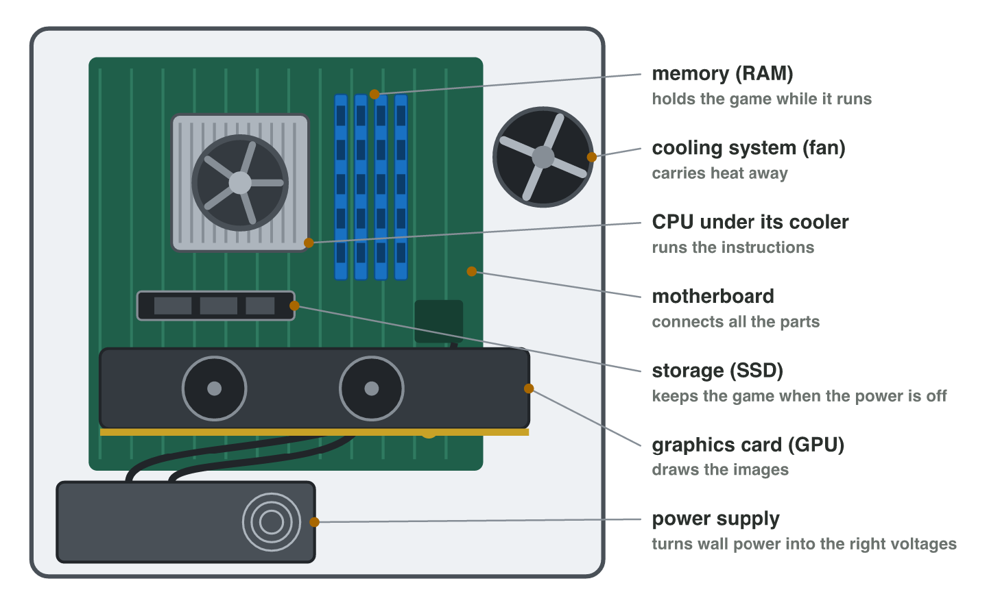
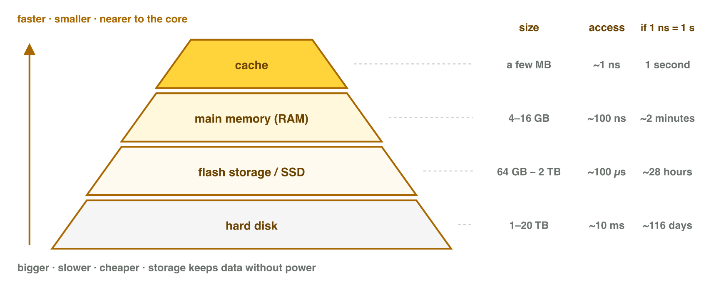

No new ideas today: two short problems on Lecture 2. Do each one alone. Tap,
sort or type your answer at every step: the page checks it at once and tells
you why.

## Recall

- The **CPU** runs the instructions; its cores work at the same time; GHz
  is the speed of one core.
- The **cache** is small, fast memory next to the cores. **RAM** holds the
  game while it runs; **storage** (SSD) keeps it when the power is off.
- Sizes count in steps of 1024: 1 GB = 1024 MB.

::: {.callout-tip title="Try it 1 · Recall"}
Choose the right answer.

::: {.match extra="24 GHz|the cache"}
A phone has 8 cores at 3 GHz. How fast is one core?
:   3 GHz

    Why: Cores do not add up: GHz is the speed of one core.

Which part keeps the saves when the power is off?
:   the storage

    Why: Storage keeps data without power.

How many MB is 4 GB?
:   4096 MB

    Why: 4 × 1024 = 4096.
:::
:::

## Activity 1 · The parts and the spec sheet of the lab computer

Most parts of a desktop computer sit on the **motherboard**, which connects
them: the CPU under its cooler, the RAM cards, the SSD, the graphics card
and the power supply. A **spec sheet** lists the values of a device line
by line: the processor (cores and GHz), the memory (RAM), the storage and
the graphics.

{width=86%}



::: {.callout-note title="Activity 1 · Parts and four lines · 15 min"}
1. In **Parts Finder**, play round 1: find each part by its name.
2. On a lab computer, open **Settings → System → About** (the processor and
   the RAM) and **Task Manager → Performance** (the cores and **Disk 0**).
3. Write the spec sheet of the lab computer in four lines: processor,
   memory, storage, graphics.

*Your product:* your score and a spec sheet with four lines.

One lab computer shows these values in About and Task Manager.

::: {.sort}
Step 3: which line of the spec sheet does each value go into? Sort them.

Processor
:   Intel Core i5, up to 4.4 GHz

    Why: The name and the GHz of the CPU.

:   Cores: 6, logical processors: 12

    Why: The cores belong to the processor line.

Memory
:   Installed RAM: 16 GB

    Why: RAM is the memory of the computer.

Storage
:   Disk 0: 512 GB SSD

    Why: The SSD keeps the files: storage.

Graphics
:   GPU 0: Intel UHD Graphics, inside the processor

    Why: The GPU makes the pictures: the graphics line.
:::
:::

::: {.callout-tip title="Try it 2 · Parts and lines"}
Choose the right answer.

::: {.match extra="the keyboard|Settings → Display"}
Which part holds the game while it runs?
:   the RAM

    Why: RAM holds what is running now.

Which part connects the CPU, the memory and the storage?
:   the motherboard

    Why: Every part plugs into the motherboard.

Where does Windows show the cores of the CPU?
:   Task Manager → Performance → CPU

    Why: The CPU page of Task Manager lists them.
:::
:::

## Activity 2 · Which laptop for the game?

A studio must test a game that needs **16 GB of RAM** and **60 GB of free
storage**. Two laptops are free:

- **Laptop L1:** 8 cores, up to 4.4 GHz; RAM 16 GB; storage 512 GB SSD
  (120 GB free).
- **Laptop L2:** 4 cores, up to 3.0 GHz; RAM 8 GB; storage 256 GB SSD
  (40 GB free).

{width=80%}

::: {.callout-note title="Activity 2 · Choose and explain · 15 min"}
1. Which laptop has enough RAM? Which one has enough free storage?
2. Which laptop do you choose? Give two reasons from the sheets.
3. L2 has "256 GB". Why can the game still not be installed on it?

*Your product:* one choice with two reasons, and one answer.

::: {.choice}
Step 1: which laptop has enough RAM and enough free storage?

- [x] L1

  Why: 16 GB of RAM and 120 GB free: both are enough.

- [ ] L2

  Why: L2 has only 8 GB of RAM and 40 GB free.

- [ ] both

  Why: The game needs 16 GB of RAM and 60 GB free; L2 has neither.
:::

::: {.sort}
Step 2: is each line a reason to choose L1? Sort them.

A reason for L1
:   It has the 16 GB of RAM that the game needs.

    Why: The game needs 16 GB; L2 has only 8 GB.

:   It has 120 GB free, more than the 60 GB the game needs.

    Why: Free storage decides if the game fits.

:   Its cores are faster: up to 4.4 GHz.

    Why: GHz is the speed of one core: a good extra reason.

Not a reason
:   Its SSD is 512 GB.

    Why: The capacity does not decide; the free space does.
:::

::: {.choice}
Step 3: L2 has "256 GB". Why can the game still not be installed?

- [x] Only 40 GB of it is free, less than the 60 GB the game needs.

  Why: The capacity is the size of the disk; the free space is what is left.

- [ ] 256 GB is too small for any game.

  Why: 256 GB could hold the game if 60 GB were free.

- [ ] An SSD cannot hold games.

  Why: Games are installed on SSDs every day.
:::
:::

::: {.callout-tip title="Try it 3 · Two laptops"}
L1: 8 cores up to 4.4 GHz, 16 GB RAM, 120 GB free. L2: 4 cores up to
3.0 GHz, 8 GB RAM, 40 GB free. Choose the right answer.

::: {.match extra="256 GB|the SSD"}
Which laptop has the faster core?
:   L1, up to 4.4 GHz

    Why: GHz is the speed of one core.

How much more RAM does L2 need for the game?
:   8 GB

    Why: 16 − 8 = 8 GB.

Which memory is small and very fast, next to the cores?
:   the cache

    Why: The cache keeps the data that the game uses again and again.
:::
:::

## Wrap-up {.summary}

- You can name the main parts of a computer and write its spec sheet.
- You can choose a device for a game from its cores, RAM and free storage.
