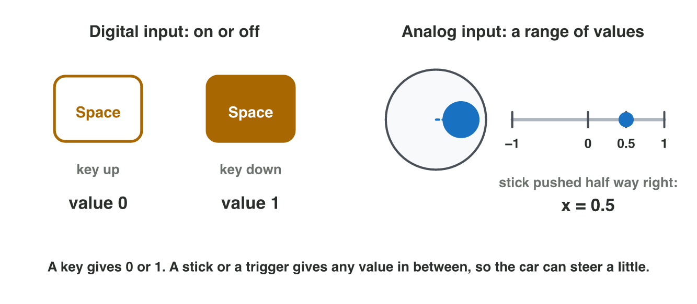
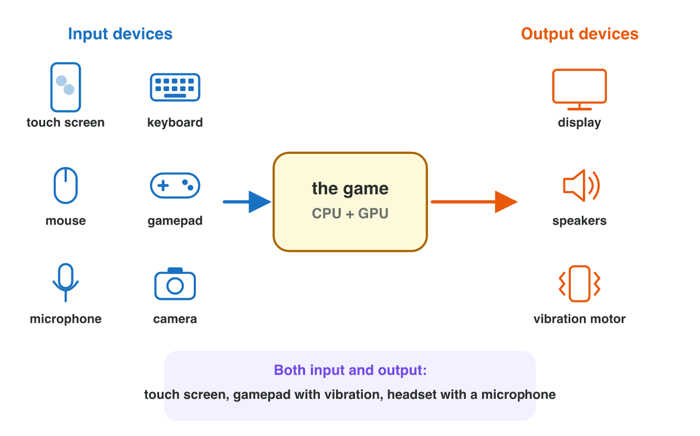
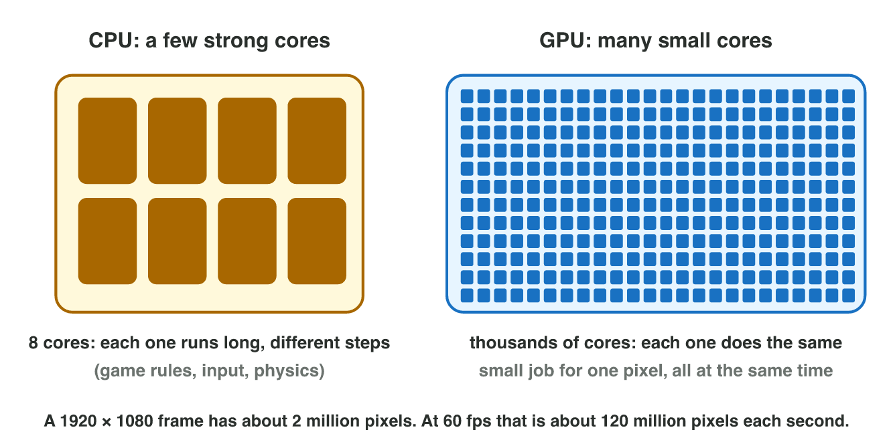

## Keywords



## 5.1 Input devices

:::: {.columns}
::: {.column width="50%"}
- An input device turns the player's action into numbers for the game.
- A key or a button is digital: it gives only 0 or 1.
- A stick or a trigger is analog: it gives any value from −1 to 1.
- **Do it:** In Input Lab, how many fingers does your phone follow at once?
:::
::: {.column width="50%"}

:::
::::

## Live demo · Input Lab



## Try it 1 · Input

The facts: Neon Drift turns the car by 40° per second times the input value.

a) A key is down. Which value does the game read?
b) A stick is pushed half way right. How far does the car turn per second?
c) Which device sends the position of several fingers?

::: {.answer}
a) 1
b) 40 × 0.5 = 20°
c) the touch screen
:::

## 5.2 Output devices

:::: {.columns}
::: {.column width="50%"}
- An output device turns data into an image, a sound or a vibration.
- The vibration of a phone or a gamepad is called haptic feedback.
- A touch screen, a gamepad with vibration and a headset are both input and output.
- **Do it:** List the input and output devices of your phone. Which ones are both?
:::
::: {.column width="50%"}

:::
::::

## Try it 2 · Input, output or both?

a) Is a monitor without touch an input device, an output device or both?
b) Is a gamepad with a vibration motor an input device, an output device or both?
c) What do we call it when the phone shakes after a crash?

::: {.answer}
a) output
b) both
c) haptic feedback
:::

## 5.3 Why games need a GPU

:::: {.columns}
::: {.column width="50%"}
- One 1920 × 1080 frame has about 2 million pixels.
- A CPU has a few strong cores for long, different steps.
- A GPU has thousands of small cores that colour pixels at the same time.
- **Do it:** In Paint Race, start the race. How long does each processor need?
:::
::: {.column width="50%"}

:::
::::

## Example · The paint race

A tiny frame has 16 × 9 = 144 pixels.
**How long do a CPU with 4 cores and a GPU with 144 small cores need?**

::: {.reveal}
1. The CPU paints 4 pixels at a time, each in 0.08 s, so it needs 36 steps.
2. The CPU needs 36 × 0.08 = **2.88 s**.
3. The GPU paints all 144 pixels at once, each in 0.32 s, so it needs **0.32 s**.
:::

## Live demo · Paint Race



## Try it 3 · CPU or GPU?

a) Which processor computes the colours of the pixels?
b) Which processor runs the rules of the game?
c) What do we call many small cores that work at the same time?

::: {.answer}
a) the GPU
b) the CPU
c) parallel processing
:::

## 5.4 Video memory and settings

:::: {.columns}
::: {.column width="50%"}
- The GPU keeps textures and frames in video memory (VRAM).
- An integrated GPU shares the main RAM, and a graphics card has its own VRAM.
- Higher resolution, textures and shadows give the GPU more work.
- **Do it:** In Task Manager, open Performance → GPU 0. How much dedicated GPU memory is there?
:::
::: {.column width="50%"}

:::
::::

## Example · Settings for Laptop L1

Neon Drift runs at 120 fps on Laptop L1 at 720p with shadows off. L1 has 2 GB of video memory.
**Which settings keep 60 fps or more?**

::: {.reveal}
1. At 1080p the pixels double, so the game runs at about 120 ÷ 2 = **60 fps**.
2. With shadows on as well, it drops to 60 ÷ 1.5 = **40 fps**, which is too slow.
3. High textures need 4 GB and do not fit, but Medium textures need 2 GB and fit.
:::

## Try it 4 · Video memory

a) Where does an integrated GPU keep its textures?
b) The textures need 4 GB, but the GPU has only 2 GB. What happens?
c) A game runs at 120 fps at 720p. About how fast does it run at 1080p?

::: {.answer}
a) in the main RAM
b) The game stutters.
c) about 60 fps
:::

## Game challenge · Tuning Neon Drift



## Try it 5 · Three devices (harder)

The facts: 1080p halves the frame rate, and shadows divide it by 1.5. Phone P1 has 2 GB and runs at 90 fps at 720p with shadows off. Desktop D1 has a graphics card with 8 GB and runs at 300 fps.

a) How many fps does Phone P1 reach at 1080p with shadows off?
b) Is Phone P1 fast enough at 720p with shadows on?
c) Which device can use High textures of 4 GB?

::: {.answer}
a) 45 fps, which is too slow
b) Yes: exactly 60 fps.
c) Desktop D1
:::

## Summary

- Input devices turn actions into numbers, and keys are digital while sticks are analog.
- Output devices give an image, a sound or a vibration, and some devices are both.
- The GPU colours millions of pixels with thousands of small cores in parallel.
- An integrated GPU shares the RAM, but a graphics card has its own VRAM.
- Resolution, textures and shadows change the work of the GPU and the frame rate.
