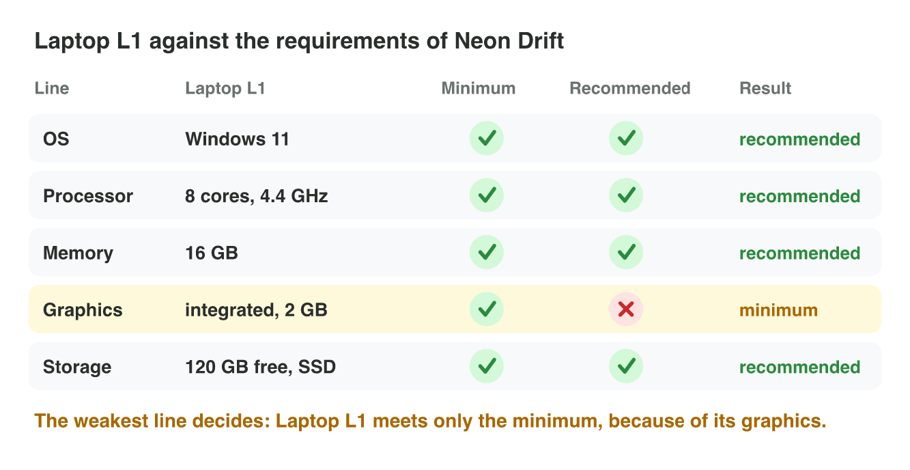
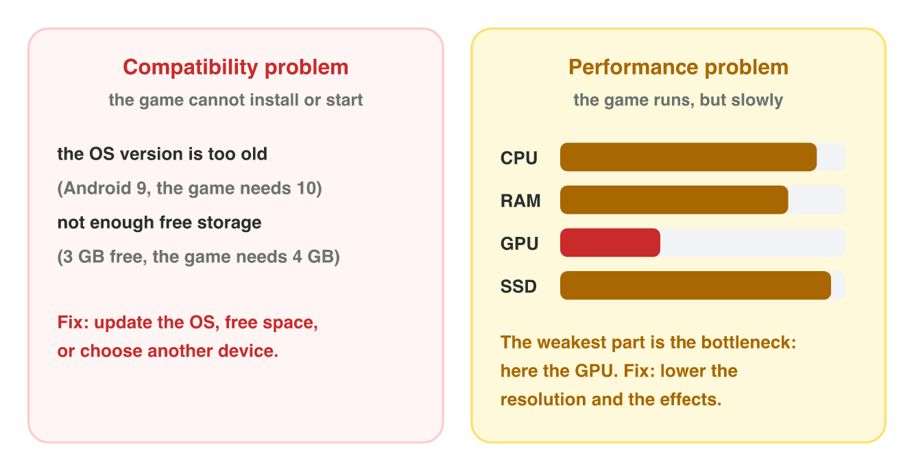

## Recall · Lectures 2 and 3

a) Which part colours the pixels of a frame?
b) A game runs at 120 fps at 720p. About how fast does it run at 1080p?
c) Where does an integrated GPU keep its textures?

::: {.answer}
a) the GPU
b) about 60 fps
c) in the main RAM
:::

## Activity 1 · The lab computer · 15 min

:::: {.columns}
::: {.column width="50%"}
- Neon Drift needs at least 4 cores, 8 GB of RAM and 2 GB of video memory.
- The weakest line of the spec sheet decides the level of the device.
- **Do it:** Enter the values of the lab computer in Spec Check. Which level does it reach, and which line is the weakest?
:::
::: {.column width="50%"}

:::
::::

## Live demo · Spec Check



## Check 1 · The lab computer

Which level does a typical lab computer reach, and why?

::: {.reveal}
1. Its cores and its RAM are often enough for the minimum or more.
2. Its GPU is often inside the processor, with about 2 GB.
3. So the graphics line is the weakest, and the computer reaches only the minimum.
:::

## Activity 2 · Your phone · 15 min

:::: {.columns}
::: {.column width="50%"}
- A compatibility problem stops the game from installing; a performance problem makes it slow.
- **Do it:** Compare the OS version and the size on the store page of your game with your phone. Then write two settings to lower for a game at 25 fps.
- Your product is a comparison and two settings.
:::
::: {.column width="50%"}

:::
::::

## Check 2 · Your phone

What does a good answer show?

::: {.reveal}
1. It compares numbers: the game needs Android 8.0 and 180 MB, and the phone has Android 13 and 12 GB free.
2. So there is no compatibility problem on this phone.
3. For a slow game with a GPU bottleneck, lower the resolution and turn the shadows off.
:::

## Wrap-up

- You can compare a device with the requirements of a game and find its weakest line.
- You can tell a compatibility problem from a performance problem.
