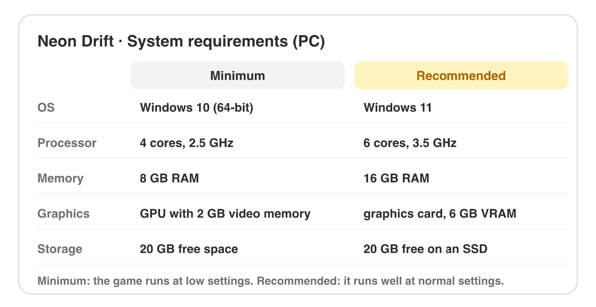
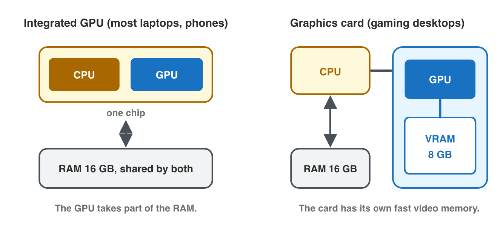

No new ideas today: you compare real devices with the needs of a game, with
what you learned in Lectures 2 and 3. Do each activity alone, then open
"Check your result". Every question on this page has its answer: try first,
then check.

## Recall

- The GPU draws the pixels; an integrated GPU shares the RAM, a graphics
  card has its own video memory (VRAM).
- 1080p has about twice the pixels of 720p: about half the frame rate.
- Higher texture quality needs more video memory; shadows lower the frame
  rate.

::: {.callout-tip title="Try it 1 · Recall"}
Choose the right answer.

::: {.match extra="the CPU|240 fps"}
Which part colours the pixels of a frame?
:   the GPU

    Why: the GPU draws the picture with many small cores.

A game runs at 120 fps at 720p. About how fast at 1080p?
:   about 60 fps

    Why: twice the pixels, about half the frame rate.

Where does an integrated GPU keep its textures?
:   in the main RAM

    Why: it has no video memory of its own.
:::
:::

## Activity 1 · What does the game need?

A store page lists the **system requirements** of a game. **Minimum:** the
game runs, but at low settings. **Recommended:** it runs well at normal
settings. *Neon Drift* for PC: minimum Windows 10 (64-bit), 4 cores at
2.5 GHz, 8 GB RAM, 2 GB video memory, 20 GB free; recommended Windows 11, 6
cores at 3.5 GHz, 16 GB RAM, a graphics card with 6 GB, 20 GB free on an SSD.

{width=86%}

::: {.callout-note title="Activity 1 · Requirements · 8 min"}
On your phone, open the store page of a game that you play. **Android:**
About this game → Requires Android. **iPhone:** Information → Size and
Compatibility. Write the OS version it requires and its size.

*Your product:* the game, the OS version it requires and its size.

::: {.check}
A good answer gives a version and a size from the store page, for example
"Requires Android 8.0 and up, 180 MB" or "Requires iOS 15.0 or later,
1.2 GB". Check that the version on your phone is the same or newer.
:::
:::

::: {.callout-tip title="Try it 2 · Requirements"}
Use the requirements of Neon Drift above. Choose the right answer.

::: {.match extra="32 GB|Windows 8.1"}
How much RAM does Neon Drift need at the minimum?
:   8 GB

    Why: the minimum column says 8 GB.

A PC meets only the minimum. How does the game run?
:   at low settings

    Why: minimum means it runs, but not well.

Where does Google Play show the Android version that a game needs?
:   Requires Android

    Why: it is in "About this game".
:::
:::

## Activity 2 · Does it run here?

Compare each line of the requirements with the same line of the spec sheet:
below minimum, minimum or recommended. **The weakest line decides** the
level of the whole device.

{width=86%}



::: {.callout-note title="Activity 2 · The lab computer · 10 min"}
In **Spec Check**, choose **My lab computer** and enter its values (from
Settings → System → About and Task Manager → Performance). Write the level
of the lab computer and its weakest line.

*Your product:* one level and one weakest line.

::: {.check}
Many lab computers reach the **minimum**: enough cores and RAM, but an
integrated GPU with about 2 GB, so the graphics line is the weakest. A lab
computer with a graphics card of 6 GB or more and 16 GB of RAM reaches the
recommended level.
:::
:::

::: {.callout-tip title="Try it 3 · The weakest line"}
Laptop L1: 8 cores, 4.4 GHz; 16 GB; GPU inside the processor, 2 GB; 120 GB
free, SSD. Old PC O1: 4 cores, 3.0 GHz; 4 GB RAM; graphics card, 2 GB; 60 GB
free, HDD. Choose the right answer.

::: {.match extra="the processor|recommended"}
Which line holds Laptop L1 back?
:   graphics

    Why: 2 GB inside the processor is only the minimum.

Which level does Old PC O1 reach?
:   below minimum

    Why: 4 GB of RAM is less than the minimum 8 GB.

A laptop has 12 GB of RAM. Which level does its memory line reach?
:   minimum

    Why: 12 GB is at least 8 GB, but less than 16 GB.
:::
:::

## Activity 3 · Compatibility or performance?

A **compatibility problem** stops the game from installing or starting (the
OS is too old, or the free storage is too small); more power does not help.
A **performance problem** makes the game slow; the weakest part is the
**bottleneck**. *Neon Drift Mobile*: minimum Android 10, 4 cores, 4 GB RAM,
4 GB free; recommended Android 12, 8 cores, 6 GB RAM.

{width=86%}

::: {.callout-note title="Activity 3 · Your phone · 8 min"}
Compare the OS version and the free storage of your phone with the
requirements of your game of Activity 1. Is there a compatibility problem?
If the game runs slowly, which part is the bottleneck, and which setting
would you lower?

*Your product:* two short answers.

::: {.check}
A good answer compares the two lines with numbers ("Android 13 ≥ Android 8:
OK; 12 GB free ≥ 180 MB: OK") and names a bottleneck with a fitting setting,
for example "the GPU: lower the resolution and the shadows" or "the RAM:
close other apps and lower the textures".
:::
:::

::: {.callout-tip title="Try it 4 · Which problem?"}
Choose the right answer. You can use an answer more than once.

::: {.match extra="buy more RAM"}
A phone has Android 9. The game needs Android 10.
:   a compatibility problem

    Why: an old OS cannot install the game at all.

The game runs, but at 25 fps.
:   a performance problem

    Why: it runs, only too slowly.

The GPU is the bottleneck. What helps first?
:   lower the resolution and the shadows

    Why: fewer pixels and no shadows mean less work for the GPU.

The phone has 3 GB free. The game needs 4 GB.
:   a compatibility problem

    Why: without enough free storage it cannot install.
:::
:::

## Activity 4 · Settings for five devices

In *Neon Drift*, 1080p halves the frame rate of 720p, and shadows divide it
by 1.5. The goal is **60 fps or more**. Five devices run the game at 720p
with shadows off at: A 60 fps, B 90 fps, C 120 fps, D 180 fps, E 300 fps.

{width=80%}

::: {.callout-note title="Activity 4 · A settings table · 10 min"}
For each device, find the best settings that keep 60 fps: 1080p or 720p,
shadows on or off. Write a table with five rows: device, resolution,
shadows, fps.

*Your product:* a table with five rows.

::: {.check}
A: 720p, off, 60. B: 720p, on, 60 (1080p would give 45). C: 1080p, off, 60
(or 720p, on, 80). D: 1080p, on, 60. E: 1080p, on, 100.
:::
:::

::: {.callout-tip title="Try it 5 · The settings table"}
720p, shadows off: A 60, B 90, C 120, D 180, E 300 fps. Choose the right
answer.

::: {.match extra="720p, shadows off|30 fps"}
Device D at 1080p with shadows on. How many fps?
:   60 fps

    Why: 180 ÷ 2 ÷ 1.5 = 60.

Device B at 1080p with shadows off. How many fps?
:   45 fps

    Why: 90 ÷ 2 = 45, below the goal.

Which devices can use 1080p with shadows on and keep 60 fps?
:   D and E

    Why: only 180 and 300 fps stay at 60 or more after ÷ 2 ÷ 1.5.
:::
:::

::: {.callout-note .ai-task title="Task with AI · Five phones in one table"}
**Goal:** a comparison table of five phones that a studio could buy as test
devices, with the chip, the RAM, the storage, the screen's refresh rate and
the OS version. Finding all these values by hand takes a long time; an AI
assistant drafts the table, and you check it on the makers' pages.

1. **Ask the AI:** start with this prompt and add five phone models of
   different prices that are sold now.

   ::: {.prompt}
   Make a table that compares these five phones for testing a mobile game.
   Columns: model, chip, RAM, storage, refresh rate of the screen, the
   Android or iOS version it ships with, and the year it came out. Phones:
   :::

2. **Do it yourself:** choose which phone fits each level of *Neon Drift
   Mobile* (below minimum, minimum, recommended).
3. **Check:** open the official page of the makers (for example the
   "Specifications" or "Tech Specs" page) for three numbers of the table.
   Write each number from the AI and from the maker. Mark every difference.

*Your product:* the table, your three checks, the levels, and one sentence
on what the AI got wrong or what you changed.

::: {.check}
A good answer has five phones, one row each; three numbers checked on the
makers' own pages with the page name; and a level for each phone with the
line that decides it. AI tables often mix up the RAM of two versions of a
phone, give the newest OS instead of the one it ships with, or invent a
value for a phone that is very new: look for these.
:::
:::

## Game challenge: test devices for Neon Drift {.challenge}

Work alone. Use every activity of today.

*Byte Bay* must choose its test devices: one for each level, recommended,
minimum and below the minimum.

- **Laptop L1:** Windows 11; 8 cores, 4.4 GHz; 16 GB; GPU inside the
  processor, 2 GB; 120 GB free, SSD.
- **Desktop D1:** Windows 11; 6 cores, 4.0 GHz; 16 GB; graphics card, 8 GB;
  300 GB free, SSD.
- **Old PC O1:** Windows 10 (64-bit); 4 cores, 3.0 GHz; 4 GB; graphics card,
  2 GB; 60 GB free, HDD.



::: {.callout-tip title="Try it 6 · Sort the devices (harder)"}
Neon Drift: minimum 4 cores at 2.5 GHz, 8 GB RAM, 2 GB video memory;
recommended 6 cores at 3.5 GHz, 16 GB RAM, a graphics card with 6 GB. Mobile:
minimum Android 10, 4 GB RAM. Choose the right answer.

::: {.match extra="Laptop L1, it has 8 cores|its chip"}
Which computer reaches the recommended level?
:   Desktop D1

    Why: every line of D1 is recommended, also the 8 GB graphics card.

Which computer reaches only the minimum?
:   Laptop L1

    Why: its graphics line is only the minimum.

What would bring Old PC O1 to the minimum?
:   8 GB of RAM or more

    Why: its RAM is the line below the minimum.

Phone P4 has Android 13 and 4 GB RAM. What is its bottleneck?
:   its RAM

    Why: 4 GB is the minimum, below the recommended 6 GB.
:::
:::

## Wrap-up {.summary}

- You can read the minimum and the recommended requirements of a game.
- You can compare a device with them line by line and find the weakest line.
- You can tell a compatibility problem from a performance problem.
- You can choose graphics settings that keep a frame rate.
