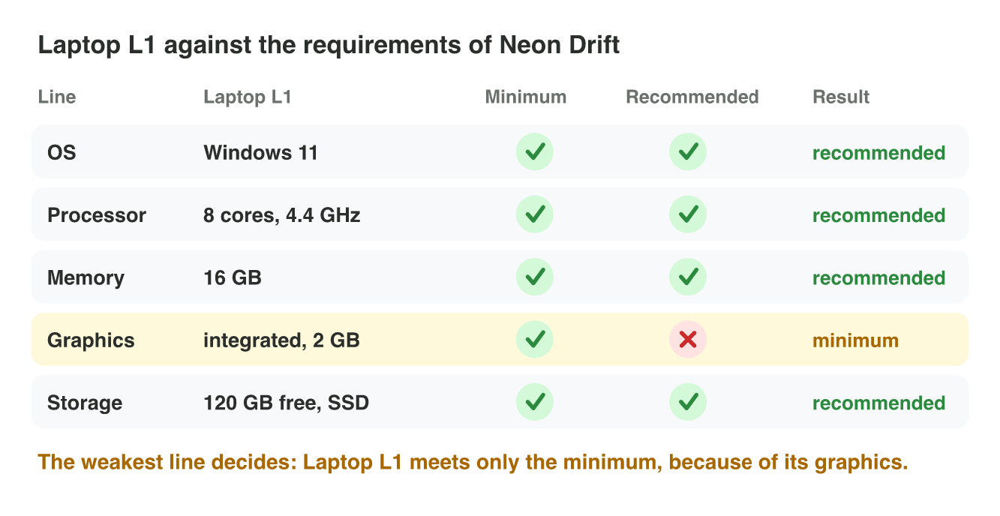
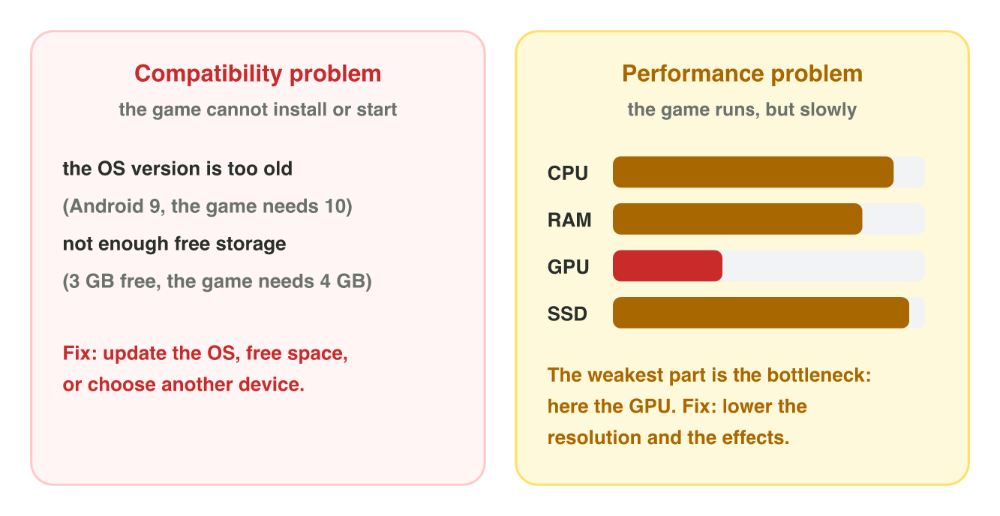

No new ideas today: two short problems on Lectures 2 and 3. Do each one
alone. Tap, sort or type your answer at every step: the page checks it at
once and tells you why.

## Recall

- The **GPU** draws the pixels. An integrated GPU shares the RAM; a
  graphics card has its own video memory (VRAM).
- 1080p has about twice the pixels of 720p: about half the frame rate.
- Higher textures need more video memory; shadows lower the frame rate.

::: {.callout-tip title="Try it 1 · Recall"}
Choose the right answer.

::: {.match extra="the CPU|240 fps"}
Which part colours the pixels of a frame?
:   the GPU

    Why: The GPU draws the picture with many small cores.

A game runs at 120 fps at 720p. About how fast at 1080p?
:   about 60 fps

    Why: Twice the pixels give about half the frame rate.

Where does an integrated GPU keep its textures?
:   in the main RAM

    Why: It has no video memory of its own.
:::
:::

## Activity 1 · Does Neon Drift run here?

A store page lists the **system requirements** of a game. **Minimum:** the
game runs at low settings. **Recommended:** it runs well. Compare each line
with the same line of the spec sheet. **The weakest line decides** the
level of the whole device.

*Neon Drift* for PC: minimum 4 cores at 2.5 GHz, 8 GB RAM, 2 GB video
memory, 20 GB free; recommended 6 cores at 3.5 GHz, 16 GB RAM, a graphics
card with 6 GB, 20 GB free on an SSD.

{width=86%}



::: {.callout-note title="Activity 1 · The lab computer · 15 min"}
1. In **Spec Check**, choose **My lab computer**. Enter its values (from
   Settings → System → About and Task Manager → Performance).
2. Write the level of the lab computer and its weakest line.

*Your product:* one level and one weakest line.

One lab computer has 6 cores at 3.2 GHz, 16 GB of RAM, an integrated GPU
with 2 GB, and 200 GB free on an SSD.

::: {.sort}
Step 1: which level does each line of this lab computer reach? Sort them.

Recommended
:   RAM: 16 GB

    Why: Recommended needs 16 GB of RAM.

:   Storage: 200 GB free on an SSD

    Why: 20 GB free on an SSD is enough for recommended.

Minimum
:   CPU: 6 cores at 3.2 GHz

    Why: 6 cores, but recommended needs 3.5 GHz; minimum needs 2.5 GHz.

:   GPU: integrated, 2 GB

    Why: Minimum needs 2 GB; recommended needs a graphics card with 6 GB.
:::

::: {.choice}
Step 2: which level does this lab computer reach?

- [x] the minimum

  Why: The weakest line decides: the CPU and the GPU reach only the minimum.

- [ ] recommended

  Why: Two lines are recommended, but the weakest line decides.

- [ ] too low for the game

  Why: Every line reaches at least the minimum.
:::
:::

::: {.callout-tip title="Try it 2 · The weakest line"}
Laptop L1: 8 cores, 4.4 GHz; 16 GB; GPU inside the processor, 2 GB; 120 GB
free, SSD. Old PC O1: 4 cores, 3.0 GHz; 4 GB RAM; graphics card, 2 GB;
60 GB free. Choose the right answer.

::: {.match extra="the processor|recommended"}
Which line holds Laptop L1 back?
:   graphics

    Why: 2 GB inside the processor is only the minimum.

Which level does Old PC O1 reach?
:   below minimum

    Why: 4 GB of RAM is less than the minimum 8 GB.

A PC meets only the minimum. How does the game run?
:   at low settings

    Why: Minimum means it runs, but not well.
:::
:::

## Activity 2 · Compatibility or performance?

A **compatibility problem** stops the game from installing or starting:
the OS is too old, or the free storage is too small. More power does not
help. A **performance problem** makes the game slow. The weakest part is
the **bottleneck**: when it is the GPU, lower the resolution and the
shadows.

{width=86%}

::: {.callout-note title="Activity 2 · Your phone · 15 min"}
1. Open the store page of a game you play. **Android:** About this game →
   Requires Android. **iPhone:** Information → Compatibility. Write the OS
   version it needs and its size. Compare them with your phone.
2. A friend's phone runs the game at 25 fps, and the GPU is the
   bottleneck. Write two settings to lower.

*Your product:* a comparison with numbers, and two settings.

One store page says: Requires Android 8.0 and up, 180 MB. Ali's phone has
Android 13 and 12 GB free.

::: {.choice}
Step 1: is there a compatibility problem on Ali's phone?

- [x] No: Android 13 is newer than 8.0, and 12 GB free is more than 180 MB.

  Why: The OS and the free storage are both enough.

- [ ] Yes: the game needs 180 MB.

  Why: 180 MB is much less than the 12 GB that are free.

- [ ] Yes: Android 13 is too new.

  Why: "8.0 and up" includes every newer version.
:::

::: {.sort}
Step 2: the GPU is the bottleneck at 25 fps. Which changes help? Sort them.

Helps the GPU
:   a lower resolution

    Why: Fewer pixels: less work for the GPU.

:   shadows off

    Why: Shadows are extra work for the GPU.

Does not help
:   more free storage

    Why: Storage does not draw pixels; it is not a compatibility problem here.

:   a faster Wi-Fi network

    Why: The network does not draw the frames.
:::
:::

::: {.callout-tip title="Try it 3 · Which problem?"}
Choose the right answer. You can use an answer more than once.

::: {.match extra="buy more RAM"}
A phone has Android 9. The game needs Android 10.
:   a compatibility problem

    Why: An old OS cannot install the game at all.

The game runs, but at 25 fps.
:   a performance problem

    Why: It runs, only too slowly.

The GPU is the bottleneck. What helps first?
:   lower the resolution and the shadows

    Why: Fewer pixels and no shadows mean less work for the GPU.

The phone has 3 GB free. The game needs 4 GB.
:   a compatibility problem

    Why: Without enough free storage it cannot install.
:::
:::

## At home · Task with AI

::: {.callout-note .ai-task title="Task with AI · Five test phones by level"}
An extra for the curious: let an AI assistant make the table. Copy the
prompt into an AI assistant that the university allows (for example
Microsoft Copilot with your university account), and look at the result.

::: {.prompt}
A mobile game runs with at least Android 10 and 4 GB of RAM (the minimum).
It runs best with Android 12 and 6 GB of RAM (recommended). Make a table of
five test phones with the columns phone, Android version, RAM and level
(too old, minimum or recommended). Colour the level red for too old, yellow
for minimum and green for recommended. Phone A: Android 9, 3 GB. Phone B:
Android 10, 4 GB. Phone C: Android 12, 6 GB. Phone D: Android 14, 8 GB.
Phone E: Android 11, 6 GB.
:::

::: {.choice}
Which colours should the table show? The AI can be wrong: compare.

- [x] A red, B yellow, C and D green, E yellow

  Why: E has 6 GB of RAM, but Android 11 is under 12: only the minimum.

- [ ] A red, B yellow, C, D and E green

  Why: Recommended needs both: Android 12 and 6 GB; E has Android 11.
:::

::: {.try-change}
**Change:** give Phone B only 3 GB of RAM, and ask again.

::: {.choice}
What changes?

- [x] B turns red: it needs both Android 10 and 4 GB of RAM.

  Why: With 3 GB it does not reach the minimum.

- [ ] B stays yellow: Android 10 is enough.

  Why: The minimum needs the OS and the RAM.
:::
:::

::: {.try-change}
**Change:** make the recommended version Android 11, and ask again.

::: {.choice}
What changes?

- [x] E turns green: three phones are green now.

  Why: Android 11 and 6 GB meet the new recommended level.

- [ ] Nothing changes.

  Why: E now meets the recommended level.
:::
:::

**Your own idea:** change one more number or word, and look again. The AI
can be wrong: compare its result with the answers.
:::

## Wrap-up {.summary}

- You can compare a device with the requirements of a game line by line and
  find its weakest line.
- You can tell a compatibility problem from a performance problem, and
  choose settings for a slow game.
