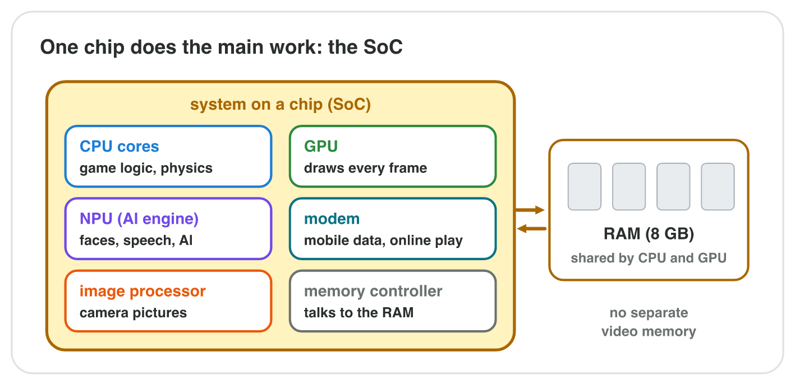
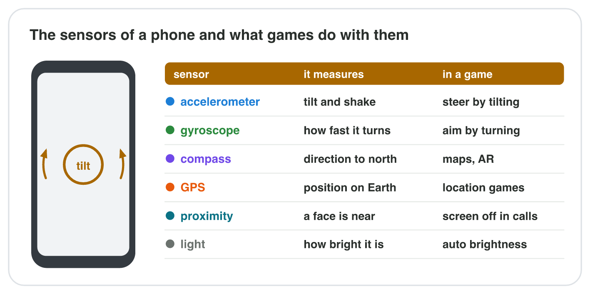
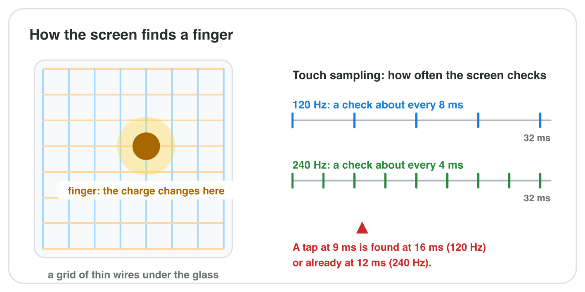
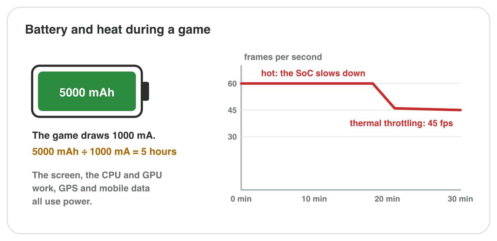

Each section: a question from a game studio, the idea, a **Do it** task and a short **Try it**.
The page checks every answer at once and tells you why. More examples
and exercises are in the lesson notes (PDF).

## Key terms



## 4.1 Why a phone has one main chip: the SoC

- A phone has no room for a graphics card and no fan. Its main parts sit on
  **one chip**: the **system on a chip (SoC)**.
- On a spec sheet, the SoC is the **Chipset** line.
- Its parts: **CPU cores** (game logic), **GPU** (draws every frame),
  **modem** (mobile data), **image processor** (camera) and the **memory
  controller** (talks to the RAM).
- The RAM sits next to the SoC. The CPU and the GPU **share** it: no
  separate video memory.

{width=92%}

::: {.callout-warning title="Watch out!"}
"8 cores" does not tell how strong the GPU is. For games, the GPU part of
the SoC often matters more.
:::



::: {.callout-note title="Do it · The SoC of your phone"}
Two spec lines: "Galaxy A55, Exynos 1480, Samsung" and "iPhone 13, A15
Bionic, Apple". (Your own phone: Settings → About.)

::: {.sort}
What is each word of the two spec lines? Sort them.

The model of the phone
:   Galaxy A55

    Why: The name of the phone, from Settings → About phone.

:   iPhone 13

    Why: The Model Name in Settings → General → About.

The SoC
:   Exynos 1480

    Why: The Chipset line: the main chip of the Galaxy A55.

:   A15 Bionic

    Why: The Chip line of the iPhone 13.

The company that made the SoC
:   Samsung

    Why: Samsung makes the Exynos chips.

:   Apple

    Why: Apple makes the A chips of the iPhone.
:::
:::

::: {.callout-tip title="Try it 1 · Inside the SoC"}
Choose the part of the SoC that does the job.

::: {.match extra="the power supply|the hard disk"}
It draws every frame of the racing game.
:   the GPU

    Why: The GPU draws the pictures.

Where does the GPU of a phone keep its textures?
:   in the RAM it shares with the CPU

    Why: A phone has no separate video memory.
:::
:::

## 4.2 How the phone feels the player: sensors

- A **sensor** measures something in the world and turns it into numbers.
- **Accelerometer:** feels acceleration and gravity, so it shows the
  **tilt** and a **shake**. Flat on a table: z ≈ 9.8, x and y ≈ 0.
- **Gyroscope:** shows how fast the phone **turns** (degrees per second). It
  reads 0 when the phone is still, even when it is tilted.
- **GPS:** the position on Earth. **Compass:** the direction to north.

{width=92%}

::: {.callout-warning title="Watch out!"}
The gyroscope does not show the tilt; the accelerometer does. Many cheap
phones have no gyroscope.
:::



::: {.callout-note title="Do it · Your phone's sensors in Tilt Lab"}
In **Tilt Lab**, use the pad (on a phone: **Use the sensors**). Lay the phone
flat, then tilt it and hold still, then turn it quickly.

::: {.choice}
The phone lies flat on a table. What does the accelerometer show?

- [x] x = 0, y = 0 and z = 9.8

  Why: Flat, gravity pulls straight through the screen: all of it is in z.

- [ ] x = 9.8, y = 0 and z = 0

  Why: x gets a part of gravity only when the phone is tilted.

- [ ] 0 in every direction

  Why: The accelerometer always feels gravity, 9.8 m/s².
:::
:::

::: {.callout-tip title="Try it 2 · Which sensor?"}
Choose the sensor.

::: {.match extra="the light sensor"}
A racing game: the player steers by tilting the phone.
:   the accelerometer

    Why: The accelerometer measures the tilt.

A shooter: the player aims by turning the phone.
:   the gyroscope

    Why: The gyroscope measures the turning.
:::
:::

## 4.3 How the screen feels a finger

- A **capacitive touch screen** has a grid of thin wires under the glass.
- The finger changes the electric charge where it touches. A controller
  finds the place and sends the position to the game.
- Cloth carries no charge: a normal glove does not work.
- **Touch sampling rate:** how often the screen checks for touches. 120 Hz:
  about every 8 ms. 240 Hz: about every 4 ms.

{width=92%}

::: {.callout-warning title="Watch out!"}
A 120 Hz screen does not mean 120 Hz touch. They are two different numbers.
:::

::: {.callout-note title="Do it · Test your touch screen"}
In a drawing app, try a fingertip, a fingernail, the back of a pencil and a
paper tissue.

::: {.sort}
Does the screen feel it? Sort them.

Works
:   a fingertip

    Why: The screen feels the electric charge of the skin.

Does not work
:   a fingernail

    Why: A nail does not carry the charge.

:   the back of a pencil

    Why: Wood carries no charge.

:   a paper tissue

    Why: Paper carries no charge.

:   a normal glove

    Why: Cloth carries no charge.
:::
:::

::: {.callout-tip title="Try it 3 · The touch screen"}
Choose the right answer.

::: {.match extra="the GPU is too slow|about every 1 ms"}
Why does a normal glove not work on the screen?
:   cloth does not carry the finger's charge

    Why: The screen feels the electric charge of the finger.

At 240 Hz, how often does the screen check for touches?
:   about every 4 ms

    Why: 1000 ms ÷ 240 is about 4 ms.
:::
:::

## 4.4 How long can the player play? Battery and heat

- **Battery capacity** in mAh; the game draws a **current** in mA.
- **Play time ≈ capacity ÷ current:** 5000 mAh ÷ 1000 mA = **5 hours**;
  5000 ÷ 500 = 10 hours.
- The SoC turns power into heat. With no fan, a hot SoC slows down:
  **thermal throttling** (lecture 3). 60 fps can fall to 45 fps.
- Games offer a "30 fps (battery saver)" setting: less work, less heat,
  longer play.

{width=92%}

::: {.callout-warning title="Watch out!"}
A bigger mAh number does not make a phone faster. It only means more charge.
:::



::: {.callout-note title="Do it · Battery use on your phone"}
In **Battery Lab**, find settings for at least 6 hours with 5000 mAh, with a
cool phone.

::: {.sort}
Which settings give a longer play time? Sort them.

Longer play
:   30 fps (battery saver)

    Why: Fewer frames: less work, less heat.

:   a darker screen

    Why: The display uses less power.

:   Wi-Fi instead of mobile data

    Why: The mobile radio uses more power than Wi-Fi.

Shorter play
:   120 fps and high graphics

    Why: The most work for the SoC: more power and more heat.

:   GPS on all the time

    Why: A radio that is always on uses power.
:::
:::

::: {.callout-tip title="Try it 4 · Battery and heat"}
Choose the right answer.

::: {.match extra="10 hours|the phone gets faster"}
A phone has 5000 mAh. A game draws 1000 mA. About how long can the player play?
:   5 hours

    Why: 5000 ÷ 1000 = 5.

After 20 minutes the SoC is hot. What happens?
:   it slows down: thermal throttling

    Why: Without a fan, a hot SoC slows itself down.
:::
:::

## Game challenge: Marble Peak {.challenge}

Work alone. Use every section of today.

*Byte Bay* tests *Marble Peak* on the test phone T1: 8 CPU cores and a GPU,
a 5000 mAh battery, an accelerometer, a gyroscope, a compass and GPS. The
game reads the **accelerometer** to roll the marble. At 60 fps it draws
1000 mA. After 20 minutes the SoC is hot, and the game falls to 45 fps.



::: {.callout-tip title="Try it 5 · The test phone T1"}
T1: 8 cores, GPU; 5000 mAh; accelerometer, gyroscope, compass, GPS. Marble
Peak: 1000 mA at 60 fps; after 20 minutes, 45 fps and a hot phone. Choose the
right answer. The last question is harder.

::: {.match extra="the GPS|8 hours"}
Which sensor rolls the marble?
:   the accelerometer

    Why: Marble Peak reads the tilt from the accelerometer.

Which part of the SoC draws the mountain and the marble?
:   the GPU

    Why: The GPU draws every frame.

Why does the game fall to 45 fps after 20 minutes?
:   the hot SoC slows down (thermal throttling)

    Why: The hot SoC slows itself down.
:::
:::

## Summary {.summary}

- The SoC holds the CPU cores, the GPU and the modem; they share the RAM.
- The accelerometer shows tilt, the gyroscope turning, the GPS position.
- The touch screen finds the finger's charge, many times a second.
- Play time ≈ battery capacity (mAh) ÷ current (mA).
- A hot SoC slows down (thermal throttling); 30 fps saves power and heat.
