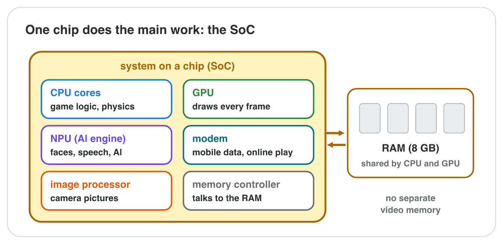
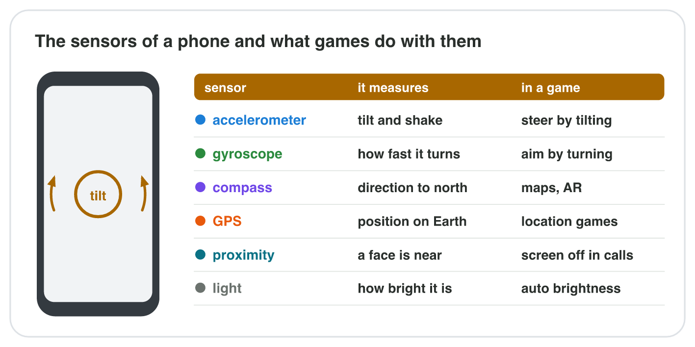
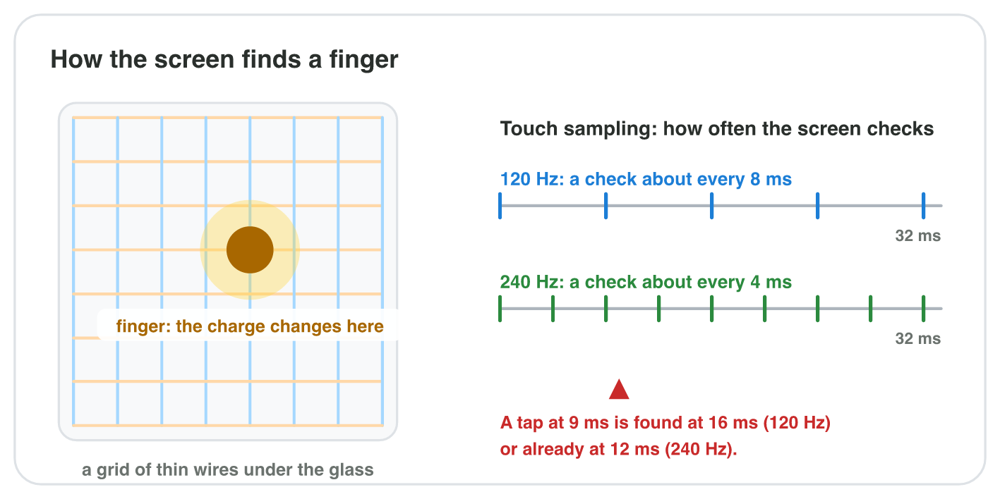
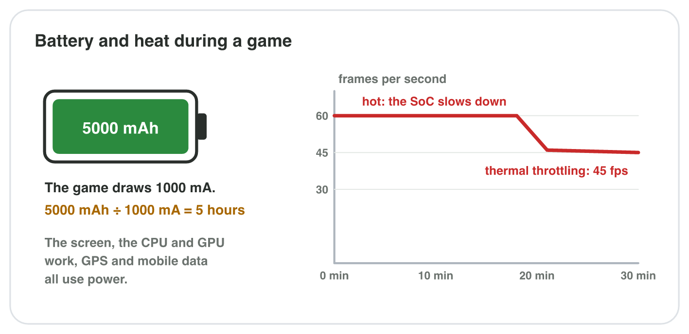

This page is the interactive version of the lesson notes (PDF). Each section
starts with a problem in a game studio. Then it explains one part of the
phone. It ends with a **Do it** task (in a simulator or on your phone) and
one set of questions. Every question on this page has its answer: try first,
then check.

## Key terms



## 4.1 Why a phone has one main chip: the SoC

- A phone has no room for a graphics card and no fan. Its main parts sit on
  **one chip**: the **system on a chip (SoC)**.
- On a spec sheet, the SoC is the **Chipset** line (Seminar 2).
- Its parts: **CPU cores** (game logic, physics), **GPU** (draws every
  frame), **modem** (mobile data, online play), **image processor**
  (camera), **memory controller** (talks to the RAM).
- The RAM sits next to the SoC. The CPU and the GPU **share** it: no
  separate video memory.

{width=92%}

::: {.callout-warning title="Watch out!"}
"8 cores" does not tell how strong the GPU is. For games, the GPU part of
the SoC often matters more.
:::



::: {.callout-note title="Do it · The SoC of your phone"}
**Android:** Settings → About phone (look for Processor or Chipset; if it is
not there, search the model on the maker's website). **iPhone:** Settings →
General → About → Model Name; Apple's website lists the chip of each model.
Write the model, the SoC and the company that made it.

::: {.check}
A good answer names the model, the SoC and its maker, for example "Galaxy
A55, Exynos 1480, Samsung" or "iPhone 13, A15 Bionic, Apple". Check: the SoC
is the Chipset (or Chip) line of the maker's spec page.
:::
:::

::: {.callout-tip title="Try it 1 · Inside the SoC"}
Choose the part of the SoC that does the job.

::: {.match extra="the power supply|the hard disk"}
It draws every frame of the racing game.
:   the GPU

    Why: The GPU draws the pictures.

It moves the enemies and checks the rules.
:   the CPU cores

    Why: The game logic runs on the CPU cores.

It sends the score to the online leaderboard over 4G.
:   the modem

    Why: The modem sends mobile data.

It moves the textures from the RAM to the GPU.
:   the memory controller

    Why: The memory controller moves data to and from the RAM.

Where does the GPU of a phone keep its textures?
:   in the RAM it shares with the CPU

    Why: A phone has no separate video memory.
:::
:::

## 4.2 How the phone feels the player: sensors

- A **sensor** measures something in the world and turns it into numbers.
- **Accelerometer:** feels acceleration and gravity, so it shows the
  **tilt** and a **shake**. Flat on a table: z ≈ 9.8, x and y ≈ 0.
- **Gyroscope:** shows how fast the phone **turns** (degrees per second). It
  reads 0 when the phone is still, even when it is tilted.
- **GPS:** the position on Earth. **Compass:** the direction to north.
  **Proximity, light, camera, microphone** are sensors too.
- Games: steer by tilting → accelerometer; aim by turning → gyroscope;
  shake to roll the dice → accelerometer; city treasure hunt → GPS; AR pet →
  camera + gyroscope + accelerometer.

{width=92%}

::: {.callout-warning title="Watch out!"}
The gyroscope does not show the tilt; the accelerometer does. Many cheap
phones have no gyroscope: a game that needs one cannot run there.
:::



::: {.callout-note title="Do it · Your phone's sensors in Tilt Lab"}
Open **Tilt Lab** on your phone and press **Use the sensors** (or use the
pad). Lay the phone flat and write x, y, z. Tilt it to the left and hold
still: write x and the gyroscope. Then turn it quickly: what does the
gyroscope show?

::: {.check}
When you tilt the phone, the accelerometer values change and stay changed
while you hold it tilted. When you turn the phone, the gyroscope values move
and go back to about 0 when it stops turning.
:::
:::

::: {.callout-tip title="Try it 2 · Which sensor?"}
Choose the sensor. You can use an answer more than once.

::: {.match extra="the light sensor"}
A racing game: the player steers by tilting the phone.
:   the accelerometer

    Why: The accelerometer measures the tilt.

A shooter: the player aims by turning the phone.
:   the gyroscope

    Why: The gyroscope measures the turning.

A treasure hunt on the streets of the city.
:   the GPS

    Why: The GPS finds the place on the map.

"Shake the phone to roll the dice."
:   the accelerometer

    Why: The accelerometer feels the shaking.

A tilted phone lies still on a book. Which sensor reads 0?
:   the gyroscope

    Why: The gyroscope measures turning; a still phone does not turn.
:::
:::

## 4.3 How the screen feels a finger

- A **capacitive touch screen** has a grid of thin wires under the glass.
- The finger changes the electric charge where it touches. A controller
  finds the place and sends the position to the game.
- Cloth carries no charge: a normal glove does not work. A wet screen can
  confuse the grid.
- **Touch sampling rate:** how often the screen checks for touches. 120 Hz:
  about every 8 ms. 240 Hz: about every 4 ms.
- **Refresh rate** (lecture 3): how often the picture changes. Many phones
  read touches twice as often as they draw (60 Hz picture, 120 Hz touch).

{width=92%}

::: {.callout-warning title="Watch out!"}
A 120 Hz screen does not mean 120 Hz touch. They are two different numbers.
:::

::: {.callout-note title="Do it · Test your touch screen"}
In a drawing or notes app, try a fingertip, a fingernail, the back of a
pencil and a paper tissue: which work? Then find the refresh rate setting
(Android: Settings → Display → Motion smoothness, Smooth display or Refresh
rate; iPhone: no setting).

::: {.check}
Only the fingertip works: the screen feels the electric charge of the skin,
and a nail, a pencil or a tissue does not carry it. Many Android phones offer
60 Hz and 90 or 120 Hz (Smooth display); an iPhone has no setting.
:::
:::

::: {.callout-tip title="Try it 3 · The touch screen"}
Choose the right answer.

::: {.match extra="the GPU is too slow|about every 1 ms"}
Why does a normal glove not work on the screen?
:   cloth does not carry the finger's charge

    Why: The screen feels the electric charge of the finger.

What is under the glass of a capacitive touch screen?
:   a grid of thin wires

    Why: A grid of thin wires finds the charge of the finger.

At 240 Hz, how often does the screen check for touches?
:   about every 4 ms

    Why: 1000 ms ÷ 240 is about 4 ms.

A phone has 60 Hz and 120 Hz on its sheet. Which number is the touch sampling rate?
:   120 Hz

    Why: The touch sampling rate is the higher number.
:::
:::

## 4.4 How long can the player play? Battery and heat

- **Battery capacity** in mAh; the game draws a **current** in mA.
- **Play time ≈ capacity ÷ current:** 5000 mAh ÷ 1000 mA = **5 hours**;
  5000 ÷ 500 = 10 hours.
- Power goes to the **screen** (brightness, refresh rate), the **SoC**
  (frame rate, graphics) and the **radios** (mobile data, GPS).
- The SoC turns power into heat. With no fan, a hot SoC slows down:
  **thermal throttling** (lecture 3). 60 fps can fall to 45 fps.
- Games offer a "30 fps (battery saver)" setting: less work, less heat,
  longer play.

{width=92%}

::: {.callout-warning title="Watch out!"}
A bigger mAh number does not make a phone faster. It only means more charge.
:::



::: {.callout-note title="Do it · Battery use on your phone"}
Android: **Settings → Battery → Battery usage**. iPhone: **Settings →
Battery**. Which three apps used the most battery today? Then, in **Battery
Lab**, find settings for at least 6 hours with 5000 mAh, with a cool phone.

::: {.check}
A good answer names three apps from the battery list (games and video apps
are often at the top). In Battery Lab, 6 hours or more need less power, for
example 30 fps, a darker screen and Wi-Fi instead of mobile data; the phone
stays cool with fewer frames.
:::
:::

::: {.callout-tip title="Try it 4 · Battery and heat"}
Choose the right answer. You can use an answer more than once.

::: {.match extra="10 hours|the phone gets faster"}
A phone has 5000 mAh. A game draws 1000 mA. About how long can the player play?
:   5 hours

    Why: 5000 ÷ 1000 = 5.

A phone has 4500 mAh. A game draws 900 mA. About how long?
:   5 hours

    Why: 4500 ÷ 900 = 5.

After 20 minutes the SoC is hot. What happens?
:   it slows down: thermal throttling

    Why: Without a fan, a hot SoC slows itself down.

Which setting saves the most battery and heat in a game?
:   a lower frame rate (30 fps)

    Why: Fewer frames mean less work for the SoC.

Does a bigger mAh number make a phone faster?
:   no, it only holds more charge

    Why: mAh measures charge, not speed.
:::
:::

## Game challenge: Marble Peak {.challenge}

Work alone. Use every section of today.

*Byte Bay* tests *Marble Peak* on the test phone T1: chipset with 8 CPU
cores (up to 3.0 GHz) and a GPU; 8 GB of RAM; a 120 Hz screen with a
touch sampling rate of 240 Hz; a 5000 mAh battery; sensors: accelerometer,
gyroscope, compass and GPS. The game reads the **accelerometer** to roll the
marble. At 60 fps with a bright screen it draws 1000 mA. After 20 minutes
the SoC is hot, and the game falls to 45 fps.



::: {.callout-tip title="Try it 5 · The test phone T1"}
T1: 8 cores, GPU; 8 GB RAM; 120 Hz screen, 240 Hz touch; 5000 mAh;
accelerometer, gyroscope, compass, GPS. Marble Peak: 1000 mA at 60 fps.
Choose the right answer.

::: {.match extra="the GPS|8 hours"}
Which sensor rolls the marble?
:   the accelerometer

    Why: Marble Peak reads the tilt from the accelerometer.

How long does the battery of T1 last in Marble Peak?
:   about 5 hours

    Why: 5000 mAh ÷ 1000 mA = 5 hours.

Which part of the SoC draws the mountain and the marble?
:   the GPU

    Why: The GPU draws every frame.

How often does T1 check for touches?
:   240 times per second

    Why: T1 has a touch sampling rate of 240 Hz.
:::
:::

::: {.callout-tip title="Try it 6 · Problems in the test (harder)"}
Marble Peak on T1: 60 fps, 1000 mA, 5000 mAh. After 20 minutes: 45 fps and a
hot phone. Choose the right answer.

::: {.match extra="the battery is too small|add more CPU cores"}
Why does the game fall to 45 fps after 20 minutes?
:   the hot SoC slows down (thermal throttling)

    Why: The hot SoC slows itself down.

What can Byte Bay add to keep the phone cooler?
:   a 30 fps battery saver setting

    Why: 30 fps means less work and less heat.

A tester's phone has no gyroscope. Can the tester play Marble Peak?
:   yes, it uses the accelerometer

    Why: Marble Peak needs only the accelerometer.

The game drops to 500 mA in battery saver mode. How long does T1 last now?
:   10 hours

    Why: 5000 ÷ 500 = 10 hours.

A tester plays with thick winter gloves. What happens at a tap on "Pause"?
:   nothing: the screen does not feel the glove

    Why: The screen does not feel the charge through the glove.
:::
:::

## Summary {.summary}

- The SoC holds the CPU cores, the GPU, the modem and more; the RAM next to it is shared.
- Sensors feel the player: the accelerometer shows tilt, the gyroscope shows turning, the GPS shows position.
- A capacitive touch screen finds the finger's charge; the touch sampling rate says how often it checks.
- Play time ≈ battery capacity (mAh) ÷ current (mA).
- A hot SoC slows down (thermal throttling); a lower frame rate saves power and heat.
