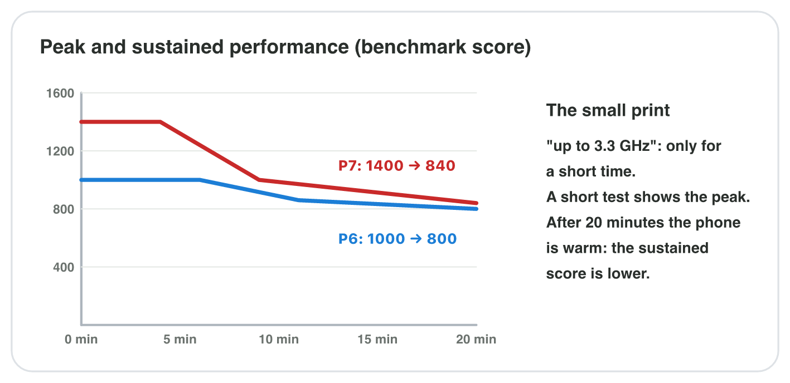

## Keywords



## 8.1 Read the sheet like a developer

:::: {.columns}
::: {.column width="50%"}
- A developer reads the lines that change how a game runs.
- These lines are the chipset, the RAM, the display, the touch sampling, the battery, the OS and the sensors.
- The camera, the weight and the colours rarely change a game.
- **Do it:** Find the full sheet of your phone online. Which line does not matter for most games?
:::
::: {.column width="50%"}

:::
::::

## Live demo · Sheet Filter



## Try it 1 · Which lines matter?

a) Which line of the sheet tells how fast the GPU is?
b) Which line tells if a game can be installed at all?
c) For which games does the main camera matter?

::: {.answer}
a) the chipset
b) the OS version
c) AR and photo games
:::

## 8.2 Which phone suits which game?

:::: {.columns}
::: {.column width="50%"}
- Each game loads the phone in its own way.
- A rhythm game needs fast touch, and an AR game needs a gyroscope and a camera.
- A big 3D world needs a strong GPU, much RAM and free storage.
- **Do it:** Use your phone's sheet. For which kind of game is your phone weakest, and why?
:::
::: {.column width="50%"}

:::
::::

## Byte Bay's three test phones

| | P5 | P6 | P7 |
|---|---|---|---|
| Chipset | 2.2 GHz, basic GPU | 2.8 GHz, mid-range GPU | 3.3 GHz, top GPU |
| RAM | 4 GB | 8 GB | 12 GB |
| Display, touch | 60 Hz, 120 Hz | 120 Hz, 240 Hz | 120 Hz, 480 Hz |
| Battery | 5000 mAh | 5000 mAh | 4500 mAh |
| Gyroscope | no | yes | yes |

## Example · Three games, three phones

The facts are in the table of the three test phones.
**Which phone shows the problems of each game, and why?**

::: {.reveal}
1. In the rhythm game, the taps of **P5** arrive latest, because it checks touches only at 120 Hz.
2. The AR pet game cannot run on **P5**, because P5 has no gyroscope.
3. The 3D world needs 8 GB of RAM, so the RAM of **P5** (4 GB) is the bottleneck.
:::

## Try it 2 · Phone and game

The facts: P5 has 4 GB of RAM and no gyroscope. P7 has a 4500 mAh battery and touch at 480 Hz.

a) An AR pet game needs a gyroscope. Which phone cannot run it?
b) Which of the three phones has the smallest battery?
c) Why should Byte Bay not test only on P7?

::: {.answer}
a) P5
b) P7
c) P7 hides the problems that most players will meet.
:::

## 8.3 Reading the small print

:::: {.columns}
::: {.column width="50%"}
- "Up to 3.3 GHz" is reached only for a short time, while the chip is cool.
- A benchmark runs the same work on every phone and gives a score.
- A short test shows the peak, and a long test shows the sustained performance.
- **Do it:** Play a game for 10 minutes. How much battery did it use, and how long would the full battery last?
:::
::: {.column width="50%"}

:::
::::

## Example · A 30-minute match

Byte Bay runs a benchmark for 20 minutes. P6 goes from 1000 to 800, and P7 goes from 1400 to 840.
**Which phone is faster in a long match?**

::: {.reveal}
1. P6 keeps 80 % of its peak, and P7 keeps only 60 %.
2. After 20 minutes, P7 scores 840 and P6 scores 800.
3. P7 is still **a little faster**, but not 40 % faster, as the peak scores suggest.
:::

## Try it 3 · The small print

a) What does "up to 3.3 GHz" on a sheet mean?
b) Why is "22 hours of video" no help when a player plays a game?
c) A game draws 900 mA on P7 with 4500 mAh. About how long can the player play?

::: {.answer}
a) The fastest core reaches it only for a short time, while the chip is cool.
b) A game needs much more power than a video.
c) about 5 hours
:::

## Game challenge · Test phones for Beat Lane



## Try it 4 · Beat Lane (harder)

The facts: Beat Lane needs fast taps and a steady 60 fps for 30 minutes. P5 has touch at 120 Hz. P6 scores 1000 → 800 and P7 scores 1400 → 840 after 20 minutes.

a) On which phone do the taps reach Beat Lane latest, and why?
b) Which phone is faster after 20 minutes of play?
c) Which number should the producer compare for a 30-minute match?

::: {.answer}
a) P5, because of its touch sampling rate of 120 Hz
b) P7, a little (840 against 800)
c) the sustained score
:::

## Summary

- A developer reads the chipset, RAM, display, touch, battery, OS and sensors lines first.
- The camera, the weight and the colours rarely change how a game runs.
- Each type of game needs other lines of the sheet.
- "Up to" values and short tests show only the peak.
- A good test plan uses a weak, a typical and a strong phone.
