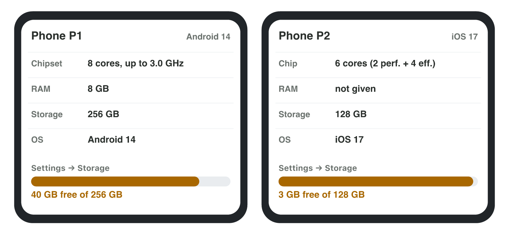
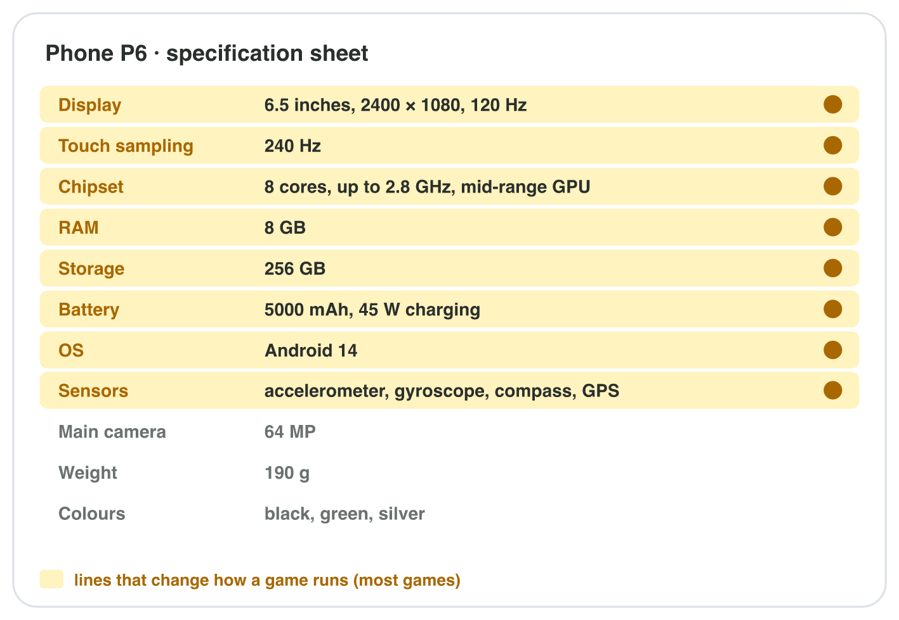
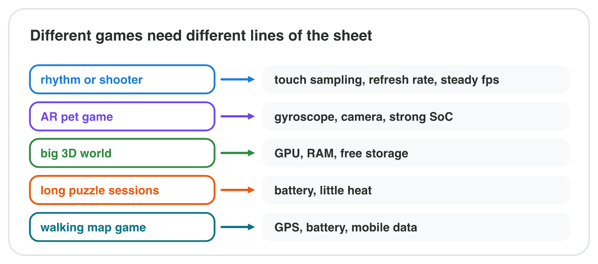

No new ideas today: you read the spec sheets of real phones with what you
learned in Lecture 4. Do each activity alone, then open "Check your result".
Every question on this page has its answer: try first, then check.

## Recall

- A phone's main chip is the **SoC**: CPU cores, GPU, modem and more. On a
  spec sheet it is the **Chipset** (or Chip) line.
- The CPU and the GPU share the **RAM**; there is no separate video memory.
- Sensors: the **accelerometer** (tilt), the **gyroscope** (turning), the
  **GPS** (position). Battery: play time ≈ mAh ÷ mA.

::: {.callout-tip title="Try it 1 · Recall"}
Choose the right answer.

::: {.match extra="the compass|2 hours"}
A game steers by turning the phone. Which sensor does it need?
:   the gyroscope

    Why: the gyroscope measures turning.

Which line of a phone sheet holds the CPU cores and the GPU?
:   the Chipset

    Why: the SoC is the Chipset line.

5000 mAh and a game that draws 500 mA. About how long?
:   10 hours

    Why: 5000 ÷ 500.
:::
:::

## Activity 1 · The spec sheet of your phone

On a phone sheet, the processor line is often called **Chipset** or
**Chip**. **RAM** and **Storage** are in GB; Apple does not print the RAM of
an iPhone. The **OS** line gives the system and its version. The capacity is
not the free space: the phone shows the free space in Settings → Storage.

{width=86%}

::: {.callout-note title="Activity 1 · Four lines · 10 min"}
**Android:** Settings → About phone (model, Android version, RAM if shown),
then Settings → Storage (capacity and free space). **iPhone:** Settings →
General → About (model name, capacity, available, iOS version).

Write a spec sheet of your phone with four lines: model, RAM (or "not
given"), storage (capacity and free), OS.

*Your product:* a spec sheet with four lines.

::: {.check}
A good sheet: "Model: Galaxy A35 · RAM: 6 GB · Storage: 128 GB (41 GB free)
· OS: Android 14", or for an iPhone "Model: iPhone 13 · RAM: not given ·
Storage: 128 GB (22 GB free) · OS: iOS 17". The free space is always less
than the capacity.
:::
:::

::: {.callout-tip title="Try it 2 · Two test phones"}
P1: chipset 8 cores, up to 3.0 GHz; RAM 8 GB; storage 256 GB (40 GB free);
Android 14. P2: chip 6 cores; RAM not given; storage 128 GB (3 GB free);
iOS 17. Choose the right answer.

::: {.match extra="P2, because it has 128 GB|4 GB"}
A 5 GB update must be installed. On which phone does it fit?
:   P1, it has 40 GB free

    Why: P2 has only 3 GB free.

Why is the RAM of P2 not on its sheet?
:   Apple does not print it

    Why: iPhone sheets leave the RAM out.

P2 has 128 GB of storage. How much of it is free?
:   3 GB

    Why: the capacity is not the free space.
:::
:::

## Activity 2 · The lines that matter for a game

An advert shows the camera and the screen size first. A developer reads the
lines that change how a game runs: the **chipset**, the **RAM**, the
**display** (refresh rate) and the **touch sampling rate**, the **battery**,
the **OS**, the free **storage** and the **sensors**. The camera, the weight
and the colour rarely matter.

{width=84%}



::: {.callout-note title="Activity 2 · Six lines · 10 min"}
1. In **Sheet Filter**, keep only the lines that matter for a game.
2. Search the web for "*your phone model* specifications" on the maker's
   site. Copy six lines: chipset, RAM, display (with the refresh rate),
   battery, OS and sensors.
3. Mark one line of the full sheet that does not matter for most games.

*Your product:* six lines and one marked line.

::: {.check}
A good answer has the six lines from the maker's page, for example "Display:
6.6 inches, 120 Hz · Battery: 5000 mAh · Sensors: accelerometer, gyroscope,
compass", and marks the camera, the weight or the colours as not mattering.
:::
:::

::: {.callout-tip title="Try it 3 · Which lines matter?"}
Choose the right answer.

::: {.match extra="the colour|the weight"}
Which line tells how fast the GPU is?
:   the chipset

    Why: the GPU is part of the SoC.

Which line tells if a game can be installed at all?
:   the OS version

    Why: an old OS cannot install a game that needs a newer one.

Which line tells how fast taps reach the game?
:   the touch sampling rate

    Why: it counts how often the screen checks for touches.

For which games does the main camera matter?
:   AR and photo games

    Why: only they use the camera picture.
:::
:::

## Activity 3 · Which phone for which game?

Every game loads the phone in its own way. *Byte Bay* has three test phones:

- **P5:** 8 cores, 2.2 GHz, basic GPU; 4 GB; 20 GB free; 60 Hz, touch
  120 Hz; 5000 mAh; accelerometer and GPS, **no gyroscope**.
- **P6:** 8 cores, 2.8 GHz, mid-range GPU; 8 GB; 90 GB free; 120 Hz, touch
  240 Hz; 5000 mAh; accelerometer, gyroscope, compass, GPS.
- **P7:** 8 cores, 3.3 GHz, top GPU; 12 GB; 300 GB free; 120 Hz, touch
  480 Hz; 4500 mAh; accelerometer, gyroscope, compass, GPS.

{width=84%}

::: {.callout-note title="Activity 3 · Three games · 12 min"}
For each game, choose the phone that will show its problems first, and name
the line that decides.

1. *Sky Rider*: the player steers a glider by turning the phone.
2. *Long Road*: an endless runner that players play for two hours; it draws
   900 mA on every phone.
3. *Castle Builder*: needs 6 GB of RAM and 30 GB of free storage.

*Your product:* three phones, each with its deciding line.

::: {.check}
1. P5: no gyroscope (it cannot run the game at all). 2. P7: the smallest
battery (4500 ÷ 900 = 5 hours). 3. P5: 4 GB RAM and only 20 GB free (both
lines are too small).
:::
:::

::: {.callout-tip title="Try it 4 · Phone and game"}
Use the three test phones above. Choose the right answer. You can use an
answer more than once.

::: {.match extra="all three phones"}
A glider game steers by turning the phone. Which phone cannot run it?
:   P5

    Why: P5 has no gyroscope.

Which phone has the smallest battery?
:   P7

    Why: 4500 mAh, less than 5000.

Which phone has the fastest touch sampling rate?
:   P7

    Why: 480 Hz.

A game needs 30 GB free. Which phone is below it?
:   P5

    Why: it has only 20 GB free.
:::
:::

## Game challenge: test phones for Beat Lane {.challenge}

Work alone. Use every activity of today.

*Byte Bay* will release *Beat Lane*, a rhythm game: the player taps notes to
the music, and a match lasts 30 minutes. It needs a steady 60 fps and fast
taps. The test phones: **P5** (60 Hz, touch 120 Hz, 4 GB RAM, 5000 mAh),
**P6** (120 Hz, touch 240 Hz, 8 GB, 5000 mAh) and **P7** (120 Hz, touch
480 Hz, 12 GB, 4500 mAh). Beat Lane draws 900 mA.



::: {.callout-tip title="Try it 5 · Beat Lane (harder)"}
P5: 60 Hz, touch 120 Hz, 4 GB, 5000 mAh. P6: 120 Hz, touch 240 Hz, 8 GB,
5000 mAh. P7: 120 Hz, touch 480 Hz, 12 GB, 4500 mAh. Beat Lane: 900 mA.
Choose the right answer.

::: {.match extra="the battery|P6"}
On which phone do taps reach Beat Lane latest?
:   P5

    Why: it checks for touches only 120 times per second.

Which line is the reason?
:   the touch sampling rate (and the refresh rate)

    Why: taps and frames come least often on P5.

How long does P7 last in Beat Lane?
:   about 5 hours

    Why: 4500 ÷ 900 = 5.

Which line does not matter for Beat Lane?
:   the main camera

    Why: a rhythm game does not use the camera.
:::
:::

## Wrap-up {.summary}

- You can write the spec sheet of your phone and tell capacity from free space.
- You can find the lines of a phone sheet that matter for a game.
- You can choose the test phone that shows the problems of a game, and the line that decides.
