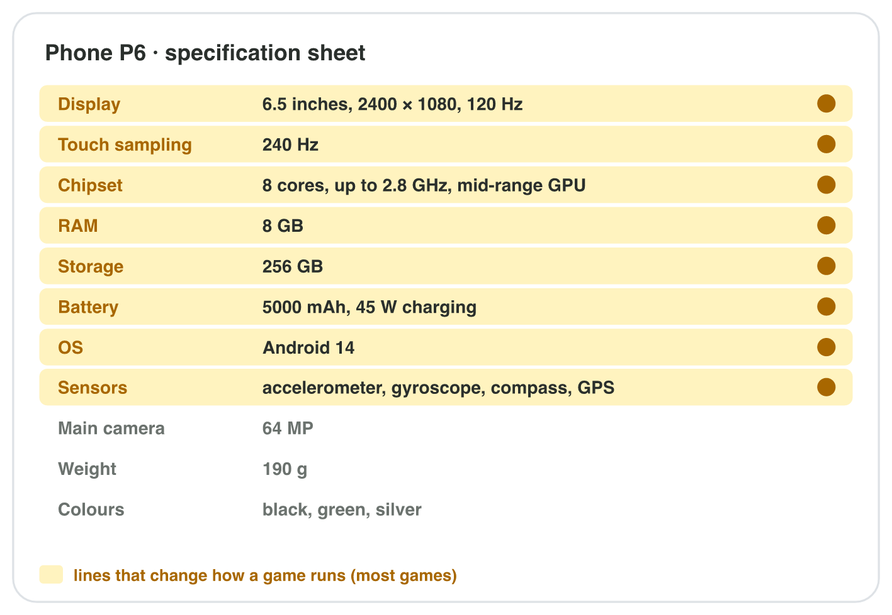
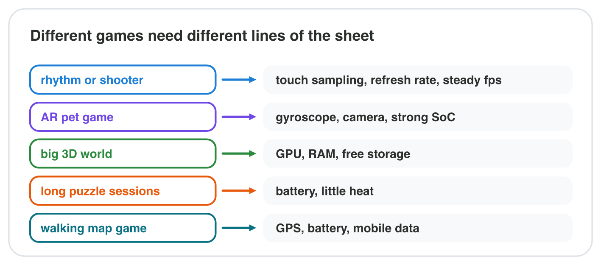

No new ideas today: two short problems on Lecture 4. Do each one alone. Tap,
sort or type your answer at every step: the page checks it at once and tells
you why.

## Recall

- A phone's main chip is the **SoC**: CPU cores, GPU and more. On a spec
  sheet it is the **Chipset** (or Chip) line.
- Sensors: the **accelerometer** (tilt), the **gyroscope** (turning), the
  **GPS** (position). The **touch sampling rate** says how often the screen
  checks for touches.
- Battery: play time ≈ mAh ÷ mA. A hot chip slows down to protect itself.

::: {.callout-tip title="Try it 1 · Recall"}
Choose the right answer.

::: {.match extra="the compass|2 hours"}
A game steers by turning the phone. Which sensor does it need?
:   the gyroscope

    Why: The gyroscope measures turning.

Which line of a phone sheet holds the CPU cores and the GPU?
:   the Chipset

    Why: The SoC is the Chipset line.

5000 mAh and a game that draws 500 mA. About how long?
:   10 hours

    Why: 5000 ÷ 500 = 10.
:::
:::

## Activity 1 · Your phone's sheet: the lines that matter

An advert shows the camera and the screen size first. A developer reads the
lines that change how a game runs: the **chipset**, the **RAM**, the
**display** (refresh rate, touch sampling rate), the **battery**, the
**OS**, the free **storage** and the **sensors**. The capacity is not the
free space: the phone shows the free space in Settings → Storage.

{width=84%}



::: {.callout-note title="Activity 1 · Six lines · 15 min"}
1. In **Sheet Filter**, keep only the lines that matter for a game.
2. Write the sheet of your phone in six lines: chipset, RAM, storage
   (capacity and free), display, battery, OS. **Android:** Settings → About
   phone and Settings → Storage. **iPhone:** Settings → General → About;
   the other lines are on the maker's page.

*Your product:* a sheet with six lines.

::: {.sort}
Step 1: which lines of an advert matter for a game? Sort them.

Matters for a game
:   Chipset: 8 cores, up to 2.4 GHz

    Why: The SoC runs the game: CPU and GPU.

:   RAM: 6 GB

    Why: The game must fit in RAM while it runs.

:   Display: 6.6 inches, 120 Hz

    Why: The refresh rate and touch decide how smooth it feels.

:   Battery: 5000 mAh

    Why: It decides how long the player can play.

Rarely matters
:   Camera: 50 MP

    Why: Most games never use the camera.

:   Colour: blue

    Why: The colour changes nothing in a game.
:::

::: {.choice}
Step 2: the advert says "Storage: 128 GB". Is that the free space?

- [x] No: 128 GB is the capacity; Settings → Storage shows the free space.

  Why: The capacity is not the free space, for example 128 GB with 41 GB free.

- [ ] Yes: the whole 128 GB is free.

  Why: The system and the apps already use part of it.
:::
:::

::: {.callout-tip title="Try it 2 · Which lines matter?"}
Choose the right answer.

::: {.match extra="the colour|the weight"}
Which line tells how fast the GPU is?
:   the chipset

    Why: The GPU is part of the SoC.

Which line tells if a game can be installed at all?
:   the OS version

    Why: An old OS cannot install a game that needs a newer one.

A phone shows "128 GB" and Settings shows "3 GB free". How much can you install?
:   3 GB

    Why: The capacity is not the free space.
:::
:::

## Activity 2 · Which phone for which game?

Every game loads the phone in its own way. *Byte Bay* has three test
phones:

- **P5:** basic GPU; 4 GB RAM; 20 GB free; touch 120 Hz; 5000 mAh;
  accelerometer and GPS, **no gyroscope**.
- **P6:** mid-range GPU; 8 GB; 90 GB free; touch 240 Hz; 5000 mAh;
  accelerometer, gyroscope, GPS.
- **P7:** top GPU; 12 GB; 300 GB free; touch 480 Hz; **4500 mAh**;
  accelerometer, gyroscope, GPS.

{width=84%}

::: {.callout-note title="Activity 2 · Three games · 15 min"}
For each game, choose the phone that will show its problems first, and
name the line that decides.

1. *Sky Rider*: the player steers a glider by turning the phone.
2. *Long Road*: a runner that players play for hours; it draws 900 mA.
3. *Castle Builder*: needs 6 GB of RAM and 30 GB of free storage.

*Your product:* three phones, each with its deciding line.

::: {.sort}
Which phone shows the problems of each game first? Sort the games.

P5
:   Sky Rider: steer by turning the phone

    Why: P5 has no gyroscope, so it cannot run the game at all.

:   Castle Builder: 6 GB of RAM, 30 GB free

    Why: P5 has only 4 GB of RAM and 20 GB free: both lines are too small.

P7
:   Long Road: hours of play at 900 mA

    Why: P7 has the smallest battery, 4500 mAh.
:::

::: {.fill answer="5" unit="hours" hint="4500 mAh ÷ 900 mA."}
Step 2: how many hours can Long Road run on P7?

Why: 4500 ÷ 900 = 5 hours; P5 and P6 have 5000 mAh: about 5.5 hours.
:::
:::

::: {.callout-tip title="Try it 3 · Phone and game"}
Use the three test phones above. Choose the right answer. You can use an
answer more than once.

::: {.match extra="all three phones|P6"}
A glider game steers by turning the phone. Which phone cannot run it?
:   P5

    Why: P5 has no gyroscope.

On which phone do taps reach a rhythm game first?
:   P7

    Why: Its touch sampling rate is the highest: 480 Hz.

How long does P7 last in a game that draws 900 mA?
:   about 5 hours

    Why: 4500 ÷ 900 = 5.

After 20 minutes P6 is hot, and the game gets slower. Why?
:   the hot chip slows down to protect itself

    Why: Heat makes the chip lower its speed.
:::
:::

## Wrap-up {.summary}

- You can write the spec sheet of your phone and find the lines that matter
  for a game.
- You can choose the test phone that shows the problems of a game, and the
  line that decides.
