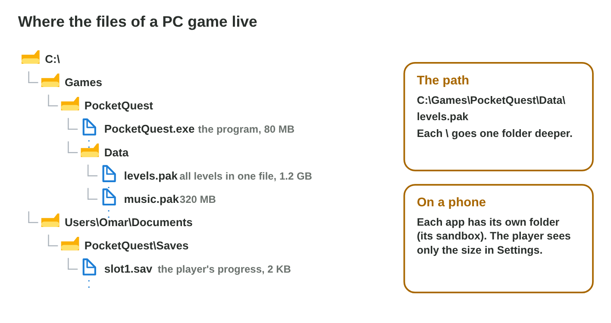

## Keywords



## 5.1 What the OS does for a game

:::: {.columns}
::: {.column width="50%"}
- A game never talks to the hardware alone, because it asks the operating system.
- The OS runs processes, shares memory, keeps files and controls devices.
- The OS also checks permissions, for example for the camera.
- **Do it:** Open Settings › About on the lab computer and on your phone. Which OS and version does each have?
:::
::: {.column width="50%"}

:::
::::

## Example · The player taps the game icon

The player taps the icon of Pocket Quest on the phone.
**Which services of the OS work now?**

::: {.reveal}
1. Files: the OS loads the game from storage into RAM.
2. Processes and memory: the OS starts a process and gives it its own RAM.
3. Devices: the OS sends every tap to the game and shows its frames.
:::

## Try it 1 · OS services

a) The game asks to use the camera. Which service of the OS decides?
b) The game saves the progress to storage. Which service does it use?
c) A tap on the screen reaches the game. Which service brings it?

::: {.answer}
a) permissions
b) files
c) devices
:::

## 5.2 Processes and the scheduler

:::: {.columns}
::: {.column width="50%"}
- A process is a running program with its own memory.
- The scheduler gives each process a time slice of a few ms on a core.
- The app on the screen gets the most time.
- **Do it:** Open Task Manager with Ctrl + Shift + Esc. Which three processes use the most memory?
:::
::: {.column width="50%"}

:::
::::

## Live demo · Scheduler Lab



## Try it 2 · Processes

a) What does the scheduler decide?
b) A phone has 8 cores and 40 apps open. Can they all run?
c) The player closes a download. What happens to the game?

::: {.answer}
a) which process runs on a core, and for how long
b) Yes, the scheduler switches between them very fast.
c) It gets more time on the core.
:::

## 5.3 Sharing the RAM

:::: {.columns}
::: {.column width="50%"}
- The OS gives each process its own part of the RAM.
- When the RAM of a phone is full, the OS closes background apps.
- A good mobile game saves its state when it goes to the background.
- **Do it:** In Task Manager › Performance › Memory, how much RAM is in use?
:::
::: {.column width="50%"}

:::
::::

## Example · A puzzle game and a video call

A phone has 6 GB of RAM. The OS uses 2 GB, a puzzle game 3 GB, and a video call needs 1.5 GB.
**What does the OS do when the call comes?**

::: {.reveal}
1. In use before: 2 + 3 = 5 GB, so 1 GB is free.
2. With the call: 5 + 1.5 = 6.5 GB, which is more than 6 GB.
3. The OS closes the **game** in the background, and the call keeps running.
:::

## Try it 3 · Memory

a) A phone has 8 GB. The OS uses 2.5 GB and a game 3 GB. How much RAM is free?
b) A game starts again from its title screen after a call. Did it crash?
c) What should a mobile game do when it goes to the background?

::: {.answer}
a) 2.5 GB
b) No, the OS closed it to free RAM.
c) It should save its state.
:::

## 5.4 Where a game keeps its files

:::: {.columns}
::: {.column width="50%"}
- The file system keeps files and folders with their names, paths, sizes and dates.
- The game folder holds the program and the packs of levels and music.
- The player's save file is in the user's own folder, so it stays after an update.
- A FAT32 stick refuses any file of 4 GB or more.
- **Do it:** Open one folder in C:\\Program Files. What is the path of its biggest file?
:::
::: {.column width="50%"}

:::
::::

## Example · A new gamepad

Ali connects a new gamepad, and the game does not see it.
**Where does he look, and what is the fix?**

::: {.reveal}
1. He opens Device Manager and finds the gamepad with a yellow sign.
2. The sign means that the driver is missing or does not work.
3. He installs the driver, and the game reads the buttons.
:::

## Try it 4 · Files and paths

a) What does the extension .sav tell about a file?
b) Why is the save file outside the game folder?
c) Why does a 4.5 GB video not copy to a FAT32 stick with 20 GB free?

::: {.answer}
a) It is a save file.
b) so that it stays after an update
c) FAT32 allows no file of 4 GB or more.
:::

## Game challenge · Pocket Quest



## Try it · The big level (harder)

The facts: the phone has 4 GB of RAM. The OS uses 1.5 GB and Pocket Quest 2.3 GB. Chat (0.4 GB) was used 1 minute ago, and Music (0.3 GB) 20 minutes ago.

a) How much RAM do all four need together?
b) Which app does the OS close first, and why?
c) Which apps must the OS close in the end?

::: {.answer}
a) 4.5 GB
b) Music, because it was used longest ago.
c) Music and Chat
:::

## Summary

- The OS manages the hardware and gives services to every app.
- The scheduler shares the CPU cores, and the app on the screen gets the most time.
- When the RAM is full, the OS closes background apps, so a game saves its state.
- The file system keeps files in folders with paths, and a save file stays in the player's folder.
- The OS finds devices, loads their drivers and shares all the resources.
