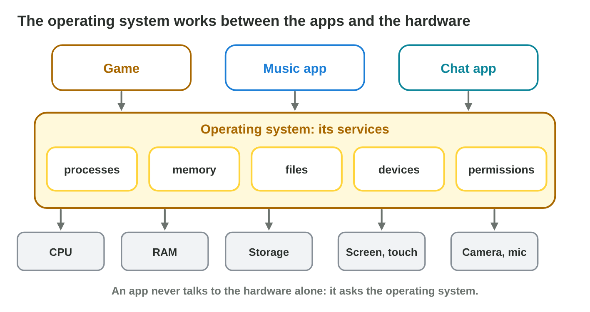
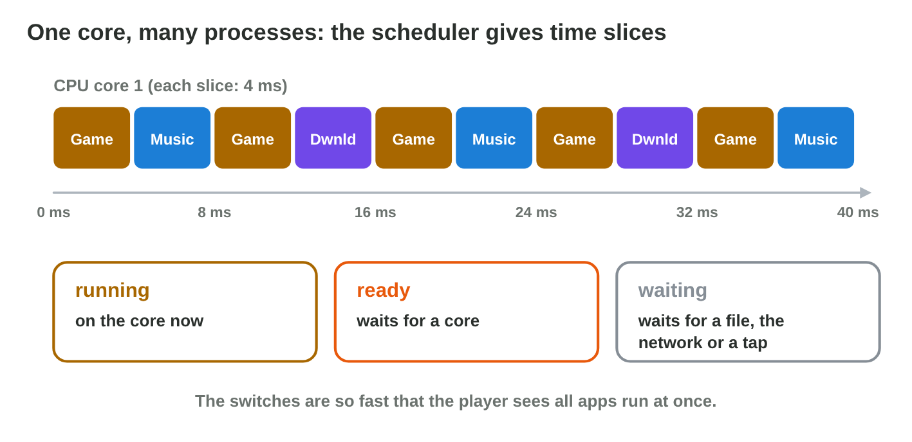
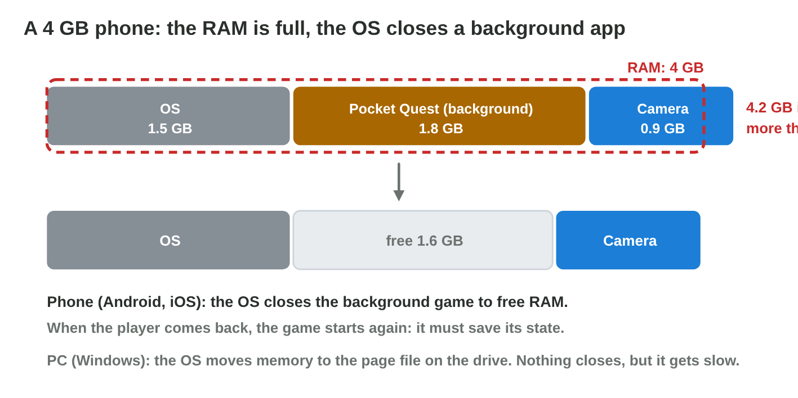
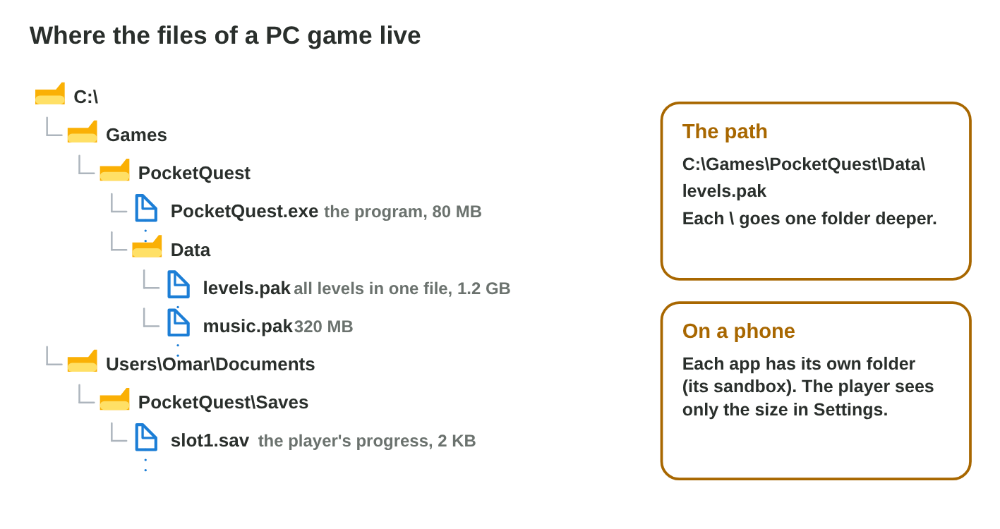
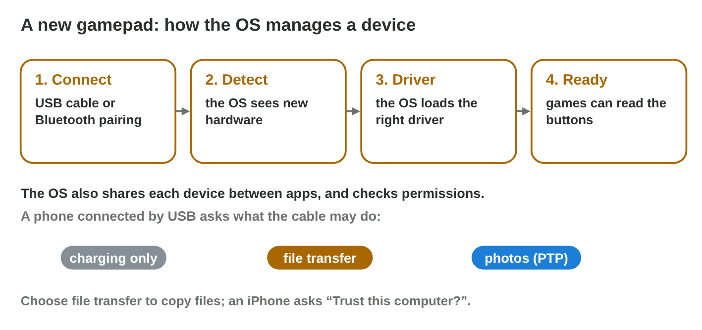

Each section: a question from a game studio, the idea, a **Do it** task and a short **Try it**.
The page checks every answer at once and tells you why. More examples
and exercises are in the lesson notes (PDF).

## Key terms



## 5.1 What the OS does for a game

- A game never talks to the hardware alone. It asks the **operating system**.
- The OS **services**: run **processes** on the CPU, share the **memory**,
  keep **files**, control **devices** (screen, touch, sound, camera), check
  **permissions**.
- Computers: Windows, macOS, Linux. Phones: Android, iOS.
- "Allow Pocket Quest to record audio?" is the **permission** service.

{width=92%}

::: {.callout-warning title="Watch out!"}
The OS is not only the home screen. Most of its work cannot be seen.
:::

::: {.callout-note title="Do it · Name your two operating systems"}
Your own devices: Settings › About shows the name and version of each OS,
for example Windows 11 and Android 14.

::: {.sort}
Which service of the OS is at work? Sort the moments of Huda's day.

Files
:   She saved a document.

    Why: The OS keeps files and folders in storage.

Processes
:   A tap on the icon started a game.

    Why: The OS starts a process and gives it CPU time.

Devices
:   The game read her taps.

    Why: The OS sends the input of the touch screen to the app.

:   A printer printed her page.

    Why: The OS controls the printer through its driver.

Permissions
:   An app asked to use the camera.

    Why: The permission service asks the user first.
:::
:::

::: {.callout-tip title="Try it 1 · OS services"}
Choose the right service.

::: {.match extra="the GPU"}
The game asks to use the camera. Which service decides?
:   permissions

    Why: The player allows or refuses it: the permission service.

The game gets time on a CPU core. Which service?
:   processes

    Why: The process service (the scheduler) shares the cores.
:::
:::

## 5.2 Many apps, few cores: processes and the scheduler

- A **process** is a running program with its own memory.
- The **scheduler** gives a process a **time slice** of a few ms on a core,
  then switches. This is **multitasking**.
- Close one app: the others get their slices more often.
- The **foreground app** gets the most time; a phone pauses most
  **background apps**.

{width=92%}



::: {.callout-warning title="Watch out!"}
8 cores do not mean 8 apps at most: the scheduler switches many times per
second.
:::

::: {.callout-note title="Do it · The processes of the lab computer"}
Open **Task Manager** (Ctrl + Shift + Esc), tab Processes, and sort by
Memory. One lab computer shows 9 apps and 112 background processes; the
browser uses 1.2 GB, Word 350 MB and the security program 210 MB.

::: {.choice}
Only a few apps are open, but there are more than 100 processes. Why?

- [x] The OS and the apps run many background processes, and the scheduler gives each one slices of time.

  Why: Multitasking: the cores switch between the processes many times per second.

- [ ] Task Manager counts every window twice.

  Why: Every line is a real process; most of them run in the background.

- [ ] The computer has more than 100 cores.

  Why: A few cores share their time between many processes.
:::
:::

::: {.callout-tip title="Try it 2 · Processes"}
Choose the right answer.

::: {.match extra="8 apps at most|deleted"}
A phone has 8 cores and 40 apps open. Can they all run?
:   yes, the scheduler switches between them

    Why: the switches are so fast that all apps seem to run at once.

The player closes the download. What happens to the game?
:   it gets more time on the core

    Why: fewer processes share the core.
:::
:::

## 5.3 Sharing the RAM: memory management

- **Memory management:** each process gets its own part of RAM; the OS keeps
  the parts apart and takes memory back when a process ends.
- **Phone, RAM full:** the OS closes background apps, the one used longest
  ago first.
- A good mobile game **saves its state** when it goes to the background.

{width=92%}

::: {.callout-warning title="Watch out!"}
A game that starts again after the camera did not always crash: the OS
closed it to free RAM.
:::

::: {.callout-note title="Do it · The memory of the lab computer"}
Task Manager › Performance › Memory: read the total RAM, in use and
available. Then open three browser tabs with videos. One lab computer shows
total 16 GB, in use 6.0 GB and available 10 GB; with the three tabs, in use
is 6.8 GB.

::: {.fill answer="0.8|800 MB|800MB" unit="GB" hint="The new value of 'in use' minus the old value."}
How much RAM did the three video tabs add?

Why: 6.8 − 6.0 = 0.8 GB, about 800 MB.
:::
:::

::: {.callout-tip title="Try it 3 · Memory"}
Choose the right answer.

::: {.match extra="the foreground app|it adds more RAM"}
The RAM of a phone is full. Which apps does the OS close?
:   background apps

    Why: A phone OS closes background apps first.

A game starts again from its title screen after a call. Did it crash?
:   no, the OS closed it to free RAM

    Why: The OS closed the background game to free RAM.
:::
:::

## 5.4 Files and devices

- The **file system** keeps files and folders on a drive: names, paths,
  sizes, dates. Data about a file is its **metadata**.
- The **path** goes one folder deeper at every `\` (Android, macOS: `/`):
  `C:\Games\PocketQuest\Data\levels.pak`.
- The **extension** says the kind of file: .exe program, .pak pack, .sav save,
  .png picture.
- The game folder holds the program and the packs; the player's save is in
  Documents (or AppData), so it stays after an update.

{width=92%}

- **Devices:** the OS finds a new device (**plug and play**), loads its
  **driver** and shares it between apps: connect → detect → driver → ready.

{width=92%}

::: {.callout-warning title="Watch out!"}
Free space is not the only limit: a USB stick formatted **FAT32** refuses any
file of 4 GB or more. **exFAT** takes big files on Windows and Mac.
:::

::: {.callout-note title="Do it · The files of an app"}
In File Explorer, open `C:\Program Files` and the folder of one program. Find
its biggest file, then Right-click › Properties. In the folder of Firefox,
the biggest file is xul.dll (140 MB).

::: {.choice}
Which one is the path of that file?

- [x] `C:\Program Files\Mozilla Firefox\xul.dll`

  Why: A path names the drive and every folder down to the file.

- [ ] `xul.dll (140 MB)`

  Why: That is the file name and its size, not where it is.

- [ ] Application extension

  Why: That is its type: one item of its metadata.
:::
:::

::: {.callout-tip title="Try it 4 · Files and paths"}
Choose the right answer.

::: {.match extra="the content of the file|C:"}
Why is the save file outside the game folder?
:   so that it stays after an update

    Why: an update replaces the game folder.

A 4.5 GB video does not copy to a FAT32 stick with 20 GB free. Why?
:   FAT32 allows no file of 4 GB or more

    Why: the limit is per file, not the free space.
:::
:::

## Game challenge: Pocket Quest on a 4 GB phone {.challenge}

Work alone. Use every section of today.

*Pocket Quest*, a game by *Byte Bay*, runs on a phone with **4 GB** of RAM.
The OS takes **1.5 GB**, the game **1.8 GB**. In a quest the player opens the
camera (**0.9 GB**) and comes back. Later the game loads a bigger level and
needs **2.3 GB**, while **Chat** (0.4 GB, used 1 minute ago) and **Music**
(0.3 GB, used 20 minutes ago) wait in the background.



::: {.callout-tip title="Try it 5 · The photo quest"}
RAM 4 GB. OS 1.5 GB, Pocket Quest 1.8 GB, camera 0.9 GB. Choose the right
answer.

::: {.match extra="the OS|0.9 GB"}
How much RAM is free before the camera opens?
:   0.7 GB

    Why: 4 − 1.5 − 1.8 = 0.7 GB.

Which app does the OS close?
:   Pocket Quest, in the background

    Why: The game is in the background now, so it is closed.
:::
:::

::: {.callout-tip title="Try it 6 · The big level (harder)"}
RAM 4 GB. OS 1.5 GB, Pocket Quest 2.3 GB (on the screen), Chat 0.4 GB (used
1 minute ago), Music 0.3 GB (used 20 minutes ago). Choose the right answer.

::: {.match extra="only Music|Pocket Quest"}
Which app does the OS close first?
:   Music, used longest ago

    Why: The background app used longest ago goes first.
:::
:::

## Summary {.summary}

- The OS manages the hardware and gives services to every app: processes, memory, files, devices and permissions.
- The scheduler shares the CPU cores between processes; the app on the screen gets the most time.
- When the RAM is full, the OS closes background apps, so a game saves its state.
- The file system keeps files in folders with paths; a save file stays in the player's folder.
- The OS finds devices, loads their drivers and shares all the resources.
