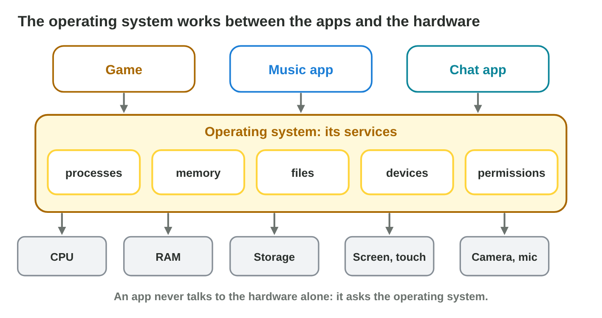
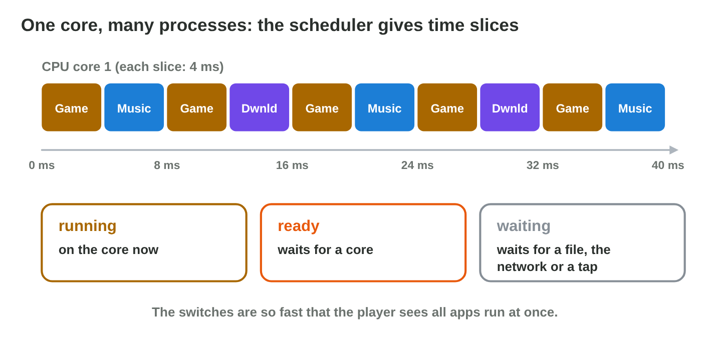
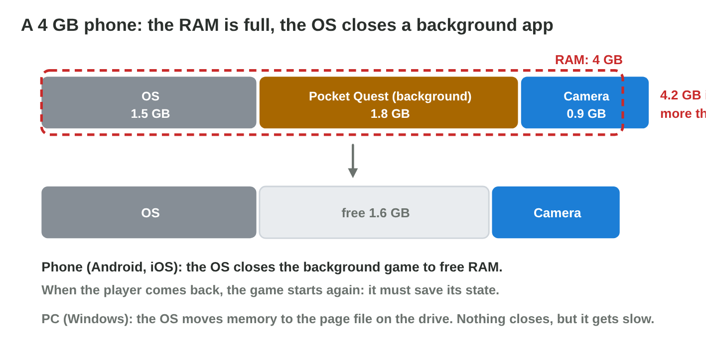

This page is the interactive version of the lesson notes (PDF). Each section
starts with a problem in a game studio. Then it explains the idea behind it.
It ends with a **Do it** task and one set of questions. Every question on
this page has its answer: try first, then check.

## Key terms



## 5.1 What the OS does for a game

- A game never talks to the hardware alone. It asks the **operating system**.
- The OS **services**: run **processes** on the CPU, share the **memory**,
  keep **files**, control **devices** (screen, touch, sound, camera), check
  **permissions**.
- Computers: Windows, macOS, Linux. Phones: Android, iOS.
- You see the OS at work in its tools: **Task Manager** and **Settings** on
  a PC, **Settings** on a phone.
- A tap on the game icon: the OS loads the game from storage into RAM
  (files), starts a process (processes), gives it RAM (memory), and sends it
  the taps (devices).
- "Allow Pocket Quest to record audio?" is the **permission** service.

{width=92%}

::: {.callout-warning title="Watch out!"}
The OS is not only the home screen. Most of its work cannot be seen.
:::

::: {.callout-note title="Do it · Name your two operating systems"}
Lab computer: Settings › System › About. Phone: Settings › About phone
(iPhone: Settings › General › About). Write the name and version of each OS,
and one service of the OS you used today.

::: {.check}
A good answer: "Lab computer: Windows 11, version 23H2; phone: Android 14
(or iOS 17)", and one service with a real example, for example "files: I
saved a document", "permissions: an app asked for the camera".
:::
:::

::: {.callout-tip title="Try it 1 · OS services"}
Choose the right service. You can use an answer more than once.

::: {.match extra="the GPU"}
The game asks to use the camera. Which service decides?
:   permissions

    Why: The player allows or refuses it: the permission service.

The game saves the progress to storage. Which service?
:   files

    Why: The OS keeps the files in storage.

A tap on the screen reaches the game. Which service?
:   devices

    Why: The OS controls the devices and sends the taps.

The game gets its own part of the RAM. Which service?
:   memory

    Why: The memory service gives each process its part.

The game gets time on a CPU core. Which service?
:   processes

    Why: The process service (the scheduler) shares the cores.
:::
:::

## 5.2 Many apps, few cores: processes and the scheduler

- A **process** is a running program with its own memory.
- The **scheduler** gives a process a **time slice** of a few ms on a core,
  then switches. This is **multitasking**.
- Close one app: the others get their slices more often.
- The **foreground app** gets the most time; a phone pauses most
  **background apps**.

{width=92%}



::: {.callout-warning title="Watch out!"}
8 cores do not mean 8 apps at most: the scheduler switches many times per
second.
:::

::: {.callout-note title="Do it · The processes of the lab computer"}
Open **Task Manager** (Ctrl + Shift + Esc), tab Processes. How many apps and
background processes are there? Which three processes use the most memory?

::: {.check}
A typical lab computer shows about 5 to 15 apps and 80 to 150 background
processes. The browser, an office app or a security program often uses the
most memory.
:::
:::

::: {.callout-tip title="Try it 2 · Processes"}
Choose the right answer.

::: {.match extra="8 apps at most|deleted"}
What is a process?
:   a running program with its own memory

    Why: the OS starts a process when a program runs.

What does the scheduler decide?
:   which process runs on a core, and for how long

    Why: it gives each process short time slices.

A phone has 8 cores and 40 apps open. Can they all run?
:   yes, the scheduler switches between them

    Why: the switches are so fast that all apps seem to run at once.

The player closes the download. What happens to the game?
:   it gets more time on the core

    Why: fewer processes share the core.

Which app gets the most time on a phone?
:   the foreground app

    Why: the app on the screen comes first; most background apps pause.
:::
:::

## 5.3 Sharing the RAM: memory management

- **Memory management:** each process gets its own part of RAM; the OS keeps
  the parts apart and takes memory back when a process ends.
- **Phone, RAM full:** the OS closes background apps, the one used longest
  ago first.
- A 6 GB phone: OS 2 GB + a puzzle game 3 GB = 5 GB, 1 GB free. A video
  call needs 1.5 GB: 6.5 GB is too much, so the OS closes the game in the
  background.
- A good mobile game **saves its state** when it goes to the background.

{width=92%}

::: {.callout-warning title="Watch out!"}
A game that starts again after the camera did not always crash: the OS
closed it to free RAM.
:::

::: {.callout-note title="Do it · The memory of the lab computer"}
Task Manager › Performance › Memory: write the total RAM, in use and
available. Open three browser tabs with videos: how much does "in use" grow?

::: {.check}
A typical result: total 16 GB, in use 6 GB, available 10 GB. Three video
tabs add several hundred MB to "in use", for example 6.0 → 6.8 GB.
:::
:::

::: {.callout-tip title="Try it 3 · Memory"}
Choose the right answer.

::: {.match extra="the foreground app|it adds more RAM"}
A phone has 8 GB of RAM. The OS uses 2.5 GB and a game 3 GB. How much is free?
:   2.5 GB

    Why: 8 − 2.5 − 3 = 2.5 GB.

The RAM of a phone is full. Which apps does the OS close?
:   background apps

    Why: A phone OS closes background apps first.

A game starts again from its title screen after a call. Did it crash?
:   no, the OS closed it to free RAM

    Why: The OS closed the background game to free RAM.

What should a mobile game do when it goes to the background?
:   save its state

    Why: Then it can continue at the same place after a restart.
:::
:::

## Game challenge: Pocket Quest on a 4 GB phone {.challenge}

Work alone. Use every section of today.

*Pocket Quest*, a game by *Byte Bay*, runs on a phone with **4 GB** of RAM.
The OS takes **1.5 GB**, the game **1.8 GB**. In a quest the player opens the
camera (**0.9 GB**) and comes back. Later the game loads a bigger level and
needs **2.3 GB**, while **Chat** (0.4 GB, used 1 minute ago) and **Music**
(0.3 GB, used 20 minutes ago) wait in the background.



::: {.callout-tip title="Try it 4 · The photo quest"}
RAM 4 GB. OS 1.5 GB, Pocket Quest 1.8 GB, camera 0.9 GB. Choose the right
answer.

::: {.match extra="the OS|0.9 GB"}
How much RAM is free before the camera opens?
:   0.7 GB

    Why: 4 − 1.5 − 1.8 = 0.7 GB.

How much RAM do the OS, the game and the camera need together?
:   4.2 GB

    Why: 1.5 + 1.8 + 0.9 = 4.2 GB, more than 4.

Which app does the OS close?
:   Pocket Quest, in the background

    Why: The game is in the background now, so it is closed.

Which app keeps running?
:   the camera, on the screen

    Why: The app on the screen keeps running.
:::
:::

::: {.callout-tip title="Try it 5 · The big level (harder)"}
RAM 4 GB. OS 1.5 GB, Pocket Quest 2.3 GB (on the screen), Chat 0.4 GB (used
1 minute ago), Music 0.3 GB (used 20 minutes ago). Choose the right answer.

::: {.match extra="only Music|Pocket Quest"}
How much RAM do all four need?
:   4.5 GB

    Why: 1.5 + 2.3 + 0.4 + 0.3 = 4.5 GB.

Which app does the OS close first?
:   Music, used longest ago

    Why: The background app used longest ago goes first.

Which apps must the OS close in the end?
:   Music and Chat

    Why: Without Music it is still 4.2 GB: Chat must go too.

How does the player keep the progress if the OS closes the game later?
:   the game saves its state in the background

    Why: A saved state lets the game continue after a restart.
:::
:::

## Summary {.summary}

- The OS manages the hardware and gives services to apps: processes, memory, files, devices, permissions.
- The scheduler shares the cores between processes in time slices of a few milliseconds.
- The OS gives each process its own part of the RAM.
- When the RAM is full, a phone closes background apps, so a game must save its state.
