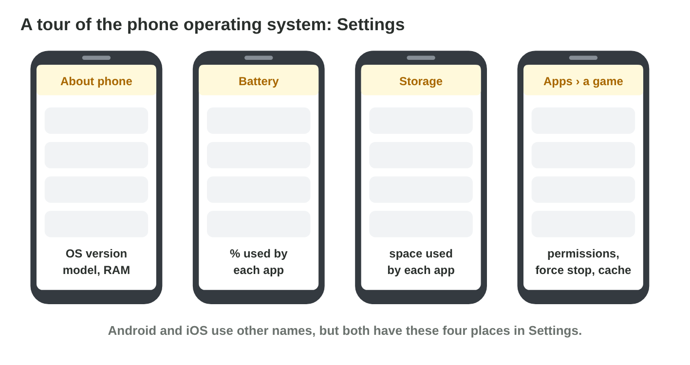
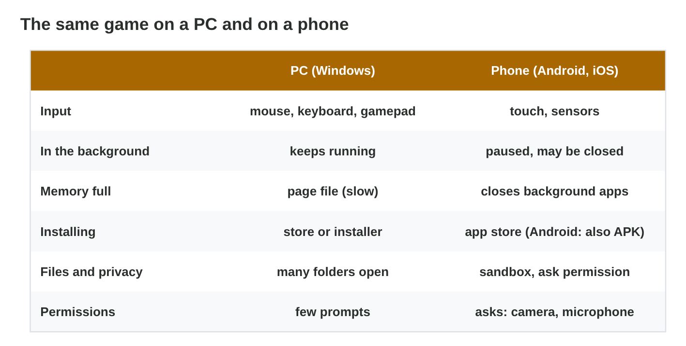

No new ideas today: you visit the operating systems of the lab computer and
of your phone with what you learned in Lecture 5. Do each activity alone,
then open "Check your result". Every question on this page has its answer:
try first, then check.

## Recall

- The OS gives services to every app: processes, memory, files, devices and
  permissions.
- The scheduler shares the cores; the app on the screen gets the most time.
- When the RAM of a phone is full, the OS closes background apps, so a game
  saves its state.

::: {.callout-tip title="Try it 1 · Recall"}
Choose the right service.

::: {.match extra="the GPU"}
The game asks to use the microphone. Which service decides?
:   permissions

    Why: the player allows or refuses the microphone.

The game saves the progress to storage. Which service?
:   files

    Why: the OS keeps the files in storage.

The game gets time on a CPU core. Which service?
:   processes

    Why: the scheduler shares the cores between processes.
:::
:::

## Activity 1 · A tour of the PC: four tools of Windows

| Tool (shortcut) | What it shows |
|---|---|
| Settings › System › About (Win + I) | Windows version, CPU, RAM |
| Task Manager (Ctrl + Shift + Esc) | processes, CPU %, memory, disk, GPU |
| File Explorer (Win + E) | drives, free space, folders |
| Device Manager (right-click Start) | devices and their drivers |

- A **device driver** is a small program that lets the OS control one kind of
  hardware (a graphics card, a gamepad).
- Omar's game stutters: Task Manager shows a video converter at 85 % CPU.
  He closes it, and the game is smooth.
- Ali's gamepad does nothing: Device Manager shows it with a yellow warning
  sign, so the driver is missing.

{width=92%}

::: {.callout-warning title="Watch out!"}
Do not restart the game again and again. Look in Task Manager and Device
Manager first.
:::

::: {.callout-note title="Activity 1 · Four facts about the lab computer · 12 min"}
Write the Windows version and the RAM (About), the process with the most CPU
(Task Manager), the free space of C: (File Explorer) and the graphics card
(Device Manager › Display adapters).

*Your product:* four facts with the tool for each.

::: {.check}
A good answer: "Windows 11, 16 GB RAM (About); the browser has the most CPU
(Task Manager); C: has 180 GB free (File Explorer); Intel UHD Graphics
(Device Manager › Display adapters)". Your values may differ, but each fact
must come from the right tool.
:::
:::

::: {.callout-tip title="Try it 2 · Which Windows tool?"}
Choose the right tool. You can use an answer more than once.

::: {.match extra="Settings › Battery"}
Which program uses most of the CPU now?
:   Task Manager

    Why: Task Manager shows the CPU % of each process.

Is the driver of the graphics card working?
:   Device Manager

    Why: Device Manager shows each device and its driver.

How much RAM does the PC have, and which Windows version?
:   Settings › About

    Why: Settings › System › About shows them.

How much free space has drive C:?
:   File Explorer

    Why: File Explorer shows the drives and their free space.
:::
:::

## Activity 2 · A tour of the phone: Settings

| Place in Settings | What it shows |
|---|---|
| About phone (iPhone: General › About) | OS version, model, storage |
| Battery | battery used by each app |
| Storage | free space, space of each app |
| Apps › a game | permissions; Android: Force stop, Clear cache |

- Each app runs in its own **sandbox**: it cannot read the files of other
  apps. For the camera, the microphone or the location, it needs an
  **app permission**.
- A puzzle game takes 1.5 GB: app 1.0 GB, user data 0.4 GB, cache 0.1 GB.
- Lina's voice chat is silent: the microphone permission is "Not allowed".

{width=92%}



::: {.callout-warning title="Watch out!"}
"Clear storage" (or "Clear data") also deletes the progress. Clear the cache
first.
:::

::: {.callout-note title="Activity 2 · The tour of your phone · 12 min"}
On your phone (or first in **Settings Explorer**): write the OS version; the
storage and permissions of one big app; and the app that used the most
battery today.

*Your product:* three facts from your phone.

::: {.check}
A good answer: "Android 14 (About phone); a game of 3 GB with the
permissions Microphone not allowed, Storage allowed; the app with the most
battery today: the video app". Each fact comes from About, Apps › the app,
and Battery.
:::
:::

::: {.callout-tip title="Try it 3 · Where in Settings?"}
Choose the right answer.

::: {.match extra="Display|Clear storage"}
Where does the phone show the Android or iOS version?
:   About phone

    Why: About phone (iPhone: General › About) shows the OS version.

Voice chat is silent. Where do you look?
:   Apps › the game › Permissions

    Why: The microphone is an app permission.

The puzzle game: app 1.0 GB, user data 0.4 GB, cache 0.1 GB. What does Clear cache free?
:   0.1 GB

    Why: Clear cache deletes only the cache: 0.1 GB.

Why can a game not read the files of the gallery app?
:   each app has its own sandbox

    Why: Each app runs in its own sandbox.
:::
:::

## Activity 3 · The same game on a PC and on a phone

| | PC (Windows) | Phone (Android, iOS) |
|---|---|---|
| Input | mouse, keyboard, gamepad | touch, sensors |
| In the background | keeps running | paused, may be closed |
| Installing | store or installer | app store (Android: also APK) |
| Files | many folders | its own sandbox |
| Permissions | few prompts | asks for camera, microphone, location |

- A call during a mobile match: the game goes to the background, the OS
  pauses it, and it may close it. The game must pause and save.
- Alt + Tab on a PC: the game keeps running, and an online match goes on.

{width=92%}

::: {.callout-warning title="Watch out!"}
Test a mobile game for calls, app switches and refused permissions.
:::

::: {.callout-note title="Activity 3 · PC or phone? · 8 min"}
Start a game or a video on your phone and on the lab computer. Switch to
another app for one minute. What did each one do: keep running, pause or
start again?

*Your product:* two short answers.

::: {.check}
On the lab computer the game or video usually keeps running in the
background. On the phone it pauses, and after a long time or with many apps
it may start again, because the OS closed it.
:::
:::

::: {.callout-tip title="Try it 4 · PC or phone?"}
Choose the right answer. You can use an answer more than once.

::: {.match extra="both"}
Which OS pauses a game in the background?
:   the phone OS

    Why: A phone OS pauses background apps and may close them.

On which device does an online match go on after Alt + Tab?
:   the PC

    Why: On a PC, a game keeps running in the background.

Which OS asks the player before a game uses the microphone?
:   the phone OS

    Why: A phone OS asks for each permission.
:::
:::

## Game challenge: the support desk of Byte Bay {.challenge}

Work alone. Use every activity of today.

Six tickets about *Pocket Quest*: **Lina** (phone): "Microphone not allowed".
**Omar** (PC): the game stutters. **Sara** (phone): "Not enough space".
**Ali** (PC): the new gamepad does not work. **Maya** (phone): does my phone
have Android 12 or newer? **Yousef** (phone): empty after one hour of play.



::: {.callout-tip title="Try it 5 · The tickets"}
Lina: microphone not allowed (phone). Omar: stutters (PC). Sara: not enough
space (phone). Ali: gamepad (PC). Choose the right place.

::: {.match extra="Settings › Battery|File Explorer"}
Where does Lina look?
:   Apps › Pocket Quest › Permissions

    Why: The microphone is a permission of the app.

Where does Omar look?
:   Task Manager

    Why: Task Manager shows the program that takes the CPU.

Where does Ali look?
:   Device Manager

    Why: Device Manager shows a missing driver with a warning sign.
:::
:::

::: {.callout-tip title="Try it 6 · The harder tickets (harder)"}
Maya (phone) asks about Android 12. Yousef's phone is empty after one hour.
Sara's Pocket Quest: app 2.1 GB, user data 0.9 GB, cache 0.2 GB. Choose the
right answer.

::: {.match extra="Task Manager|1.1 GB"}
Where does Yousef see which app used the battery?
:   Settings › Battery

    Why: Settings › Battery lists the apps by battery use.

Sara clears the cache. How much space does she get?
:   0.2 GB

    Why: Her cache is 0.2 GB.

Why should Sara not press "Clear storage"?
:   she would lose her progress

    Why: Clear storage deletes the user data too.
:::
:::

## Wrap-up {.summary}

- You can find facts about a PC with Settings, Task Manager, File Explorer and Device Manager.
- You can find the OS version, the storage, the permissions and the battery use in a phone's Settings.
- You can say what a PC and a phone do with a game in the background.
