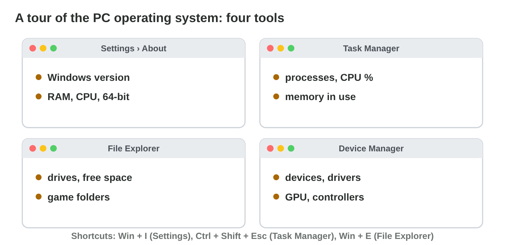
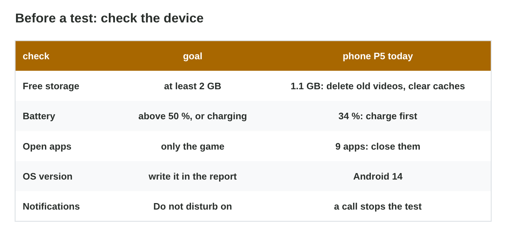

No new ideas today: two short problems on Lecture 5, on the lab computer
and on your phone. Do each one alone, then open "Check your result". Every
question on this page has its answer: try first, then check.

## Recall

- The OS gives services to every app: processes, memory, files, devices and
  permissions.
- The **scheduler** shares the cores; the app on the screen gets the most
  time.
- When the RAM of a phone is full, the OS closes background apps, so a game
  saves its state.
- The file system keeps files in folders with paths; the OS loads a driver
  for every device and shares all the resources.

::: {.callout-tip title="Try it 1 · Recall"}
Choose the right service.

::: {.match extra="the GPU"}
The game asks to use the microphone. Which service decides?
:   permissions

    Why: The player allows or refuses the microphone.

The game saves the progress to storage. Which service?
:   files

    Why: The OS keeps the files in storage.

The game gets time on a CPU core. Which service?
:   processes

    Why: The scheduler shares the cores between processes.
:::
:::

## Activity 1 · A tour of the PC: four tools of Windows

| Tool (shortcut) | What it shows |
|---|---|
| Settings › System › About (Win + I) | Windows version, CPU, RAM |
| Task Manager (Ctrl + Shift + Esc) | processes, CPU %, memory |
| File Explorer (Win + E) | drives, free space, folders |
| Device Manager (right-click Start) | devices and their drivers |

A **device driver** is a small program that lets the OS control one kind of
hardware, such as a gamepad.

{width=92%}

::: {.callout-note title="Activity 1 · Four facts · 15 min"}
On the lab computer, write four facts, each with its tool:

1. the Windows version and the RAM;
2. the process that uses the most CPU now;
3. the free space of drive C:;
4. the graphics card (Device Manager › Display adapters).

*Your product:* four facts with the tool for each.

::: {.check}
A good answer: "Windows 11, 16 GB RAM (About); the browser uses the most CPU
(Task Manager); C: has 180 GB free (File Explorer); Intel UHD Graphics
(Device Manager › Display adapters)". Your values may differ, but each fact
must come from the right tool.
:::
:::

::: {.callout-tip title="Try it 2 · Which Windows tool?"}
Choose the right tool.

::: {.match extra="Settings › Battery|File Explorer"}
A game stutters. Which program uses most of the CPU now?
:   Task Manager

    Why: Task Manager shows the CPU % of each process.

A new gamepad does nothing. Is its driver working?
:   Device Manager

    Why: Device Manager shows each device and its driver.

How much RAM does the PC have?
:   Settings › About

    Why: Settings › System › About shows the RAM.
:::
:::

## Activity 2 · Make the phone ready for a test

Rami must test *Pocket Quest 1.2* on phone **P5** for 40 minutes. P5 has
**1.1 GB** free, the battery shows **34 %**, and **9 apps** are open.
Clearing an app's **cache** frees space and keeps its progress; clearing
its **storage** (data) deletes the progress. A test phone must pass the
**device check**: at least 2 GB free, the battery above 50 % or charging,
only the game open, Do not disturb on, and the OS version in the report.

{width=86%}



::: {.callout-note title="Activity 2 · The device check · 15 min"}
1. In **Test Day**, prepare Rami's phone P5 for the test.
2. On your own phone, write the free space (Settings › Storage) and the
   battery level. Does it pass the device check? If not, write what you do
   first.

*Your product:* your score and two short lines.

::: {.check}
Test Day: delete old videos and clear caches, charge above 50 %, close the
other apps, set USB to file transfer, name the screenshot
`2026-11-12_P5_level3.png`, and turn on Do not disturb. A good answer for
your phone: "9.4 GB free, battery 72 %: it passes. I close the other apps
and turn on Do not disturb before the test."
:::
:::

::: {.callout-tip title="Try it 3 · The device check"}
Choose the right answer.

::: {.match extra="Clear storage|test now"}
Which button frees space and keeps the progress?
:   Clear cache

    Why: The cache holds only temporary files.

A phone has 1.6 GB free and clears 0.6 GB of caches. Is it ready for the test?
:   yes, 2.2 GB is more than 2 GB

    Why: 1.6 + 0.6 = 2.2 GB.

The battery shows 34 %. What do you do before a 40-minute test?
:   charge it above 50 % first

    Why: At low battery, the phone may save power and slow the game down.

A call stopped the last test. What do you turn on?
:   Do not disturb

    Why: Do not disturb keeps calls and notifications away.
:::
:::

## Wrap-up {.summary}

- You can find the processes, the memory, the free space and the drivers of
  a computer with the tools of Windows.
- You can free space without losing progress, and make a phone ready for a
  fair test.
