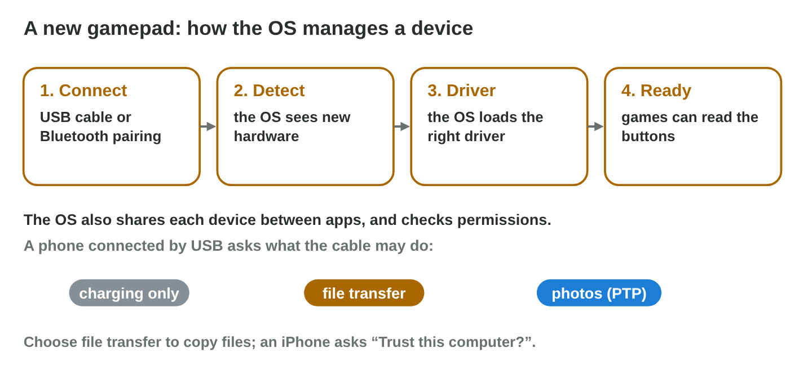

This page is the interactive version of the lesson notes (PDF). Each section
starts with a problem in a game studio. Then it explains the idea behind it.
It ends with a **Do it** task and one set of questions. Every question on
this page has its answer: try first, then check.

## Key terms



## 6.1 Where does a game keep its files?

- The **file system** keeps files and folders on a drive: names, paths,
  sizes, dates. Data about a file is its **metadata**.
- The **path** goes one folder deeper at every `\` (Android, macOS: `/`):
  `C:\Games\PocketQuest\Data\levels.pak`.
- The **extension** says the kind of file: .exe program, .pak pack, .sav save,
  .png picture.
- The game folder holds the program and the packs; the player's save is in
  Documents (or AppData), so it stays after an update.
- On a phone, each app has its own sandbox folder; Settings shows only the
  size.

{width=92%}

::: {.callout-warning title="Watch out!"}
Free space is not the only limit: a USB stick formatted **FAT32** refuses any
file of 4 GB or more. **exFAT** takes big files on Windows and Mac.
:::

::: {.callout-note title="Do it · The files of an app"}
In File Explorer, open `C:\Program Files` and the folder of one program.
Write the path and the biggest file. Right-click › Properties: write three
items of its metadata.

::: {.check}
A good answer: "C:\\Program Files\\Mozilla Firefox, biggest file xul.dll
(140 MB)", with three items of metadata from Properties, for example the
type (Application extension), the size and the date it was created.
:::
:::

::: {.callout-tip title="Try it 1 · Files and paths"}
Choose the right answer.

::: {.match extra="the content of the file|C:"}
What does the extension .sav tell?
:   it is a save file

    Why: the extension names the kind of file.

What is the metadata of a file?
:   its name, type, size and dates

    Why: metadata is data about the file, not its content.

Why is the save file outside the game folder?
:   so that it stays after an update

    Why: an update replaces the game folder.

Which sign separates folders in an Android path?
:   /

    Why: Android and macOS use /, Windows uses \\.

A 4.5 GB video does not copy to a FAT32 stick with 20 GB free. Why?
:   FAT32 allows no file of 4 GB or more

    Why: the limit is per file, not the free space.
:::
:::

## 6.2 Sharing the hardware: devices and resources

- **Device management:** the OS finds a new device (**plug and play**), loads
  its **driver**, shares it between apps and checks permissions.
- **System resources:** CPU time, memory, storage, battery, network and
  devices.
- A new gamepad: connect → detect → driver → ready. A yellow sign in Device
  Manager: the driver is missing.
- A phone on a USB cable asks for the **USB mode**: charging only, file
  transfer, photos. Choose file transfer; an iPhone asks "Trust this
  computer?".

{width=92%}

::: {.callout-warning title="Watch out!"}
If the OS does not see a device, no game can use it. Check the cable, the
driver and the permission first.
:::

::: {.callout-note title="Do it · Connect your phone"}
Connect your phone to the lab computer by USB. Change the USB mode to file
transfer (iPhone: Trust). Find the folder of photos (Android: DCIM).

::: {.check}
After you choose file transfer (or tap Trust), the phone appears in File
Explorer under This PC. The photos are in the DCIM folder (Android: Internal
storage › DCIM; iPhone: Internal Storage › DCIM).
:::
:::

::: {.callout-tip title="Try it 2 · Devices"}
Choose the right answer.

::: {.match extra="format the drive|the battery only"}
A gamepad shows a yellow sign in Device Manager. What is wrong?
:   its driver is missing or does not work

    Why: the yellow sign marks a driver problem.

The phone charges, but the PC shows no files. What do you change?
:   the USB mode to file transfer

    Why: "charging only" does not share the files.

What is plug and play?
:   the OS finds a new device and loads its driver

    Why: the player does not set up the device by hand.

Name a system resource that apps share.
:   the network

    Why: CPU, memory, storage, battery, network and devices are shared.

What does an iPhone ask before the PC can see its files?
:   Trust this computer?

    Why: the player must allow the PC first.
:::
:::

## 6.3 Making a device ready for a test

- A test shows how the game runs. A full, empty or busy phone shows its own
  problems instead.
- The **device check**: at least **2 GB** free; battery **above 50 %** or
  charging; **only the game** open; **Do not disturb** on; the **OS
  version** in the report.
- Lina's phone: 1.4 GB free → delete 1.0 GB of old videos (after copying)
  and clear 0.5 GB of caches → 2.9 GB free.
- Clear the **cache**, never the **storage** (data): that deletes logins and
  progress.

{width=90%}

::: {.callout-warning title="Watch out!"}
The check makes a test fair; it does not mean testing only the best phone.
:::

::: {.callout-note title="Do it · Your phone's resources"}
Write four resources of your phone now: free storage, battery %, the number
of open apps, and the OS version. Which one would fail the device check?

::: {.check}
A good answer has four values, for example "12 GB free, 46 %, 7 apps open,
Android 14", and names the line that fails: here the battery (below 50 %)
and the open apps (more than the game).
:::
:::

::: {.callout-tip title="Try it 3 · The device check"}
Choose the right answer.

::: {.match extra="1 GB|clear the storage of all apps"}
How much free storage should a test phone have?
:   at least 2 GB

    Why: the game and its downloads need room during the test.

0.9 GB free, old videos 1.2 GB, caches 0.4 GB. Free after deleting both?
:   2.5 GB

    Why: 0.9 + 1.2 + 0.4.

How do you free space without losing progress?
:   delete old videos and clear caches

    Why: clearing the cache keeps the data.

Why close the other apps before a test?
:   they use RAM and CPU

    Why: other apps share the resources with the game.
:::
:::

## Game challenge: Disk Doctor at Byte Bay {.challenge}

Work alone. Use every section of today.

The team of *Byte Bay* collects problems of *Pocket Quest*: Omar's **FAT32**
stick refuses the **5 GB** `levels.pak`; Omar cannot find `slot1.sav`; Lina's
phone **charges** but shows **no files** on the PC; a test phone has **0.8 GB
free**; Ali's gamepad shows a **yellow sign**; a **6 GB** build must go on a
stick for Windows **and** Mac.



::: {.callout-tip title="Try it 4 · The cases"}
FAT32: no file of 4 GB or more. The device check needs 2 GB free. Choose the
right answer.

::: {.match extra="the stick is full|clear the storage"}
Why does the 5 GB file not copy to the FAT32 stick?
:   the file is 4 GB or more

    Why: FAT32 has a limit for each file.

What is the fix for Ali's gamepad?
:   install or update the driver

    Why: a yellow sign means a driver problem.

Which format for the 6 GB build stick (Windows and Mac)?
:   exFAT

    Why: exFAT takes big files and works on both.

What does Lina change on her phone?
:   the USB mode to file transfer

    Why: "charging only" shows no files.
:::
:::

::: {.callout-tip title="Try it 5 · Ready for the test (harder)"}
The test phone: 0.8 GB free, old videos 1 GB (copied to the PC), caches
0.5 GB, battery 30 %, six apps open. Choose the right answer.

::: {.match extra="1.3 GB|charge to 40 %"}
How much is free after deleting the videos and clearing the caches?
:   2.3 GB

    Why: 0.8 + 1 + 0.5.

Does the phone pass the storage line now?
:   yes, 2.3 GB is more than 2 GB

    Why: the check needs at least 2 GB.

What must the tester do with the battery?
:   charge it above 50 % or keep it charging

    Why: a low battery can slow the phone down.

Where is Omar's save file, so that it stays after a reinstall?
:   in Documents\\PocketQuest\\Saves

    Why: the player's files are outside the game folder.
:::
:::

## Summary {.summary}

- The file system keeps files in folders with paths, extensions and metadata.
- A save file sits outside the game folder; FAT32 refuses files of 4 GB or more.
- The OS finds devices, loads their drivers and shares the resources between apps.
- A phone on USB needs the file transfer mode (iPhone: Trust).
- Before a test: 2 GB free, battery above 50 %, only the game open, Do not disturb.
