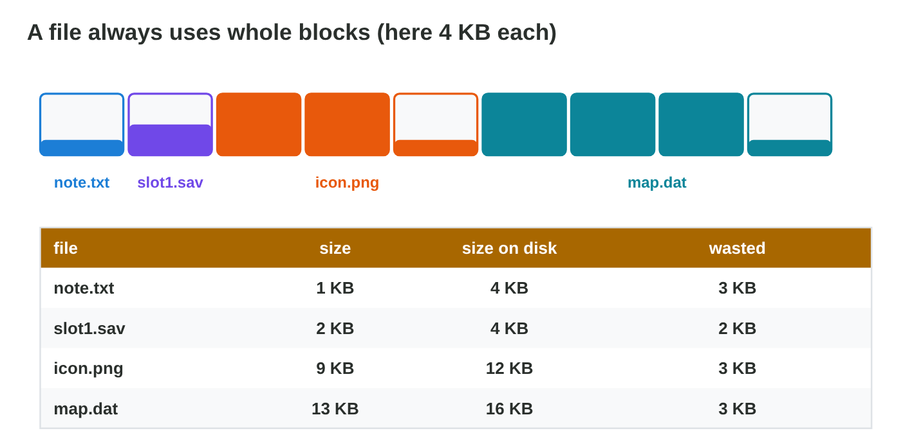
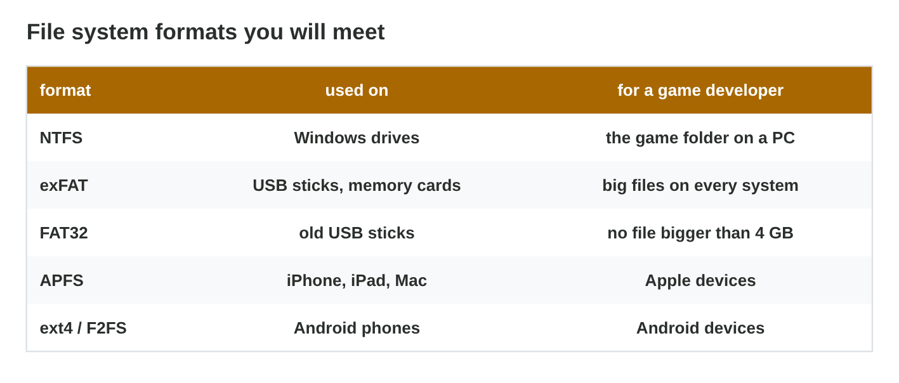

This page is the interactive version of the lesson notes (PDF). Each section
starts with a problem at a game studio. Then it explains the idea behind it.
It ends with a **Do it** task and one set of questions. The full
explanations, examples and exercises are in the notes.

## Key terms



## 11.1 Where does a game keep its files?

- The **file system** keeps files and folders on a drive: names, paths,
  sizes, dates. Data about a file is its **metadata**.
- The **path** goes one folder deeper at every `\` (Android, macOS: `/`):
  `C:\Games\PocketQuest\Data\levels.pak`.
- The **extension** says the kind of file: .exe program, .pak pack, .sav save,
  .png picture.
- Pocket Quest: the game folder holds the program (80 MB), `levels.pak`
  (1.2 GB) and `music.pak` (320 MB). The save `slot1.sav` (2 KB) is in
  `C:\Users\Omar\Documents\PocketQuest\Saves`, so it stays after an update.
- On a phone, each app has its own sandbox folder; Settings shows only the
  size.

{width=92%}

::: {.callout-warning title="Watch out!"}
The save file is often not in the game folder, but in Documents or AppData.
:::

::: {.callout-note title="Do it · The files of an app"}
In File Explorer, open `C:\Program Files` and the folder of one program.
Write the path and the biggest file. Right-click › Properties: write three
items of its metadata.
:::

::: {.callout-tip title="Try it 1 · Files and paths"}
Choose the right answer.

::: {.match extra="C:\\Games\\PocketQuest\\slot1.sav|the content of the file"}
Where is Omar's save file?
:   C:\\Users\\Omar\\Documents\\PocketQuest\\Saves\\slot1.sav

What does the extension .pak tell?
:   it is a pack of game data

What is the metadata of a file?
:   its name, type, size and dates

Why is the save file outside the game folder?
:   so that it stays after an update

Which sign separates folders in an Android path?
:   /
:::
:::

## 11.2 How files sit on a drive: blocks and formats

- A drive is divided into **blocks** (clusters), often 4 KB.
- A file uses **whole blocks**: a 1 KB file takes 4 KB on disk; 9 KB takes
  12 KB. This is its **size on disk**.
- 10 000 files of 1 KB: 10 MB of data, but about 39 MB on disk. Packed into
  one file: about 10 MB. Games use pack files.
- **Formats:** NTFS (Windows drives); exFAT (USB sticks, memory cards, big
  files on every system); FAT32 (old sticks, **no file of 4 GB or more**);
  APFS (Apple); ext4 or F2FS (Android).
- Omar's 5 GB `levels.pak` does not fit on a FAT32 stick, even with 16 GB
  free. As exFAT, it fits.

{width=92%}

{width=88%}



::: {.callout-warning title="Watch out!"}
Free space is not the only limit: FAT32 refuses any file of 4 GB or more.
:::

::: {.callout-note title="Do it · Size and size on disk"}
Make a one-line text file on the desktop. Properties: write "Size" and "Size
on disk". Then save and pack ten small files in **Block Lab**.
:::

::: {.callout-tip title="Try it 2 · Blocks and formats"}
Blocks are 4 KB. Choose the right answer.

::: {.match extra="6 KB|NTFS"}
A file has 6 KB. What is its size on disk?
:   8 KB

1 000 files of 1 KB. How much space on disk?
:   4 000 KB

Why do games pack many small files into one?
:   less wasted space

A 5 GB file does not copy to a FAT32 stick. Why?
:   FAT32 allows no file of 4 GB or more

Which format for a stick that works on Windows and Mac?
:   exFAT
:::
:::

## 11.3 Sharing the hardware: devices and resources

- **Device management:** the OS finds a new device (**plug and play**), loads
  its **driver**, shares it between apps and checks permissions.
- **System resources:** CPU time, memory, storage, battery, network and
  devices.
- A new gamepad: connect → detect → driver → ready. A yellow sign in Device
  Manager: the driver is missing.
- A phone on a USB cable asks for the **USB mode**: charging only, file
  transfer, photos. Choose file transfer; an iPhone asks "Trust this
  computer?".

{width=92%}

::: {.callout-warning title="Watch out!"}
If the OS does not see a device, no game can use it. Check the cable, the
driver and the permission first.
:::

::: {.callout-note title="Do it · Connect your phone"}
Connect your phone to the lab computer by USB. Change the USB mode to file
transfer (iPhone: Trust). Find the folder of photos (Android: DCIM).
:::

::: {.callout-tip title="Try it 3 · Devices"}
Choose the right answer.

::: {.match extra="format the drive|the battery only"}
A gamepad shows a yellow sign in Device Manager. What is wrong?
:   its driver is missing or does not work

The phone charges, but the PC shows no files. What do you change?
:   the USB mode to file transfer

What is plug and play?
:   the OS finds a new device and loads its driver

Name a system resource that apps share.
:   the network

What does an iPhone ask before the PC can see its files?
:   Trust this computer?
:::
:::

## Game challenge: Disk Doctor at Byte Bay {.challenge}

Work alone. Use every section of today.

The team of *Byte Bay* collects problems of *Pocket Quest*: Omar's FAT32
stick refuses the 5 GB `levels.pak`; Omar cannot find `slot1.sav`; an old
version had 10 000 files of 1 KB with 4 KB blocks; Ali's gamepad shows a
yellow sign; a 6 GB build must go on a stick for Windows and Mac.



::: {.callout-tip title="Try it 4 · The cases"}
FAT32: no file of 4 GB or more. Blocks: 4 KB. Choose the right answer.

::: {.match extra="the stick is full|clear the cache"}
Why does the 5 GB file not copy to the FAT32 stick?
:   the file is 4 GB or more

What is the fix for Ali's gamepad?
:   install or update the driver

Which format for the 6 GB build stick (Windows and Mac)?
:   exFAT

Where is Omar's save file?
:   in Documents\\PocketQuest\\Saves
:::
:::

::: {.callout-tip title="Try it 5 · The small files (harder)"}
10 000 files of 1 KB, blocks of 4 KB, 1 MB = 1024 KB. Choose the right answer.

::: {.match extra="10 000 KB on disk|4 KB"}
How much data do the files hold?
:   10 000 KB (about 10 MB)

How much space do they take on disk?
:   40 000 KB (about 39 MB)

How many blocks does one pack of 10 000 KB need?
:   2 500

Besides space, why is one big pack better?
:   the drive reads it in one long run
:::
:::

## Summary {.summary}

- The file system keeps files and folders with their paths, sizes and dates.
- Games keep their data in the game folder and the player's saves in the user's folders.
- A file uses whole blocks: its size on disk is rounded up.
- The format of a drive matters: FAT32 refuses files of 4 GB or more; exFAT works everywhere.
- The OS finds devices, loads their drivers and shares all resources between apps.
