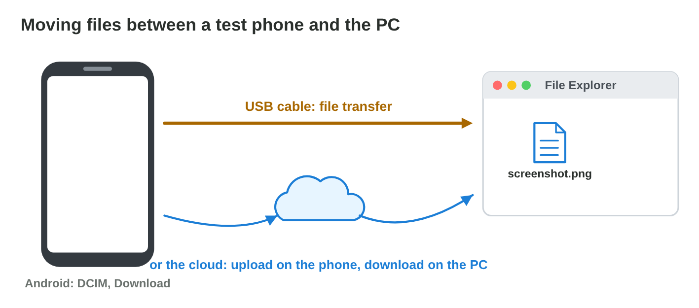

::: {.lead}
Tomorrow Rami, a tester at *Byte Bay*, tests *Pocket Quest 1.2* on phone P5
for 40 minutes. He will take about 40 screenshots and write a report. Last
time, the phone ran out of space in the middle of the test, a call stopped
the game, and nobody could find the screenshots afterwards. A good test
starts before the game: with files that are easy to find, and a device that
is ready. In lecture 11 you saw how the OS keeps files and manages devices.
In this hands-on seminar you **manage** them yourself on the lab computer and
on your phone, as a tester does. Every section ends with a task, and at the
end your phone is ready for a test.
:::

## Key terms



## 12.1 Files that anyone can find: folders and names

After a test day, a team has builds, screenshots, videos and reports from
several phones. Without a plan, nobody finds "the screenshot of the bug on
P5". A clear folder and clear names solve this (@fig-folder).

::: {.callout-important title="Definition 12.1 — A test folder and file names"}
Keep one folder per **game build** (one finished version for one platform),
with subfolders for builds, screenshots and reports. A good file name says
**what**, **which version or device**, and **when**, has no spaces, and puts
the date first as year-month-day, so that files sort by date.
:::

{#fig-folder width=96%}

::: {.callout-note title="Example 12.1 — Three good names"}
1. The Android build of version 1.2: `PocketQuest_1.2_android.apk`.
2. A screenshot of level 3 on P5, on 12 November 2026:
   `2026-11-12_P5_level3.png`.
3. The report of the same day: `2026-11-12_P5_report.docx`.
:::

::: {.callout-note title="Example 12.2 — Why the date comes first"}
Files named `12-11-2026_…` and `13-10-2026_…` sort by the day, not by the
date: October comes after November. With `2026-10-13_…` and `2026-11-12_…`,
the names sort in time order.
:::

::: {.callout-warning title="Common mistake"}
Names like `final.apk`, `final_new.apk`, `IMG_4821.png`. They say nothing
about the version, the device or the day.
:::



::: {.callout-note title="Do it · Build the test folder"}
On the lab computer, in your Documents folder:

1. Make the folders `Tests\PocketQuest_1.2\builds`, `screenshots` and
   `reports`.
2. In **Name Checker**, do the three tasks. Then make an empty text file in
   `reports` with the third name.

*Your result:* the folder tree and one well-named file (a screenshot of the
File Explorer window).
:::

## 12.2 Move files between the test phone and the PC

Rami takes the screenshots on P5, but he writes the report on the PC. He must
move the files. There are two common ways (@fig-move).

::: {.callout-important title="Definition 12.2 — Two ways to move files"}
**USB cable:** connect the phone, set the USB mode to **file transfer**
(iPhone: Trust this computer), and copy in File Explorer. Fast, and no
Internet needed. **Cloud:** upload on the phone (for example OneDrive or
Google Drive), download on the PC. No cable, but it uses the network and
takes longer for big files.
:::

{#fig-move width=96%}

::: {.callout-note title="Example 12.3 — 40 screenshots by USB"}
1. Rami connects P5. The PC shows nothing: the phone is set to charging
   only.
2. He chooses file transfer. File Explorer shows P5 › Internal storage.
3. He copies the 40 screenshots from `Pictures\Screenshots` to
   `Tests\PocketQuest_1.2\screenshots` and renames them.
:::

::: {.callout-note title="Example 12.4 — A long video"}
Rami recorded a 300 MB video of a bug. Over the cloud on mobile data, this
uses 300 MB of his data plan and takes minutes. With the USB cable it takes
a few seconds, and costs nothing.
:::

::: {.callout-warning title="Common mistake"}
Moving instead of copying, and losing the only copy when the cable comes out.
Copy first, check the files on the PC, then delete them from the phone.
:::

::: {.callout-note title="Do it · From your phone to the folder"}
1. Take a screenshot on your phone.
2. Copy it to the lab computer (USB file transfer or the cloud) into
   `Tests\PocketQuest_1.2\screenshots`.
3. Rename it with today's date, your phone and what it shows.

*Your result:* the renamed screenshot in the right folder.
:::

## 12.3 Make the device ready: storage, battery and apps

A test shows how the game runs. If the phone is full, low on battery or busy
with other apps, the test shows those problems instead. So a tester checks
the device first (@fig-check).

::: {.callout-important title="Definition 12.3 — The device check"}
Before a test, check the **resources** of the **test device**: at least 2 GB
free storage; battery above 50 % or charging; only the game open; Do not
disturb on; and the OS version written in the report.
:::

{#fig-check width=96%}

::: {.callout-note title="Example 12.5 — Freeing space on P5"}
P5 has 1.1 GB free; the test needs 2 GB.

1. Rami deletes three old videos (1.5 GB) after copying them to the PC.
2. He clears the cache of two apps (0.8 GB). He does **not** clear their
   storage (data): that would delete their logins and progress (lecture 10).
3. Free now: 1.1 + 1.5 + 0.8 = 3.4 GB.
:::

::: {.callout-note title="Example 12.6 — Battery and apps"}
1. The battery shows 34 %. Many phones save power below about 20 %, and the
   game slows down. Rami charges to 62 % first.
2. Nine apps are open. They use RAM and CPU (lecture 9). He closes them.
3. He turns on Do not disturb, so no call stops the test.
:::

::: {.callout-warning title="Common mistake"}
Testing with the best phone, fully charged, on the desk only. A device check
makes a test fair; it does not hide the weak phones (lecture 8).
:::

::: {.callout-note title="Do it · Check your own phone"}
Fill the five lines of the device check (@fig-check) for your own phone.

1. Write the value of each line now.
2. Fix one line that is "not ready" (for example clear one cache or close
   the open apps), and write the new value.

*Your result:* a filled device check with one fixed line.
:::

## Case study: Test Day at Byte Bay

Rami prepares phone P5 to test *Pocket Quest 1.2* for 40 minutes. P5 has
1.1 GB free, but the test needs 2 GB. The battery shows 34 %, and nine apps
are open. When he connects P5 to the PC to copy 40 screenshots, the PC sees
no files. He must also name the screenshot of level 3 taken on
12 November 2026, and stop calls from breaking the test. The Game challenge
of the interactive lesson uses this story. In the mini-game below you help
Rami.



## Further reading

Android Help, "Transfer files between your computer and Android device";
Apple Support, "If your computer doesn't recognise your iPhone". Silberschatz,
Galvin and Gagne, *Operating System Concepts*, 10th ed., Chapter 13.

## Exercises

1. Which three subfolders does a test folder of one build need?
2. Write a good name for the Windows build of Pocket Quest 1.3.
3. Write a good name for a video of a bug on phone P6, 14 November 2026.
4. Why does the date come first, as year-month-day?
5. The PC shows no files of the connected phone. What do you change?
6. Give one reason to use the USB cable and one to use the cloud.
7. Why copy first and delete later?
8. P5 has 0.9 GB free. Old videos take 1.2 GB, caches 0.4 GB. How much is
   free after deleting both?
9. Why not clear the storage (data) of apps to free space?
10. Name the five lines of the device check.

## Answers to the exercises

::: {.answers}
1. builds, screenshots, reports.
2. `PocketQuest_1.3_windows.zip` (or .exe).
3. `2026-11-14_P6_bug.mp4` (with what the bug is, if possible).
4. So that the names sort in time order.
5. The USB mode on the phone: file transfer (iPhone: Trust).
6. USB: fast, no Internet; cloud: no cable, from anywhere.
7. So that you do not lose the only copy.
8. 0.9 + 1.2 + 0.4 = 2.5 GB.
9. It deletes the logins and progress of the apps.
10. Free storage, battery, open apps, OS version, Do not disturb.
:::
