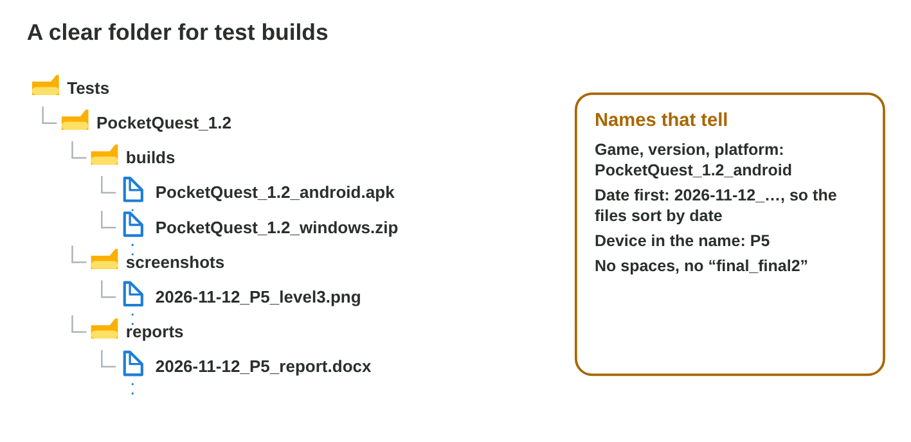

::: {.lead}
In Lecture 6 you learned where a game keeps its files, how the OS shares
the devices, and how to make a device ready for a test. Today you do both
on the lab computer and on your phone. There are no new ideas: two short
problems. Do each one alone. The results of the activities are at the end
of this worksheet.
:::

## Recall

- The file system keeps files in folders; a path goes one folder deeper at
  every `\` (Android: `/`); the extension names the kind of file.
- A phone on USB needs the **file transfer** mode (iPhone: Trust this
  computer).
- The device check: 2 GB free, battery above 50 %, only the game open, Do
  not disturb, the OS version in the report.

::: {.callout-tip title="Try it 1 · Recall"}
Choose the right answer.

::: {.match extra="1 GB|.exe"}
Which extension has a save file?
:   .sav

How much free storage does the device check ask for?
:   at least 2 GB

The phone charges, but the PC shows no files. What do you change?
:   the USB mode to file transfer
:::
:::

## Activity 1 · A screenshot in the test folder

A test team keeps one folder per game build, with the subfolders
**builds**, **screenshots** and **reports**. A good file name says **what**,
**which device**, and **when**, with no spaces and the date first as
year-month-day: `2026-11-12_P5_level3.png`. Then the files sort in time
order.

{width=92%}



::: {.callout-note title="Activity 1 · Copy and name · 15 min"}
1. Do the three tasks of **Name Checker**.
2. In Documents, make the folder `Tests\PocketQuest_1.2\screenshots`.
3. Take a screenshot on your phone. Copy it into the folder (USB in file
   transfer mode, or the cloud). Rename it with the date, your phone and
   what it shows.

*Your product:* one renamed screenshot in the right folder.

::: {.check}
A good result: `Documents\Tests\PocketQuest_1.2\screenshots\2026-11-12_A35_home.png`
(today's date, your phone, what it shows, no spaces). Copy first, check the
file on the PC, and only then delete it from the phone.
:::
:::

::: {.callout-tip title="Try it 2 · Names and copies"}
Choose the right answer.

::: {.match extra="game final new.apk|delete it at once"}
Which is the best name for the Android build of version 1.2?
:   PocketQuest_1.2_android.apk

What is wrong with IMG_4821.png?
:   it says nothing about the test

What do you do before you delete a file from the phone?
:   check that the copy is on the PC
:::
:::

## Activity 2 · Make the phone ready for a test

Rami must test *Pocket Quest 1.2* on phone **P5** for 40 minutes. P5 has
**1.1 GB** free, the battery shows **34 %**, and **9 apps** are open.
Clearing an app's **cache** frees space and keeps its progress; clearing
its **storage** (data) deletes the progress.

{width=86%}



::: {.callout-note title="Activity 2 · The device check · 15 min"}
1. In **Test Day**, prepare Rami's phone P5 for the test.
2. On your own phone, write the free space (Settings › Storage) and the
   battery level. Does it pass the device check? If not, write what you do
   first.

*Your product:* your score and two short lines.

::: {.check}
Test Day: delete old videos and clear caches, charge above 50 %, close the
other apps, set USB to file transfer, name the screenshot
`2026-11-12_P5_level3.png`, and turn on Do not disturb. A good answer for
your phone: "9.4 GB free, battery 72 %: it passes. I close the other apps
and turn on Do not disturb before the test."
:::
:::

::: {.callout-tip title="Try it 3 · The device check"}
Choose the right answer.

::: {.match extra="Clear storage|test now"}
Which button frees space and keeps the progress?
:   Clear cache

A phone has 1.6 GB free and clears 0.6 GB of caches. Is it ready for the test?
:   yes, 2.2 GB is more than 2 GB

The battery shows 34 %. What do you do before a 40-minute test?
:   charge it above 50 % first

A call stopped the last test. What do you turn on?
:   Do not disturb
:::
:::

## Exercises

1. Write a good name for the report of a test on phone P6 on 3 December 2026.
2. Why does the date come first, as year-month-day?
3. What is the difference between Clear cache and Clear storage?
4. Name three steps of the device check.

## Answers to the exercises

::: {.answers}
1. For example 2026-12-03_P6_report.docx.
2. The files sort in time order.
3. Clear cache keeps the progress; Clear storage deletes the progress and the logins too.
4. For example: 2 GB free, battery above 50 %, only the game open, Do not disturb.
:::
