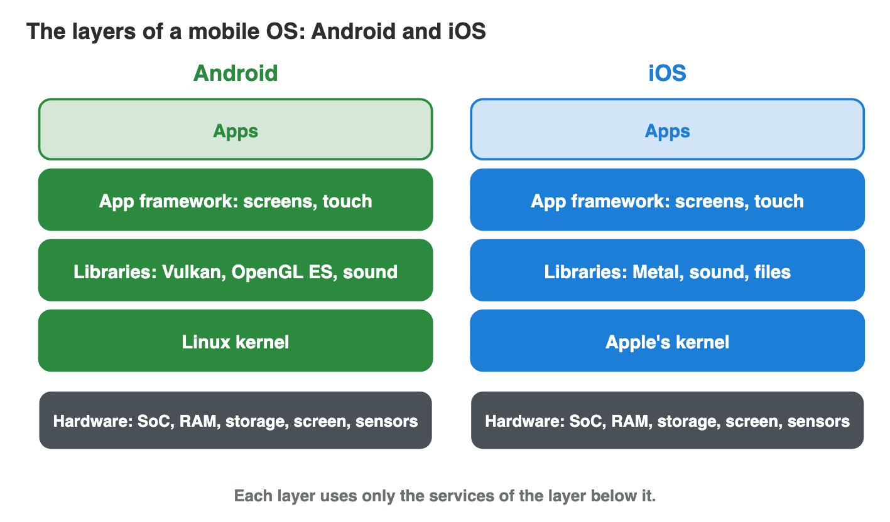
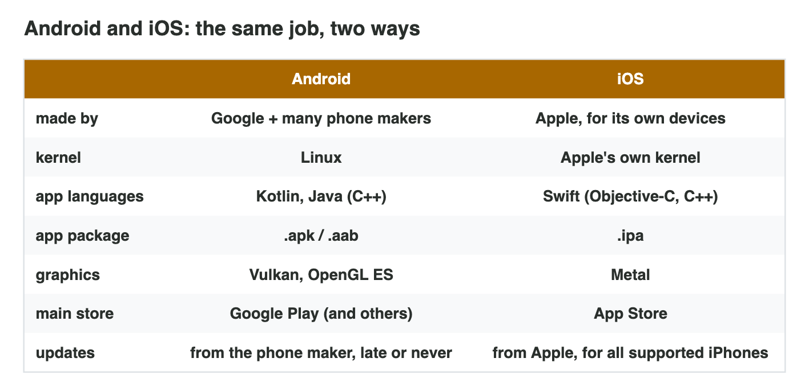
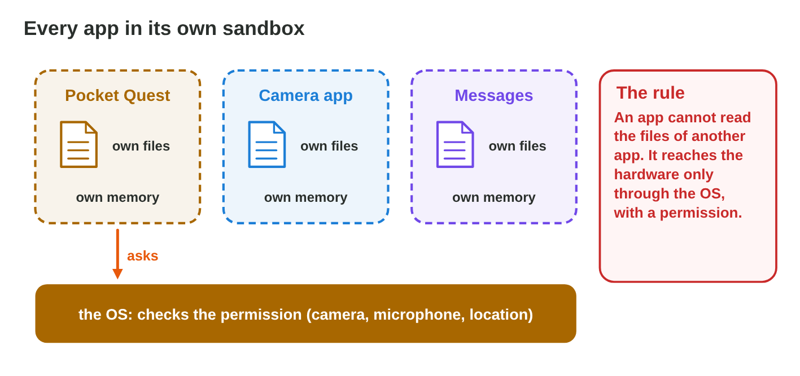
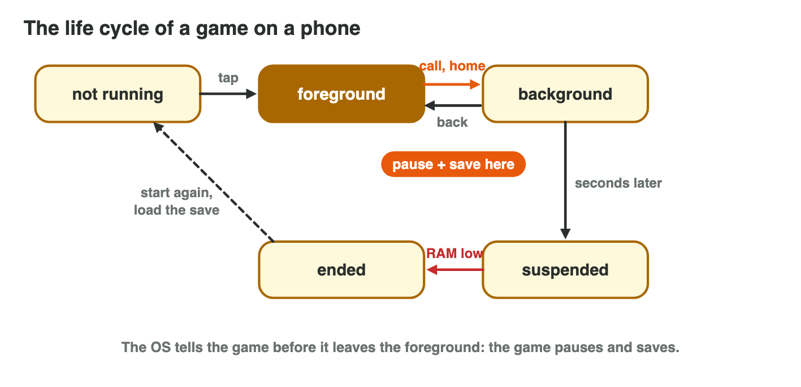

Each section: a question from a game studio, the idea, a **Do it** task and a short **Try it**.
The page checks every answer at once and tells you why. More examples
and exercises are in the lesson notes (PDF).

## Key terms



## 6.1 A mobile OS is built in layers

- A **software stack**: layers of software between the hardware and the
  apps. Each layer uses only the layer below it.
- The **kernel** is the lowest layer: processes, memory, drivers, power.
- The apps are the top layer. A game never talks to the hardware directly.
- A screenshot: app → framework → libraries (PNG) → kernel (storage
  driver) → storage chip.

{width=90%}



::: {.callout-warning title="Watch out!"}
Apps call the layers above the kernel; the OS decides what reaches the
hardware.
:::

::: {.callout-note title="Do it · Build both stacks"}
In **Stack Builder**, build the Android stack and the iOS stack from the
bottom up.

::: {.order}
Put the layers of the Android stack in order, from the bottom up.

1. the Linux kernel
2. the libraries
3. the app framework
4. the apps

Why: The kernel is the lowest layer; the apps are on top and never talk to the hardware directly.
:::
:::

::: {.callout-tip title="Try it 1 · Layers"}
Choose the right answer.

::: {.match extra="the apps|the screen"}
Which layer runs directly on the hardware?
:   the kernel

    Why: The kernel is the lowest layer.

Which layer may each layer use?
:   only the layer below it

    Why: Each layer uses only the layer below it.
:::
:::

## 6.2 Android and iOS: two ways to build the stack

- **Android:** Linux kernel → libraries → app framework → apps; Google's
  system on the phones of many makers.
- **iOS:** Apple's kernel → libraries → app framework → apps; only on
  Apple's phones.
- The OS version is in Settings › About (Android also shows the **security
  patch**).
- One Unity game, two builds: `.apk`/`.aab` with Vulkan or OpenGL ES for
  Android; `.ipa` with Metal for iOS.

{width=90%}

::: {.callout-warning title="Watch out!"}
An `.apk` cannot be installed on an iPhone. Each platform needs its own build.
:::

::: {.callout-note title="Do it · Your phone's stack"}
Read the table of Android and iOS in the figure, line by line.

::: {.sort}
Android or iOS? Sort the lines of the table.

Android
:   the Linux kernel

    Why: Android is built on the Linux kernel.

:   an `.apk` or `.aab` package

    Why: The build of an Android game.

:   Vulkan or OpenGL ES for the graphics

    Why: The graphics libraries of Android.

:   phones by many makers, such as Samsung or Xiaomi

    Why: Google makes Android; many companies make the phones.

iOS
:   Apple's own kernel

    Why: iOS has its own kernel.

:   an `.ipa` package

    Why: The build of an iOS game; an `.apk` cannot be installed on an iPhone.

:   Metal for the graphics

    Why: Metal is Apple's graphics library.
:::
:::

::: {.callout-tip title="Try it 2 · Android or iOS?"}
Choose the right answer. You can use an answer more than once.

::: {.match extra="Windows|both|Google"}
Which OS has the Linux kernel?
:   Android

    Why: Android is built on the Linux kernel.

Which OS runs on the phones of many makers?
:   Android

    Why: Google's Android runs on phones of many companies.

Which OS installs `.ipa` packages?
:   iOS

    Why: An iPhone build is an .ipa.
:::
:::

## 6.3 Every app in its own sandbox

- A **sandbox**: each app has its own files and its own memory.
- An app cannot read the files of another app.
- The camera, microphone, location and contacts: only through the OS,
  with a **permission**.
- The game's progress is saved in its own sandbox: "Clear storage" or
  deleting the app removes it.

{width=90%}

::: {.callout-warning title="Watch out!"}
A game cannot save in any folder it likes; it saves in its own sandbox.
:::

::: {.callout-note title="Do it · Look at the sandbox"}
Open the settings of one game on your phone: the storage of its data and its
permissions. *Pocket Quest* shows: data 850 MB; Storage allowed, Microphone
not allowed.

::: {.choice}
Where does the game save its progress?

- [x] in its own sandbox

  Why: Each app has its own files; the data of Pocket Quest lives only there.

- [ ] in any folder it likes

  Why: An app cannot write outside its sandbox.

- [ ] in the files of another app

  Why: An app cannot read or write the files of another app.
:::
:::

::: {.callout-tip title="Try it 3 · The sandbox"}
Choose the right answer.

::: {.match extra="all photos of the phone|the kernel of the phone"}
Pocket Quest wants the camera. Whom does it ask?
:   the OS

    Why: Apps reach the hardware only through the OS.

Can Pocket Quest read the files of the messages app?
:   no, they are in another sandbox

    Why: Each app has its own sandbox.
:::
:::

## 6.4 The life cycle of a game

- States: **not running → foreground → background → suspended → ended**.
- The OS tells the game before it leaves the foreground: the game **pauses
  and saves**.
- In the background, a game gets little or no CPU time; iOS suspends it.
- When RAM is low, the OS ends background apps. Only the saved progress
  survives.

{width=90%}

::: {.callout-warning title="Watch out!"}
Do not save only on "Quit": the OS can end a game without warning.
:::

::: {.callout-note title="Do it · Watch the life cycle"}
Play a game for a moment, go to the home screen, wait a minute and come
back. Then open many other apps and come back again.

::: {.order}
Put the states of a game in order.

1. not running
2. foreground
3. background
4. suspended
5. ended

Why: The player starts the game, leaves it, the OS pauses it, and at last the OS may end it.
:::
:::

::: {.callout-tip title="Try it 4 · States"}
Choose the right state or step.

::: {.match extra="not running|the kernel"}
The game is on the screen and running. Which state?
:   foreground

    Why: The app on the screen is in the foreground.

A call arrives. What must the game do?
:   pause and save

    Why: The OS may end it later; only saved progress survives.

The game is in RAM but gets no CPU time. Which state?
:   suspended

    Why: A suspended app waits in RAM without CPU time.
:::
:::

## Game challenge: Pause, Please! {.challenge}

Work alone. Use every section of today.

Rami tests *Pocket Quest 1.2* on **P5 (Android, 4 GB RAM)** and on **P8 (an
iPhone)**. A **call** arrives in level 3. Later he opens **ten other apps**,
and at the end he opens the game again.



::: {.callout-tip title="Try it 5 · The test day"}
Choose the right answer.

::: {.match extra="the game gets more CPU time|it moves to the cloud"}
On P8 the game stays in the background a few seconds. What does iOS do?
:   suspends it

    Why: iOS suspends background apps quickly.

Rami opens the game again after it was ended. What does he see?
:   level 3 from the saved point

    Why: The game saved when the call came.
:::
:::

::: {.callout-tip title="Try it 6 · Two builds (harder)"}
Choose the right answer.

::: {.match extra="Vulkan|only on Quit"}
Can the P5 build (.apk) be installed on P8?
:   no, P8 needs its own .ipa build

    Why: An .apk is made for the Android stack.
:::
:::

## Summary {.summary}

- A mobile OS is a stack of layers, from the kernel on the hardware to the
  apps.
- Android and iOS fill the same layers: kernel, libraries, framework, apps.
- Each platform needs its own build (`.apk`/`.aab` or `.ipa`).
- Every app has its own sandbox; hardware only with a permission.
- A game must pause and save when it leaves the foreground: the OS may end
  it later.
