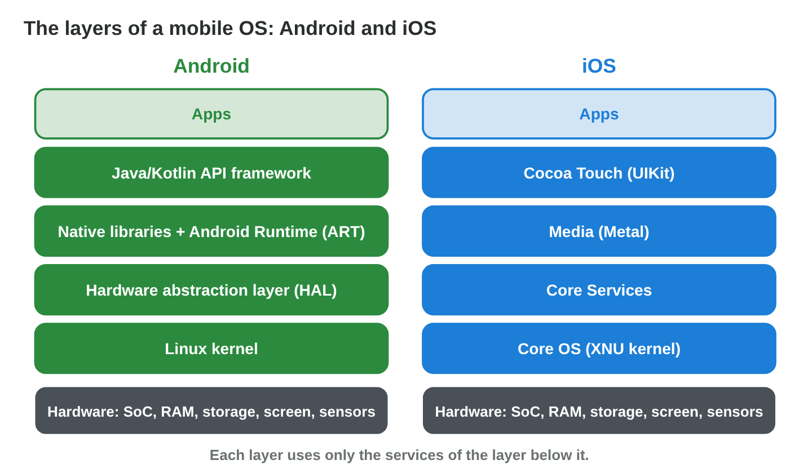
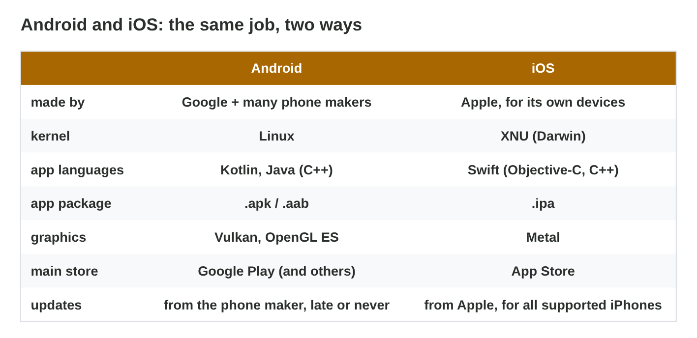
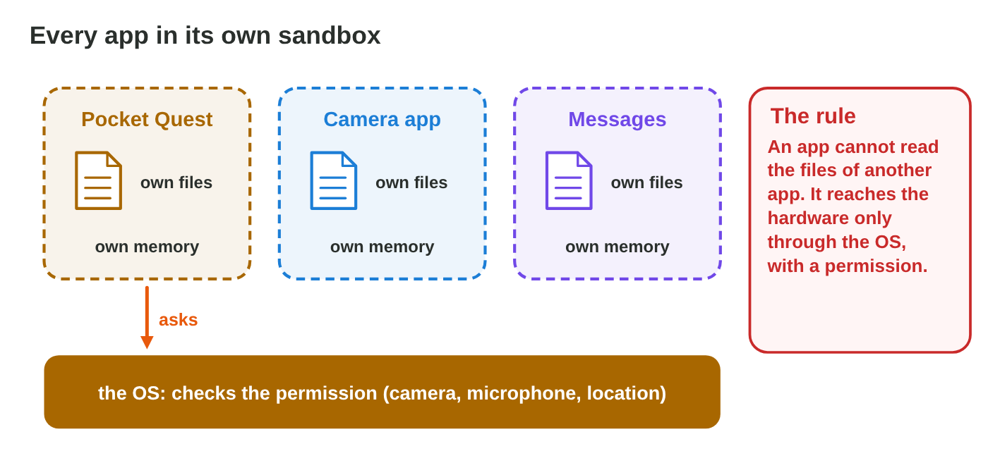
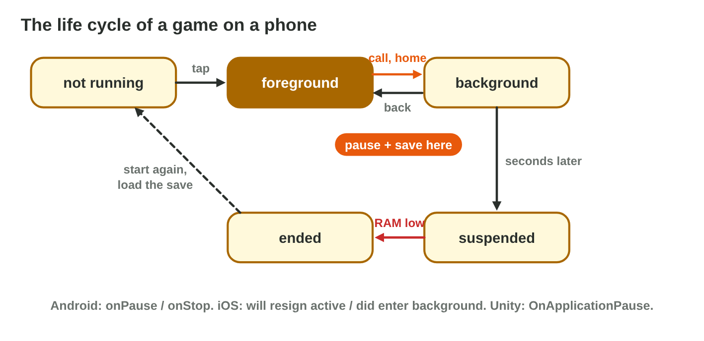

This page is the interactive version of the lesson notes (PDF). Each section
starts with a problem at a game studio. Then it explains the idea behind it.
It ends with a **Do it** task and one set of questions. The full
explanations, examples and exercises are in the notes.

## Key terms



## 13.1 A mobile OS is built in layers

- A **software stack**: layers of software between the hardware and the
  apps. Each layer uses only the layer below it.
- The **kernel** is the lowest layer: processes, memory, drivers, power.
- The apps are the top layer. A game never talks to the hardware directly.
- A screenshot: app → framework → libraries (PNG) → kernel (storage
  driver) → storage chip.

{width=90%}



::: {.callout-warning title="Watch out!"}
Apps call the layers above the kernel; the OS decides what reaches the
hardware.
:::

::: {.callout-note title="Do it · Build both stacks"}
In **Stack Builder**, build the Android stack and the iOS stack from the
bottom up. Which iOS layer does the job of the Linux kernel?
:::

::: {.callout-tip title="Try it 1 · Layers"}
Choose the right answer.

::: {.match extra="the apps|the screen"}
Which layer runs directly on the hardware?
:   the kernel

Which layer is at the top of the stack?
:   the apps

Which layer may each layer use?
:   only the layer below it

Which job does the kernel do?
:   manages processes, memory and drivers
:::
:::

## 13.2 Android and iOS: two ways to build the stack

- **Android:** Linux kernel → **HAL** → native libraries + **Android
  Runtime (ART)** → Java/Kotlin framework → apps.
- **iOS:** Core OS (XNU kernel) → Core Services → Media (Metal) → Cocoa
  Touch → apps.
- Android: Google plus many phone makers; the HAL gives one standard way to
  use the hardware of every maker. iOS: only Apple.
- One Unity game, two builds: `.apk`/`.aab` with Vulkan or OpenGL ES for
  Android; `.ipa` with Metal for iOS.

{width=90%}

::: {.callout-warning title="Watch out!"}
An `.apk` cannot be installed on an iPhone. Each platform needs its own build.
:::

::: {.callout-note title="Do it · Your phone's stack"}
Which OS does your phone run, and who made the phone and the OS? Find two
lines of the table that differ for your phone and a phone of the other OS.
:::

::: {.callout-tip title="Try it 2 · Android or iOS?"}
Choose the right answer. You can use an answer more than once.

::: {.match extra="Windows|both"}
Which OS has the Linux kernel?
:   Android

Which OS uses Metal for graphics?
:   iOS

Which OS has a hardware abstraction layer for many phone makers?
:   Android

Which OS installs `.ipa` packages?
:   iOS

Which OS runs app code in ART?
:   Android
:::
:::

## 13.3 Every app in its own sandbox

- A **sandbox**: each app has its own files and its own memory.
- An app cannot read the files of another app.
- The camera, microphone, location and contacts: only through the OS,
  with a **permission**.
- The game's progress is saved in its own sandbox: "Clear storage" or
  deleting the app removes it.

{width=90%}

::: {.callout-warning title="Watch out!"}
A game cannot save in any folder it likes; it saves in its own sandbox.
:::

::: {.callout-note title="Do it · Look at the sandbox"}
Open the settings of one game on your phone. How much storage does its
data use, and which permissions does it have?
:::

::: {.callout-tip title="Try it 3 · The sandbox"}
Choose the right answer.

::: {.match extra="all photos of the phone|the kernel of the phone"}
Pocket Quest wants the camera. Whom does it ask?
:   the OS

What does the game get after Rami allows the camera?
:   the picture of the camera only

Can Pocket Quest read the files of the messages app?
:   no, they are in another sandbox

What removes the saved progress of a game?
:   clearing its storage or deleting the app
:::
:::

## 13.4 The life cycle of a game

- States: **not running → foreground → background → suspended → ended**.
- The OS tells the game before it leaves the foreground: the game **pauses
  and saves** (Android: onPause; iOS: will resign active; Unity:
  `OnApplicationPause`).
- In the background, a game gets little or no CPU time; iOS suspends it.
- When RAM is low, the OS ends background apps. Only the saved progress
  survives.

{width=90%}

::: {.callout-warning title="Watch out!"}
Do not save only on "Quit": the OS can end a game without warning.
:::

::: {.callout-note title="Do it · Watch the life cycle"}
Play a game for a moment, go to the home screen, wait a minute and come
back. Then open many other apps and come back again. What happened each
time?
:::

::: {.callout-tip title="Try it 4 · States"}
Choose the right state or step.

::: {.match extra="not running|the kernel"}
The game is on the screen and running. Which state?
:   foreground

A call arrives. What must the game do?
:   pause and save

The game is in RAM but gets no CPU time. Which state?
:   suspended

RAM is low. What may happen to a game in the background?
:   it is ended
:::
:::

## Game challenge: Pause, Please! {.challenge}

Work alone. Use every section of today.

Rami tests *Pocket Quest 1.2* on **P5 (Android, 4 GB RAM)** and on **P8 (an
iPhone)**. A **call** arrives in level 3. Later he opens **ten other apps**,
and at the end he opens the game again.



::: {.callout-tip title="Try it 5 · The test day"}
Choose the right answer.

::: {.match extra="the game gets more CPU time|it moves to the cloud"}
Rami taps the icon. In which state is the game?
:   foreground

On P8 the game stays in the background a few seconds. What does iOS do?
:   suspends it

RAM is low on P5. What does Android do?
:   ends the game in the background

Rami opens the game again after it was ended. What does he see?
:   level 3 from the saved point
:::
:::

::: {.callout-tip title="Try it 6 · Two builds (harder)"}
Choose the right answer.

::: {.match extra="Vulkan|Swift"}
Which package does Byte Bay build for P8?
:   .ipa

Which graphics interface does the P8 build use?
:   Metal

Which layer lets the P5 camera work the same as on other Android phones?
:   the HAL

Which Unity function is the right place to save on a phone?
:   OnApplicationPause
:::
:::

## Summary {.summary}

- A mobile OS is a stack of layers, from the kernel on the hardware to the
  apps.
- Android: Linux kernel, HAL, libraries and ART, framework, apps. iOS: Core
  OS, Core Services, Media, Cocoa Touch, apps.
- Each platform needs its own build (`.apk`/`.aab` or `.ipa`).
- Every app has its own sandbox; hardware only with a permission.
- A game must pause and save when it leaves the foreground: the OS may end
  it later.
