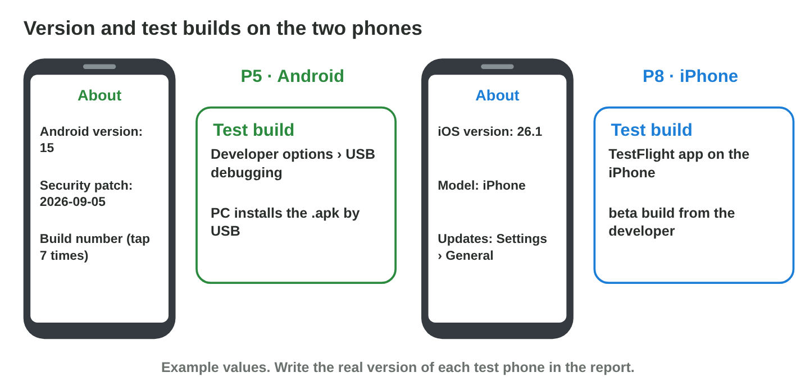
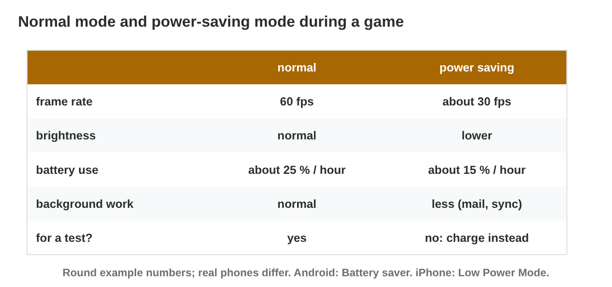

This page is the interactive version of the lesson notes (PDF). Each section
starts with a problem on a test day. Then it shows what a tester does on
each phone. It ends with a **Do it** task and one set of questions. The full
explanations, examples and exercises are in the notes.

## Key terms



## 14.1 Versions and test builds

- **Android:** Settings › About phone: Android version, **security patch**,
  build number. Each version has an **API level**.
- **iPhone:** Settings › General › About: iOS version.
- Test build on Android: tap Build number 7 times → **developer options** →
  **USB debugging**; the PC installs the `.apk`.
- Test build on iPhone: a **beta build** through TestFlight (or a Mac with
  Xcode).

{width=90%}

::: {.callout-warning title="Watch out!"}
Turn USB debugging off on a personal phone, and never install `.apk` files
from unknown websites.
:::

::: {.callout-note title="Do it · Read your version"}
Find the OS version of your phone (and the security patch on Android).
Compare with a classmate who has the other system: which phone got its last
update later?
:::

::: {.callout-tip title="Try it 1 · Versions and builds"}
Choose the right answer.

::: {.match extra="Settings › Battery|the box of the phone"}
Where does Android show the security patch?
:   Settings › About phone

Where does an iPhone show its iOS version?
:   Settings › General › About

How do you show developer options?
:   tap Build number 7 times

How does a beta build reach an iPhone?
:   through TestFlight
:::
:::

## 14.2 Permissions and privacy

- A **runtime permission** is asked when the app first needs the camera,
  microphone, location, contacts or notifications.
- Location: while using the app · **only this time** (iPhone: **Allow
  Once**) · don't allow.
- Give only what the game needs; change it later in the app's settings.
- Rami: location only this time, no microphone (no voice chat in the test),
  notifications allowed (the test checks the reward message).

{width=90%}

::: {.callout-warning title="Watch out!"}
A game that asks for the contacts without a reason is a warning sign.
:::

::: {.callout-note title="Do it · Check the permissions"}
Open the permission page of a game and of one other app. Turn off one
permission the app does not need. Does it still work?
:::

::: {.callout-tip title="Try it 2 · Permissions"}
Choose the right answer.

::: {.match extra="Allow all the time|uninstall the phone"}
Which iPhone answer gives the location only now?
:   Allow Once

Which Android answer gives the location only now?
:   Only this time

The test has no voice chat. The game asks for the microphone. What do you answer?
:   Don't allow

Where do you change a permission later on iPhone?
:   Settings › the app
:::
:::

## 14.3 Power saving, Do not disturb and the game

- **Power-saving mode** (Android: Battery saver; iPhone: Low Power Mode):
  lower CPU speed, often 30 fps instead of 60, lower brightness, less
  background work. Offered at about 20 %.
- **Do not disturb** (iPhone: a Focus): no calls or notifications during
  the test.
- For a fair test: charge the phone, keep power saving off, turn Do not
  disturb on.

{width=90%}



::: {.callout-warning title="Watch out!"}
With power saving on, the test measures the power-saving mode, not the
game.
:::

::: {.callout-note title="Do it · Find the switches"}
Find power saving and Do not disturb on your phone. In **Power Lab**, set
the battery to 20 % and turn power saving on. What happens to the frame
rate and the play time?
:::

::: {.callout-tip title="Try it 3 · Power and focus"}
Use Power Lab. Choose the right answer.

::: {.match extra="120 fps|the battery runs out faster"}
What is the frame rate with power saving on?
:   30 fps

What does power saving do to the play time?
:   it gets longer

What stops notifications during a test?
:   Do not disturb

Should a tester keep power saving on during a test?
:   no, charge the phone instead
:::
:::

## Game challenge: Two Phones {.challenge}

Work alone. Use every section of today.

Rami prepares the test of *Pocket Quest 1.2* on **P5 (Android)** and **P8
(an iPhone)**: versions, test builds, permissions, notifications, and
**Low Power Mode at 18 %**.



::: {.callout-tip title="Try it 4 · The two phones"}
Choose the right step. You can use an answer more than once.

::: {.match extra="the Play Store|Bluetooth"}
Install the test build on P5 from the PC?
:   developer options and USB debugging

Install the test build on P8?
:   TestFlight

Stop notifications on P8 during the test?
:   a Focus: Do Not Disturb

P8 asks for Low Power Mode at 18 %?
:   say no and charge the phone
:::
:::

::: {.callout-tip title="Try it 5 · Compare (harder)"}
Android or iPhone? You can use an answer more than once.

::: {.match extra="both|neither"}
Which phone installs a test build from an `.apk` file?
:   Android

Which phone gets its updates from one maker for all models at once?
:   iPhone

Which phone shows a security patch date in About phone?
:   Android

Which phone calls the power-saving mode Low Power Mode?
:   iPhone
:::
:::

## Summary {.summary}

- Version: Android in About phone (with the security patch), iPhone in
  General › About.
- Test builds: developer options and USB debugging on Android, TestFlight
  on iPhone.
- Runtime permissions: give only what the game needs; change them later in
  the settings.
- For a fair test: power saving off and the phone charged; Do not disturb
  on.
