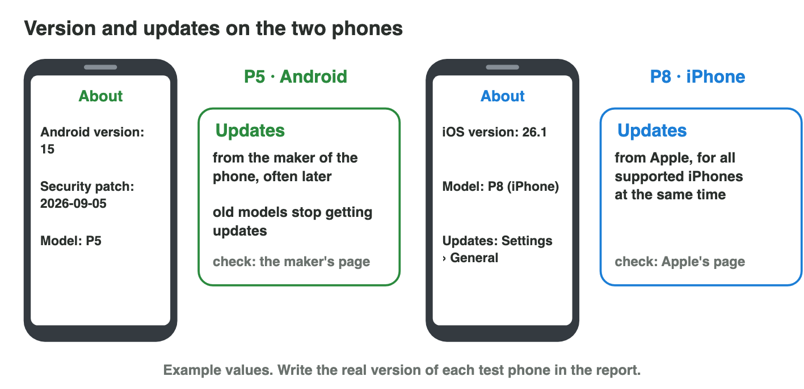
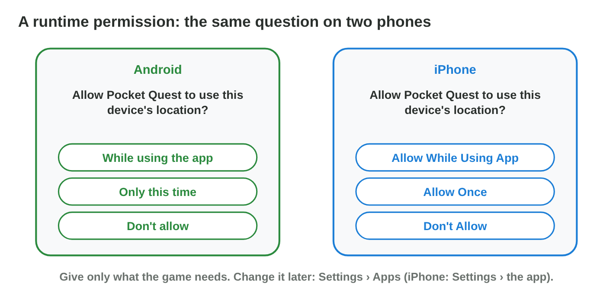

No new ideas today: two short problems on Lecture 6, on your phone. Do each
one alone. Tap, sort or type your answer at every step: the page checks it
at once and tells you why.

## Recall

- A mobile OS is a stack of layers: kernel, libraries, app framework, apps.
  Each platform needs its own build (`.apk`/`.aab` or `.ipa`).
- Every app lives in its own **sandbox**. It reaches the camera, the
  microphone or the location only through the OS, with a **permission**.
- A game pauses and saves when it leaves the foreground.

::: {.callout-tip title="Try it 1 · Recall"}
Choose the right answer.

::: {.match extra="the app framework|.apk"}
Which layer of a mobile OS runs directly on the hardware?
:   the kernel

    Why: The kernel is the lowest layer; it manages processes, memory and drivers.

Which package does an iPhone install?
:   .ipa

    Why: An .apk is made for Android; an iPhone needs its own .ipa build.

A game wants the microphone. Who decides?
:   the user, when the OS asks

    Why: Apps reach the hardware only through the OS, after the user gives a permission.
:::
:::

## Activity 1 · Your phone's version and its updates

A bug report always names the phone and its **OS version**: a bug may
appear on Android 13 but not on Android 15. **Security updates** close holes
for harmful apps. Android phones get their updates from the **maker of the
phone**, often later, and old models stop getting them. Apple updates **all
supported iPhones at the same time**.

{width=90%}

::: {.callout-note title="Activity 1 · Version and updates · 15 min"}
1. Find the OS version of your phone. **Android:** Settings › About phone
   (also the security patch date). **iPhone:** Settings › General › About.
2. Open the update page of your phone's maker (search for the maker's name
   and "security updates"). Does your model still get updates?

*Your product:* the version, the patch date (Android) and what the maker's
page says about your model.

Huda's phone shows Android 14 with the security patch 2026-08-01, and
Samsung's security page lists her model (A35) with monthly updates.

::: {.choice}
Step 2: where does the fact "my model still gets updates" come from?

- [x] the maker's update page for this model

  Why: The maker decides the updates of each model.

- [ ] another student's phone

  Why: Another model can have other updates.

- [ ] the store page of a game

  Why: A game page shows what the game needs, not the updates of the phone.
:::

::: {.sort}
Android phones or iPhones? Sort the facts.

Android phones
:   They get their updates from the maker of the phone, often later.

    Why: Samsung, Xiaomi and others send their own updates.

:   About phone shows a security patch date.

    Why: Android lists the date of its last security patch.

:   Old models stop getting updates sooner.

    Why: Each maker supports its models for its own time.

iPhones
:   All supported models get an update at the same time.

    Why: Apple updates all supported iPhones together.
:::
:::

::: {.callout-tip title="Try it 2 · Android and iOS"}
Choose the right answer.

::: {.match extra="Settings › Battery|the box of the phone"}
Where does an Android phone show its security patch date?
:   Settings › About phone

    Why: About phone shows the Android version, the patch date and the model.

Where does an iPhone show its iOS version?
:   Settings › General › About

    Why: General › About shows the iOS version and the model.

Which phones get their updates from one maker, for all models at the same time?
:   iPhones

    Why: Apple makes iOS and the iPhones, and updates all supported models together.
:::
:::

## Activity 2 · Give a game only what it needs

The new *Pocket Quest* has a map of real places and a voice chat. On a test
day it asks for the location, the microphone, the notifications and the
contacts. The test lasts one day, has **no voice chat**, and checks the
daily reward message. For the location, Android offers **Only this time**;
the iPhone calls it **Allow Once**.

{width=90%}

::: {.callout-note title="Activity 2 · Four questions · 15 min"}
1. Copy the table. Write the answer and a reason for each question.

   | Question | Answer | Reason |
   |---|---|---|
   | Location for the map | | |
   | Microphone | | |
   | Notifications | | |
   | Contacts | | |

2. On your phone, open the permissions of one game (Android: Settings ›
   Apps › the game › Permissions; iPhone: Settings › the game). Turn off one
   permission it does not need. Does the game still work?

*Your product:* the filled table and one change on your phone.

::: {.sort}
Step 1: the one-day test has no voice chat and checks the daily reward
message. Sort the questions by the right answer.

Allow
:   Notifications

    Why: The test checks the reward message.

Only this time (iPhone: Allow Once)
:   Location for the map

    Why: The map is needed only for this one test.

Don't allow
:   Microphone

    Why: The test has no voice chat.

:   Contacts

    Why: The game does not need them.
:::

::: {.choice}
Step 2: you turn off the microphone of a puzzle game. What happens?

- [x] The game still works: it does not need the microphone.

  Why: Give a game only what it needs; it asks again if a feature needs it.

- [ ] The game cannot start any more.

  Why: A permission controls one device, not the whole game.

- [ ] The game loses its progress.

  Why: The progress is in its sandbox; permissions do not touch it.
:::
:::

::: {.callout-tip title="Try it 3 · Permissions and the sandbox"}
Choose the right answer.

::: {.match extra="Allow all the time|keep playing"}
Which iPhone answer gives the location only now?
:   Allow Once

    Why: Allow Once gives the location now and asks again next time.

The test has no voice chat. What do you answer when the game asks for the microphone?
:   Don't allow

    Why: Give an app only what it needs for the test.

Why can a game not read the photos of another app without asking?
:   every app has its own sandbox

    Why: The sandbox keeps the files of each app apart.

A call comes during a match. What must the game do?
:   pause and save

    Why: The game leaves the foreground and may be closed.
:::
:::

## Wrap-up {.summary}

- You can find the OS version and the updates of a phone, and say how
  Android and iOS get their updates.
- You can give a game only the permissions it needs, on Android and on
  iPhone.
