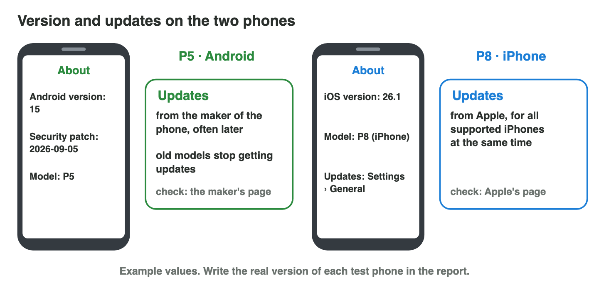
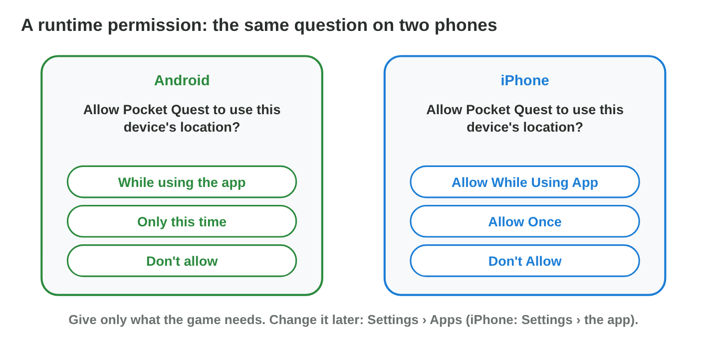

::: {.lead}
In Lecture 7 you learned how Android and iOS are built in layers, how each
app lives in its own sandbox, and what happens when a game leaves the
screen. Today you look at your own phone. There are no new ideas: two short
problems. Do each one alone. The results of the activities are at the end
of this worksheet.
:::

## Recall

- A mobile OS is a stack of layers: kernel, libraries, app framework, apps.
  Each platform needs its own build (`.apk`/`.aab` or `.ipa`).
- Every app lives in its own **sandbox**. It reaches the camera, the
  microphone or the location only through the OS, with a **permission**.
- A game pauses and saves when it leaves the foreground.

::: {.callout-tip title="Try it 1 · Recall"}
Choose the right answer.

::: {.match extra="the app framework|.apk"}
Which layer of a mobile OS runs directly on the hardware?
:   the kernel

Which package does an iPhone install?
:   .ipa

A game wants the microphone. Who decides?
:   the user, when the OS asks
:::
:::

## Activity 1 · Your phone's version and its updates

A bug report always names the phone and its **OS version**: a bug may
appear on Android 13 but not on Android 15. **Security updates** close holes
for harmful apps. Android phones get their updates from the **maker of the
phone**, often later, and old models stop getting them. Apple updates **all
supported iPhones at the same time**.

{width=90%}

::: {.callout-note title="Activity 1 · Version and updates · 15 min"}
1. Find the OS version of your phone. **Android:** Settings › About phone
   (also the security patch date). **iPhone:** Settings › General › About.
2. Open the update page of your phone's maker (search for the maker's name
   and "security updates"). Does your model still get updates?

*Your product:* the version, the patch date (Android) and what the maker's
page says about your model.

::: {.check}
A good answer: "Android 14, security patch 2026-08-01, in Settings › About
phone. Samsung's security updates page lists my model (A35) with monthly
updates." Or: "iOS 26.1, in Settings › General › About. Apple's page lists
26.1 as the newest version: my iPhone is up to date." The update fact comes
from the maker's page, not from another phone.
:::
:::

::: {.callout-tip title="Try it 2 · Android and iOS"}
Choose the right answer.

::: {.match extra="Settings › Battery|the box of the phone"}
Where does an Android phone show its security patch date?
:   Settings › About phone

Where does an iPhone show its iOS version?
:   Settings › General › About

Which phones get their updates from one maker, for all models at the same time?
:   iPhones
:::
:::

## Activity 2 · Give a game only what it needs

The new *Pocket Quest* has a map of real places and a voice chat. On a test
day it asks for the location, the microphone, the notifications and the
contacts. The test lasts one day, has **no voice chat**, and checks the
daily reward message. For the location, Android offers **Only this time**;
the iPhone calls it **Allow Once**.

{width=90%}

::: {.callout-note title="Activity 2 · Four questions · 15 min"}
1. Copy the table. Write the answer and a reason for each question.

   | Question | Answer | Reason |
   |---|---|---|
   | Location for the map | | |
   | Microphone | | |
   | Notifications | | |
   | Contacts | | |

2. On your phone, open the permissions of one game (Android: Settings ›
   Apps › the game › Permissions; iPhone: Settings › the game). Turn off one
   permission it does not need. Does the game still work?

*Your product:* the filled table and one change on your phone.

::: {.check}
Location: Only this time (iPhone: Allow Once): the map is needed for this
one test. Microphone: Don't allow: the test has no voice chat.
Notifications: Allow: the test checks the reward message. Contacts: Don't
allow: the game does not need them. On your phone, a good change is
"Microphone off for a puzzle game; the game still works."
:::
:::

::: {.callout-tip title="Try it 3 · Permissions and the sandbox"}
Choose the right answer.

::: {.match extra="Allow all the time|keep playing"}
Which iPhone answer gives the location only now?
:   Allow Once

The test has no voice chat. What do you answer when the game asks for the microphone?
:   Don't allow

Why can a game not read the photos of another app without asking?
:   every app has its own sandbox

A call comes during a match. What must the game do?
:   pause and save
:::
:::

## Exercises

1. Why does a bug report name the OS version of the phone?
2. Who sends the updates of an Android phone?
3. A puzzle game asks for the contacts. What do you answer, and why?
4. What must a game do when it leaves the foreground?

## Answers to the exercises

::: {.answers}
1. A bug may appear on one version and not on another.
2. The maker of the phone.
3. Don't allow: a puzzle game does not need them.
4. Pause and save.
:::
