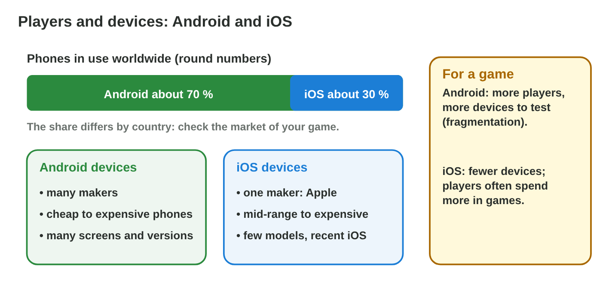
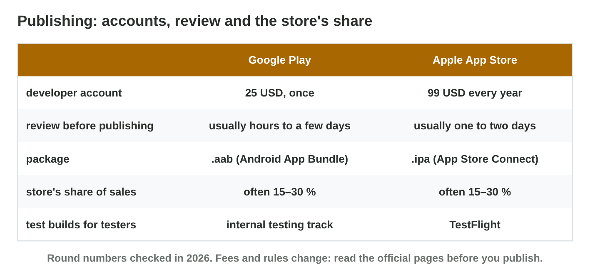

## Keywords



## 15.1 Players and devices

:::: {.columns}
::: {.column width="50%"}
- Worldwide, about seven in ten phones run Android.
- The share is different in each country, so we check it with its date.
- Android runs on many makers and models, and iOS on a few iPhones.
- **Do it:** Count the Android phones and iPhones in the class. Is it 70 / 30?
:::
::: {.column width="50%"}

:::
::::

## Try it 1 · Players and devices

a) About how many phones in ten run Android worldwide?
b) What does fragmentation mean for a tester?
c) Why do we look at the share of one country?

::: {.answer}
a) about seven
b) many models and versions to test
c) Players differ from country to country.
:::

## 15.2 Building and testing

:::: {.columns}
::: {.column width="50%"}
- Android Studio runs on Windows, macOS and Linux.
- Xcode runs only on a Mac, so an iOS build needs a Mac.
- Android needs more real test phones than iOS.
- **Do it:** Plan a launch on both with only Windows PCs. What is the problem?
:::
::: {.column width="50%"}

:::
::::

## Example · Byte Bay's computers

Byte Bay has five Windows PCs and no Mac.
**Which builds can the studio make, and on which phones does it test?**

::: {.reveal}
1. The **Android** build is possible today, on any of the PCs.
2. The **iOS** build waits until the studio buys or rents a Mac.
3. It tests on P5, P6 and P7 for Android, and on two iPhones for iOS.
:::

## Live demo · Launch Planner



## Try it 2 · Build and test

a) On which computer can Xcode run?
b) Byte Bay has only Windows PCs. Which build can it make?
c) Why are emulators not enough for testing?

::: {.answer}
a) only on a Mac
b) the Android build
c) A virtual phone has no real battery, heat or weak chip.
:::

## 15.3 Publishing

:::: {.columns}
::: {.column width="50%"}
- A Google Play account costs about 25 USD once.
- An Apple developer account costs about 99 USD every year.
- Both stores review every game and keep a share of the sales.
- **Do it:** What do both accounts cost together for three years?
:::
::: {.column width="50%"}

:::
::::

## Example · The first year

A game sells for 2 USD, and the store keeps 30 % of each sale.
**What does Byte Bay pay for accounts, and what does it get per sale?**

::: {.reveal}
1. Android only costs **25 USD once**.
2. iOS only costs **99 USD**, and 99 USD again next year.
3. The studio gets 2 × 0.7 = **1.40 USD** per sale on either store.
:::

## Try it 3 · Publishing

a) How much does the Apple Developer Program cost?
b) What do both accounts cost together for three years?
c) A 5 USD game sells, and the store keeps 30 %. What does the studio get?

::: {.answer}
a) about 99 USD every year
b) 25 + 3 × 99 = 322 USD
c) 3.50 USD
:::

## 15.4 Openness and updates

:::: {.columns}
::: {.column width="50%"}
- Android is open, and apps can come from other stores or an .apk file.
- iOS is closed, and apps come mainly from the App Store.
- Android updates come from each maker, but Apple updates all iPhones at once.
- **Do it:** When did your phone get its last system update?
:::
::: {.column width="50%"}

:::
::::

## Try it 4 · Open or closed?

a) Which platform installs an .apk file from outside the store?
b) Which platform updates every supported phone at the same time?
c) Why does a tester still test on an old Android version?

::: {.answer}
a) Android
b) iOS
c) Many phones never get the newest version.
:::

## Game challenge · Platform Pick



## Try it 5 · Advice (harder)

a) Which platform should a studio with only Windows PCs and budget-phone players choose first?
b) Which platform fits a studio with a Mac whose players mostly have iPhones?
c) What should a studio with a Mac and players all over the world choose?

::: {.answer}
a) Android first
b) iOS first, or both
c) both platforms
:::

## Summary

- Android reaches more phones worldwide, but each country is different.
- Android builds on any PC, and iOS needs a Mac.
- Google takes a one-time fee, and Apple a yearly fee.
- Android is open and updated by each maker, and iOS by Apple.
