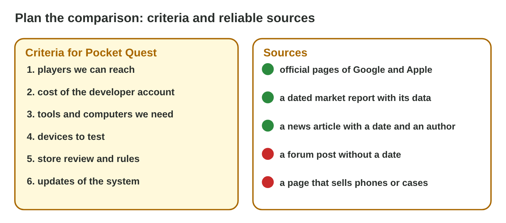
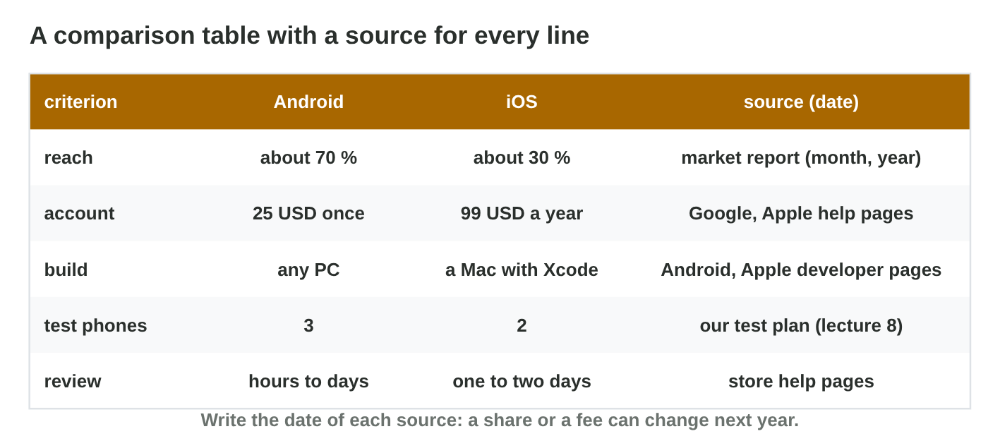

## Keywords



## 16.1 Criteria and sources

:::: {.columns}
::: {.column width="50%"}
- The criteria are the points we compare for one decision.
- A reliable source has an author, a date and its data.
- The best source for a platform fact is the maker's own page.
- **Do it:** Write five criteria for Pocket Quest. Which one matters most?
:::
::: {.column width="50%"}

:::
::::

## Live demo · Source Check



## Try it 1 · Sources

a) Which source is best for the fee of Apple's developer account?
b) A forum post has no author and no date. Do we use it?
c) Is a page that sells phone cases a reliable source?

::: {.answer}
a) Apple's developer page, with this year's date
b) No, we find a better source.
c) No, it sells something.
:::

## 16.2 The comparison table

:::: {.columns}
::: {.column width="50%"}
- The table has one row for each criterion.
- It has a column for each platform and one for the source and its date.
- The cells hold facts with units, not opinions.
- **Do it:** Fill five rows of your table. Which row was hardest to source?
:::
::: {.column width="50%"}

:::
::::

## Example · Rami's first lines

Rami starts his table with three criteria.
**What does he write in the rows for reach, account and build?**

::: {.reveal}
1. Reach: Android **about 70 %**, iOS **about 30 %**, from a dated market report.
2. Account: **25 USD once** and **99 USD per year**, from the store help pages.
3. Build: **any PC** and **a Mac with Xcode**, from the developer pages.
:::

## Try it 2 · The table

a) What should the cell for the Google Play account say?
b) What is wrong with a cell that says "cheaper"?
c) Which column does every line of the table need?

::: {.answer}
a) 25 USD once
b) It is an opinion, not a fact.
c) the source with its date
:::

## 16.3 A recommendation

:::: {.columns}
::: {.column width="50%"}
- A recommendation says what to do and why, with facts.
- It also says what would change the advice.
- It fits the computers, the budget and the players of the studio.
- **Do it:** Write your advice in four sentences. Which facts did you use?
:::
::: {.column width="50%"}

:::
::::

## Example · Rami's advice

Byte Bay has only Windows PCs, and most of its players have budget Android phones.
**What does Rami advise, and why?**

::: {.reveal}
1. He advises to launch **Android first**.
2. The reasons: iOS needs a **Mac**, the players have **Android** phones, and the account costs **25 USD once**.
3. The change: **add iOS** when the studio has a Mac.
:::

## Try it 3 · The advice

a) Which three parts does a good recommendation have?
b) Byte Bay buys a Mac. Which part of the advice changes?
c) What is wrong with the advice "Android is the best"?

::: {.answer}
a) what, why and what would change it
b) the iOS part
c) It gives no reason.
:::

## Game challenge · Fact or Myth?



## Try it 4 · Check yourself (harder)

a) A blog from 2019 gives a fee. What do we do?
b) Which word in a claim is a warning sign?
c) Why do we write the date of every source?

::: {.answer}
a) We check the official page today.
b) always
c) Facts like fees and shares change.
:::

## Summary

- We choose the criteria first, for the decision we must make.
- We use reliable sources with a date and their data.
- Every line of the table has a fact, a source and a date.
- The advice says what, why and what would change it.
