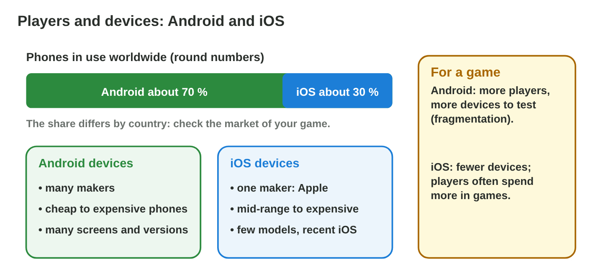
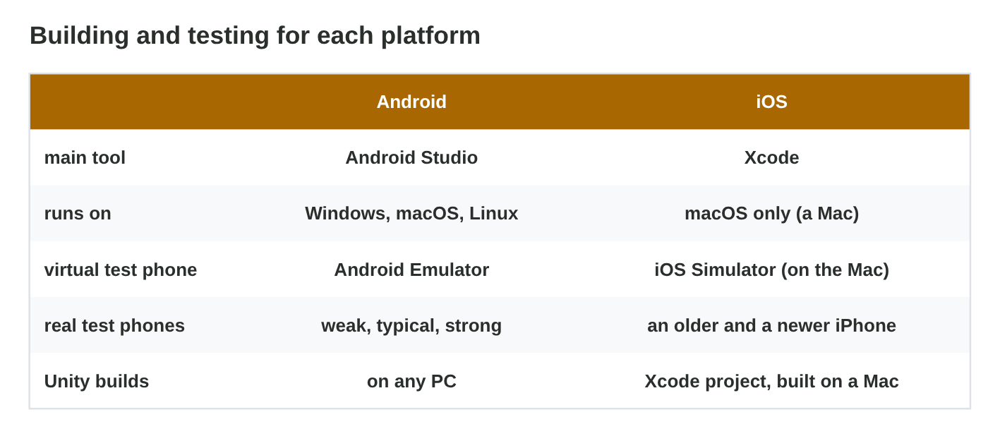
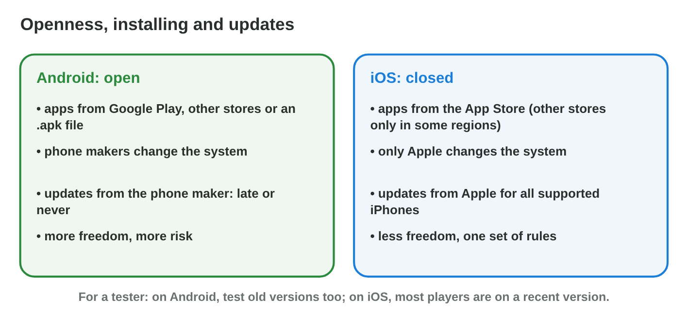
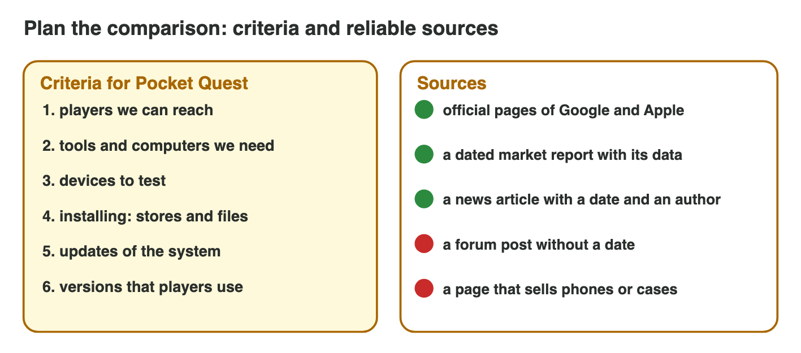

Each section: a question from a game studio, the idea, a **Do it** task and a short **Try it**.
The page checks every answer at once and tells you why. More examples
and exercises are in the lesson notes (PDF).

## Key terms



## 7.1 Players and devices

- **Market share** worldwide: about **7 in 10** phones run Android, about
  **3 in 10** iOS. It differs by country: check it, with its date.
- Android: many makers, cheap to expensive phones, many versions
  (**fragmentation**).
- iOS: one maker, few models, most on a recent iOS; players often spend
  more on games.

{width=90%}

::: {.callout-warning title="Watch out!"}
One worldwide number does not fit every country.
:::

::: {.callout-note title="Do it · The phones at home"}
Count the Android phones and the iPhones in your family. Sami's family has
5 Android phones and 1 iPhone.

::: {.choice}
What is the share in Sami's family?

- [x] about 80 / 20

  Why: 5 of 6 phones run Android: about 83 %.

- [ ] 70 / 30, like the world

  Why: Count this family: 5 of 6, not 7 of 10.

- [ ] 50 / 50

  Why: 5 against 1 is far from half and half.
:::
:::

::: {.callout-tip title="Try it 1 · Players and devices"}
Choose the right answer.

::: {.match extra="one in ten|Apple and Google"}
About how many phones in ten run Android worldwide?
:   about seven

    Why: Worldwide, about 7 in 10 phones run Android and 3 in 10 run iOS.

What does fragmentation mean for a tester?
:   many models and versions to test

    Why: Android runs on many makers, screens, chips and versions.
:::
:::

## 7.2 Building and testing

- **Android:** Android Studio on Windows, macOS or Linux; several real
  **test devices** (weak, typical, strong).
- **iOS:** Xcode only on a **Mac**; an older and a newer iPhone.
- **Unity** is a **cross-platform** engine: one project, both builds. For
  iOS a Mac finishes the build.
- Byte Bay has five Windows PCs and no Mac: Android today, iOS only with a
  Mac.

{width=90%}



::: {.callout-warning title="Watch out!"}
Virtual phones on the PC do not replace real phones: they do not heat up and
have no real battery.
:::

::: {.callout-note title="Do it · Plan the launch"}
In **Launch Planner**, choose "Android and iOS" and "only Windows PCs", and
read what the planner says.

::: {.choice}
What problem does the planner show?

- [x] An iOS build needs a Mac with Xcode.

  Why: Byte Bay must buy or rent a Mac before the iOS build.

- [ ] Unity cannot make an Android build on Windows.

  Why: Android builds work on Windows PCs.

- [ ] There is no problem.

  Why: With only Windows PCs, the iOS build cannot be finished.
:::
:::

::: {.callout-tip title="Try it 2 · Build and test"}
Choose the right answer.

::: {.match extra="any PC|a phone"}
Byte Bay has only Windows PCs. Which build can it make?
:   Android

    Why: Android builds are made on any PC; iOS needs a Mac.

What makes Unity a cross-platform engine?
:   one project gives both builds

    Why: Unity builds the same game for Android and for iOS.
:::
:::

## 7.3 Open or closed: installing and updates

- **Android: open.** Google Play, other stores or an `.apk`
  (**sideloading**); makers change the system; updates from each maker,
  late or never.
- **iOS: closed.** The **App Store** (other stores only in some regions);
  only Apple changes it; updates for all supported iPhones at once.
- A tester tests old Android versions too.

{width=90%}

::: {.callout-warning title="Watch out!"}
Open is not always unsafe, closed is not always safe: update and install
from known sources.
:::

::: {.callout-note title="Do it · Where can apps come from?"}
Android: search Settings for "Install unknown apps" and look at the list.
Do not turn anything on. iPhone: look for a way to install an app from a
file.

::: {.sort}
Android or iPhone? Sort the facts.

Android
:   "Install unknown apps" lists the browser and the file manager, each "Not allowed".

    Why: Sideloading is possible, but off until you allow it.

:   An app can be installed from an `.apk` file.

    Why: Android is open: other stores and files are possible.

iPhone
:   There is no setting to install an app from a file.

    Why: iOS is closed: apps come from the App Store.

:   Other stores exist only in some regions.

    Why: Apple allows them only where the law asks for it.
:::
:::

::: {.callout-tip title="Try it 3 · Open or closed?"}
Android or iOS?

::: {.match extra="both|neither"}
Installs an `.apk` file from outside the store.
:   Android

    Why: Android allows sideloading from a file.

Updates every supported phone at the same time.
:   iOS

    Why: Apple updates all supported iPhones at once.
:::
:::

## 7.4 Facts you can trust: reliable sources

- **Criteria:** the points you compare, chosen for the decision: reach,
  tools, test devices, installing, updates.
- **Reliable source:** a known author or organisation, a **date**, its
  data. Best for a platform fact: the **maker's official page**.
- Weak: forum posts without a date, pages that sell something, old blogs.
- The share in Rami's country: a market report from last month → use it,
  with the month.

{width=90%}



::: {.callout-warning title="Watch out!"}
The first search result is often an advertisement or an old page.
:::

::: {.callout-note title="Do it · Judge five sources"}
Judge all five sources in **Source Check**.

::: {.sort}
Use or skip? Sort the sources.

Use
:   1. Apple's page about Xcode, with a date

    Why: The maker's own page, dated.

:   3. Google's page about testing, with a date

    Why: The maker's own page, dated.

:   5. a market report from last month, with its data

    Why: A known organisation, a date and its data.

Skip
:   2. a forum post without author or date

    Why: No known author, no date.

:   4. an old shop page that sells phones

    Why: It sells something, and it is old.
:::
:::

::: {.callout-tip title="Try it 4 · Sources"}
Choose the right answer.

::: {.match extra="the first search result|any blog"}
A forum post has no author and no date. Do you use it?
:   no, find a better source

    Why: Without author and date you cannot check it.

A market report shows its data and its date. Do you use it?
:   yes, with its date

    Why: A share changes, so the date goes into the table.
:::
:::

## Game challenge: Platform Pick {.challenge}

Work alone. Use every section of today.

The producer of **Byte Bay** asks six questions before the launch of
*Pocket Quest*. The studio has **only Windows PCs**. The questions are about
the build, the reach, the testing, a **source for the share in Jordan**, an
old **Android 11** bug, and installing **from a file**.



::: {.callout-tip title="Try it 5 · The producer's questions"}
Byte Bay has only Windows PCs. Choose the right answer.

::: {.match extra="iOS|the iPhone has no bugs"}
Which platform can Byte Bay build this week?
:   Android

    Why: An iOS build needs a Mac with Xcode.

Why test on Android 11?
:   many phones never get the newest version

    Why: Android updates come from each maker, late or never.
:::
:::

::: {.callout-tip title="Try it 6 · Advice (harder)"}
Choose the best first launch for each studio.

::: {.match extra="iOS only, today|no launch"}
A small studio with only Windows PCs, and players with budget phones.
:   Android first

    Why: It builds on any PC, and its players have Android phones.
:::
:::

## Summary {.summary}

- Android reaches about 7 in 10 phones worldwide, iOS about 3 in 10: check
  your country, with a date.
- Android builds on any PC; iOS needs a Mac. Android needs more test
  phones (fragmentation).
- Android is open and updated by each maker; iOS is closed and updated by
  Apple for all iPhones.
- A fact goes into a comparison only with a reliable source: an author, a
  date and its data.
