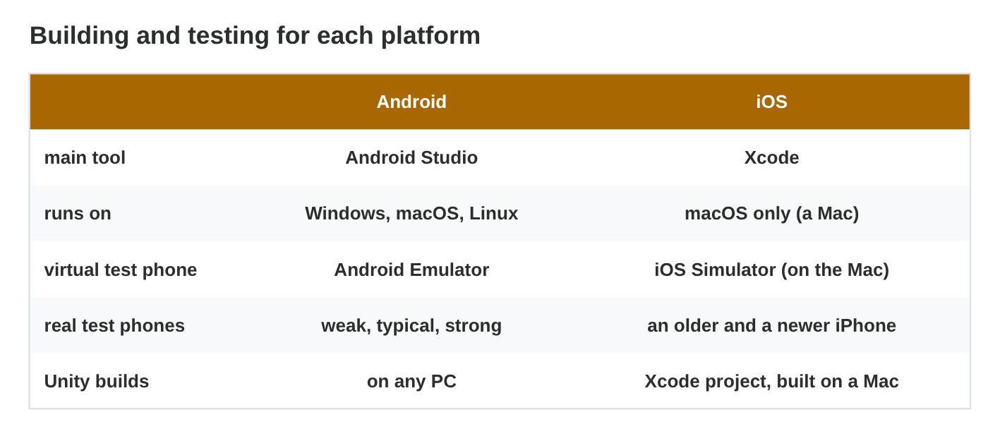
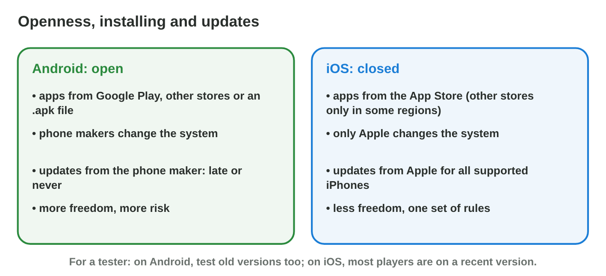
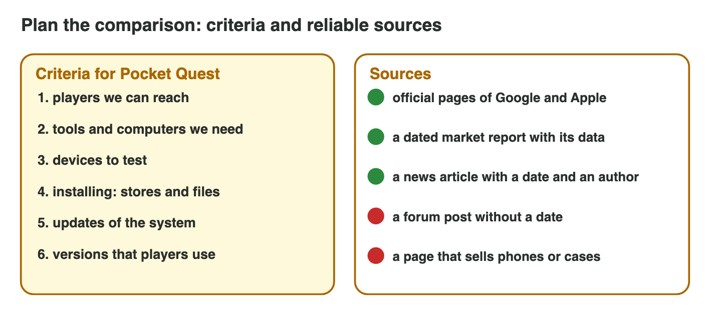

::: {.lead}
*Byte Bay* must decide how to launch *Pocket Quest*: on Android, on iOS, or
on both. In lecture 7 you saw how the two systems are built. Now you
compare them as a studio does. Which players can we reach? What do we need
to build and test the game? How free are we, and how fast do players get
updates? And where do the facts come from? In this lesson you compare the
two platforms in three steps, and you learn to check every fact with a
reliable source. Every section ends with a short task.
:::

## Key terms



## 8.1 Players and devices

The first question of a studio is: who can play our game? Android and iOS
reach different numbers of players and very different devices
(@fig-reach).

::: {.callout-important title="Definition 8.1 — Market share and fragmentation"}
The **market share** of a platform is the part of all phones that use it,
in a region and a month. Worldwide, about **seven in ten** phones run
Android and about **three in ten** run iOS; in some countries iPhones are
more common. **Fragmentation** means that Android runs on many makers,
screens, chips and versions; iOS runs on a few iPhone models.
:::

{#fig-reach width=94%}

::: {.callout-note title="Example 8.1 — Two launches"}
1. Pocket Quest on Android: most phones worldwide, from cheap to
   expensive, but the game must run on weak phones too.
2. Pocket Quest on iOS: fewer phones, few models to test, and players who
   often spend more on games.
3. Both: almost every smartphone, with twice the work.
:::

::: {.callout-warning title="Common mistake"}
Using one worldwide number for every country. In one country most players
may have iPhones, in another almost all have budget Android phones. Look
at the share in the country of your players, with its date.
:::

::: {.callout-note title="Do it · The phones at home"}
1. Count the Android phones and the iPhones in your family.
2. Is the share near 70 / 30? Why might it be different?

*Your result:* two numbers and one sentence.

::: {.check}
A good answer looks like: "5 Android phones and 1 iPhone: about 80 / 20.
Five people is a small group, and prices and shops in our country are not
the same as in the whole world." Check: two counts, a share, and a reason
(a small group, or a country that differs from the world).
:::
:::

## 8.2 Building and testing

To make a build, a studio needs the right tool on the right computer; to
test it, it needs the right phones (@fig-build).

::: {.callout-important title="Definition 8.2 — Tools and test devices"}
- **Android:** Android Studio runs on Windows, macOS and Linux. Because of
  fragmentation, the studio tests on several real **test devices** (weak,
  typical, strong).
- **iOS:** Xcode runs only on macOS, so an iOS build needs a **Mac**. A few
  real iPhones (an older and a newer one) cover most players.
- **Unity** is a **cross-platform** engine: one project gives both builds.
  It builds Android on any PC; for iOS it makes an Xcode project that a Mac
  turns into the app.
:::

{#fig-build width=94%}

::: {.callout-note title="Example 8.2 — Byte Bay's computers"}
Byte Bay has five Windows PCs and no Mac.

1. Android build: possible today, on any of the PCs.
2. iOS build: not possible until the studio buys or rents a Mac.
3. Test phones: a weak, a typical and a strong Android phone (P5, P6, P7),
   and P8 with one older iPhone for iOS.
:::



::: {.callout-warning title="Common mistake"}
Testing only on virtual phones on the computer. A virtual phone does not
heat up, has no real battery and has the power of the PC: test on real
phones too.
:::

::: {.callout-note title="Do it · Plan the launch"}
1. In **Launch Planner**, choose "Android and iOS" with "only Windows
   PCs". What problem does the planner show?
2. How many test phones does the launch need?

*Your result:* one problem and one number.

::: {.check}
The planner says: "an iOS build needs a Mac with Xcode", so Byte Bay must
buy or rent a Mac first. The launch on both needs at least 5 test phones:
3 Android phones (weak, typical, strong) and 2 iPhones (an older and a
newer one).
:::
:::

## 8.3 Open or closed: installing and updates

Android and iOS differ in how much freedom they give, and in how fast
players get a new version of the system (@fig-open).

::: {.callout-important title="Definition 8.3 — Open and closed platforms"}
- **Android** is **open**: apps come from Google Play, other stores or an
  `.apk` file (**sideloading**); phone makers change the system; updates
  come from each maker, late or never.
- **iOS** is **closed**: apps come from the **App Store** (other stores
  only in some regions); only Apple changes the system; Apple updates all
  supported iPhones at the same time.
:::

{#fig-open width=94%}

::: {.callout-note title="Example 8.3 — An old version"}
A bug in Pocket Quest appears only on Android 11.

1. Many players still use Android 11: their makers never sent a newer
   version. Byte Bay must fix it.
2. On iOS, most players use one of the last two versions, so the test plan
   can stay smaller.
:::

::: {.callout-warning title="Common mistake"}
"Open means unsafe" or "closed means safe". Both systems get security
updates; the risk is installing apps from unknown sources and never
updating.
:::

::: {.callout-note title="Do it · Where can apps come from?"}
1. Android: open Settings and search for "Install unknown apps". Which apps
   may install other apps? Do not turn anything on.
2. iPhone: search Settings for a way to install an app from a file. What
   do you find?

*Your result:* the name of the setting and what it shows, in one sentence.

::: {.check}
On Android, "Install unknown apps" lists apps such as the browser or the
file manager, each with "Not allowed": sideloading is possible, but off
until you allow it. On an iPhone there is no such setting: apps come from
the App Store (other stores only in some regions). Leave the setting off:
install apps only from known sources.
:::
:::

## 8.4 Facts you can trust: reliable sources

Rami searches the Internet for facts about the two platforms and finds
hundreds of pages: official help pages, market reports, forums, shops and
old blogs. Some say the opposite of others. Before a fact goes into a
comparison, he checks where it comes from (@fig-crit).

::: {.callout-important title="Definition 8.4 — Criteria and reliable sources"}
**Comparison criteria** are the points you compare, chosen for the
decision: for a game launch, reach, tools, test devices, installing and
updates. A **reliable source** has a known author or organisation, a
**date**, and shows its data. The best source for a fact about a platform
is its **maker's official page**.
:::

{#fig-crit width=94%}

::: {.callout-note title="Example 8.4 — Three sources for one fact"}
Rami needs the share of Android phones in the country of his players.

1. A market report with its data, updated last month. **Use it**, and write
   the month.
2. A blog from 2019: "almost everyone has Android". Old, without data: do
   not use it.
3. A forum post: "everyone has an iPhone now". No author, no date: do not
   use it.
:::

::: {.callout-warning title="Common mistake"}
Taking the first search result. The first result is often an
advertisement or an old page. Look for the maker's page or a dated report.
:::



::: {.callout-note title="Do it · Judge five sources"}
1. In **Source Check**, judge all five sources.
2. Write the three signs of a reliable source that you used.

*Your result:* your score in Source Check and three signs.

::: {.check}
Use sources 1, 3 and 5: Apple's page about Xcode and Google's page about
testing (the makers' own pages, dated) and the market report (dated, with
its data). Skip source 2 (a forum post without author or date) and source 4
(an old shop page that sells something). The three signs: a known author or
organisation, a date, and its data.
:::
:::

::: {.callout-note title="Team activity · A one-page comparison (about 20 minutes)"}
**Task.** The producer of Byte Bay asks for one page: Android and iOS for
Pocket Quest, with four criteria and a recommendation.

**Team roles** (teams of four):

1. **Android researcher:** finds the Android facts for the four criteria,
   each with a reliable source and its date.
2. **iOS researcher:** does the same for iOS.
3. **Writer:** builds the table (criterion, Android, iOS, source with date)
   and checks that every cell is a fact, not an opinion.
4. **Presenter:** writes three sentences of advice and presents the page in
   two minutes.

Each member checks the part of one other member.

**Individual alternative.** A student who works alone finds the facts of
both platforms for three criteria, builds the table and writes the advice
in three sentences.

::: {.check}
A good page has four rows (for example reach, build, test phones, updates),
a source with its date in every row, cells with facts ("about 70 %", "a Mac
with Xcode"), and advice that names what to do, why (two facts from the
table) and what would change it.
:::
:::

## Case study: Platform Pick

The producer of Byte Bay asks six questions before the launch of Pocket
Quest: which platform the studio can build this week with only Windows
PCs; which platform reaches the most phones worldwide; why Android needs
more test phones; which source to use for the share of Android phones in
Jordan; why an old Android version still matters; and where a tester can
install the game from a file. The Game challenge of the interactive lesson
uses these questions. In the mini-game below you answer them.



## Further reading

Android Developers, "Test your app on Android devices"; Apple Developer,
"Xcode"; a market report of mobile OS shares (for example StatCounter
Global Stats). Check the date on each page: shares change.

## Exercises

1. About how many phones in ten run Android worldwide?
2. Why can the share in your country be different?
3. On which computers does Android Studio run? And Xcode?
4. Why does an Android launch need more test phones?
5. What is a cross-platform engine? Give an example.
6. What is sideloading? On which platform is it simple?
7. Who sends the system updates on Android? On iOS?
8. Name three signs of a reliable source.
9. Which source is best for a fact about a platform?
10. Byte Bay has only Windows PCs. Which platform should it launch first,
    and why?

## Answers to the exercises

::: {.answers}
1. About seven.
2. Prices, shops and habits differ from country to country.
3. Android Studio: Windows, macOS, Linux. Xcode: only macOS.
4. Fragmentation: many makers, screens, chips and versions.
5. An engine that makes builds for several platforms from one project;
   for example Unity.
6. Installing an app from a file or another source; simple on Android.
7. Android: each phone maker. iOS: Apple.
8. A known author or organisation, a date, and its data.
9. The maker's official page.
10. Android: it builds on any PC; iOS needs a Mac.
:::
