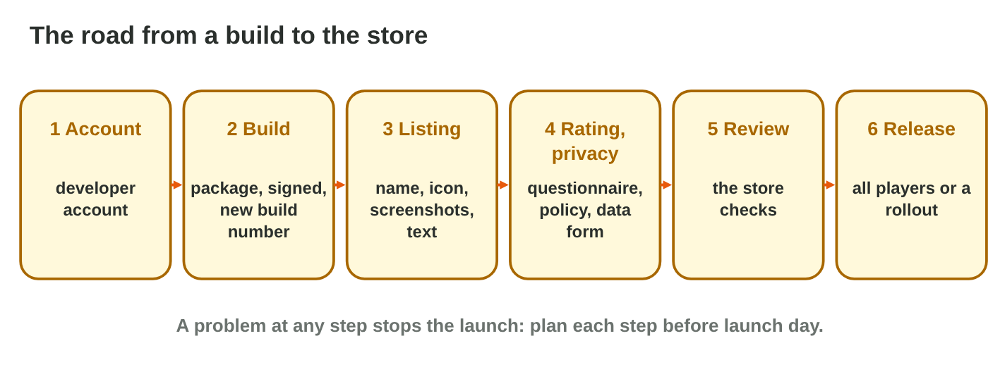
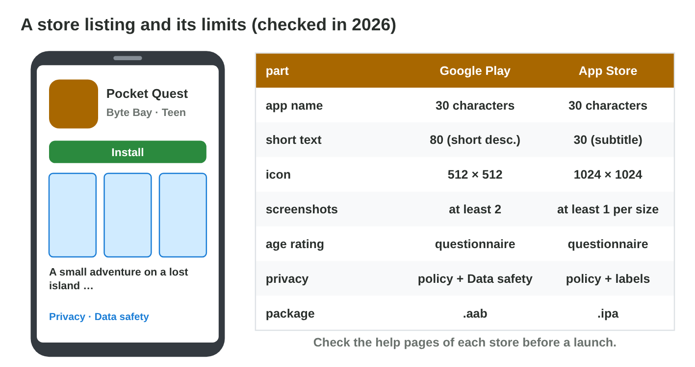
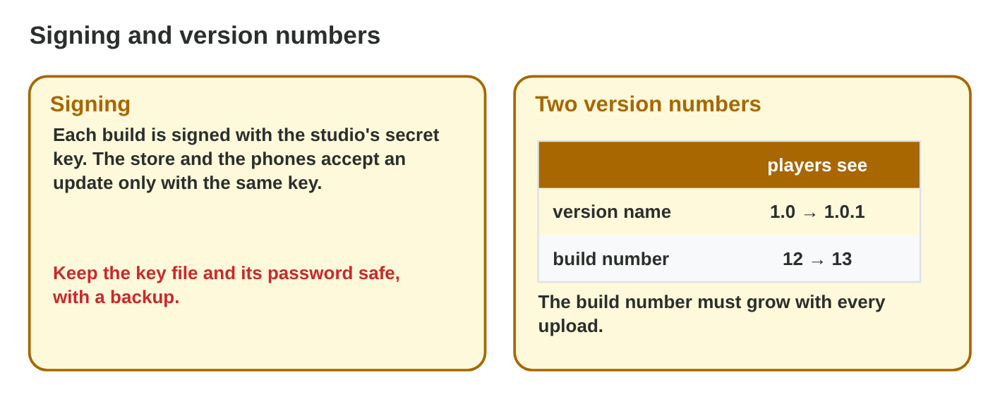
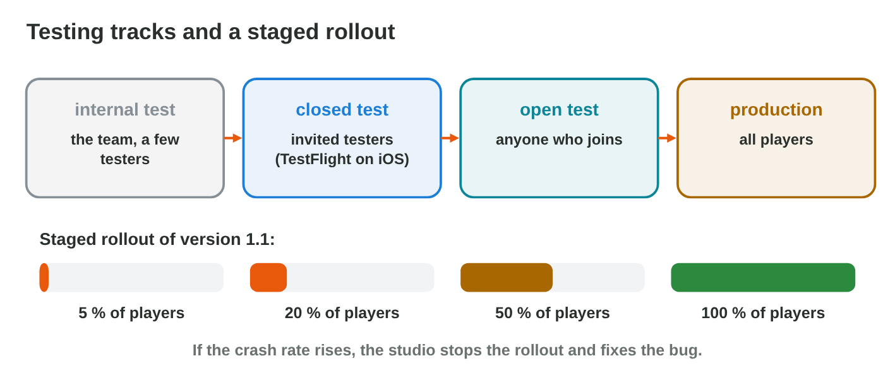

::: {.lead}
*Pocket Quest 1.0* is finished and tested. Now *Byte Bay* must bring it to
the players, through Google Play and the App Store. A store is not a
shelf where anyone puts anything: it asks for an account, a signed
package, a listing with pictures and texts, an age rating, a privacy
policy, and a review before the game goes live. In lecture 15 you saw the
accounts and fees of each store. In this lesson you follow the whole road
from a build to the players, and you learn what each store requires at
each step. Every section ends with a short task.
:::

## Key terms



## 17.1 The road to the store

Publishing has six steps, and each one can stop the launch (@fig-road).

::: {.callout-important title="Definition 17.1 — The publishing steps"}
1. **Account:** a developer account in each store (lecture 15).
2. **Build:** the package (`.aab` for Google Play, `.ipa` for the App
   Store), signed, with a new build number.
3. **Listing:** the **store listing**: name, icon, screenshots, texts,
   category.
4. **Rating and privacy:** the age-rating questionnaire, a privacy policy
   and a form about the collected data.
5. **Review:** the store checks the game.
6. **Release:** to all players, or step by step.
:::

{#fig-road width=94%}

::: {.callout-note title="Example 17.1 — Byte Bay's plan"}
1. Three weeks before the launch: accounts open (the identity check can take some days).
2. Two weeks before: final build, screenshots and texts; rating and privacy forms.
3. In the last week: review (hours to a few days); release on the day of the launch
   post.
:::

::: {.callout-warning title="Common mistake"}
Starting with the accounts one day before the launch. Identity checks and
the first review can take days: start weeks before.
:::

::: {.callout-note title="Do it · Plan the road"}
Write the six steps for your own small game, with one thing you must
prepare for each step.

*Your result:* a list of six steps.
:::

## 17.2 The store listing

The listing is the shop window of the game. Each store has limits for its
parts (@fig-listing).

::: {.callout-important title="Definition 17.2 — Store listing"}
A **store listing** has: an **app name** (at most 30 characters in both
stores), a short text (Google Play: short description, 80 characters;
App Store: subtitle, 30 characters), a long description, an **icon**
(Google Play 512 × 512 pixels; App Store 1024 × 1024), **screenshots** of
the real game, a category and contact details. Limits of 2026: check the
help pages before a launch.
:::

{#fig-listing width=94%}

::: {.callout-note title="Example 17.2 — A name that is too long"}
Rami types "Pocket Quest: The Lost Island of the Seven Golden Keys": 52
characters. The store refuses it. He writes "Pocket Quest" (12 characters)
and moves the rest to the short text: "Find the seven golden keys!"
:::



::: {.callout-warning title="Common mistake"}
Screenshots of a better-looking game, or of features that do not exist. A
misleading listing is one of the most common reasons for a rejection
(lecture 18).
:::

::: {.callout-note title="Do it · Make the listing ready"}
1. In **Store Listing Builder**, fix every problem for Google Play.
2. Switch to the App Store. Which line becomes a problem, and why?

*Your result:* two ready checklists and one answer.
:::

## 17.3 Signing, versions, rating and privacy

Behind the listing, the store checks who made the build, which version it
is, who may play it, and which data it collects (@fig-sign).

::: {.callout-important title="Definition 17.3 — Signing, build number, rating, privacy"}
- **App signing:** each build is signed with the studio's secret key; a
  store and a phone accept an update only with the same key.
- **Build number** (Android: version code): it must grow with every upload.
  Players see a **version name** such as 1.0.1.
- **Age rating:** the studio answers a questionnaire (violence, language,
  purchases, chat); the rating follows from the answers.
- **Privacy:** a link to a **privacy policy**, and a form about the data
  (Google Play: Data safety; App Store: privacy labels).
:::

{#fig-sign width=94%}

::: {.callout-note title="Example 17.3 — Version 1.0.1"}
1. Byte Bay fixes a bug: the version name goes from 1.0 to **1.0.1**.
2. The build number goes from 12 to **13**; with 12 again, the upload
   fails.
3. The build is signed with the same key as version 1.0, so players get it
   as an update.
:::

::: {.callout-warning title="Common mistake"}
Answering the age-rating questions with "no" to get a lower age. A wrong
rating can remove the game from the store later.
:::

::: {.callout-note title="Do it · Rate a game"}
Choose a game you know. Answer for it: Does it have violence? Bad language?
Purchases? Chat with strangers? Which age group would you expect?

*Your result:* four answers and an age group.
:::

## 17.4 Review, testing tracks and release

Before and after the review, a studio releases a game in steps, so that
few players meet a bug (@fig-release).

::: {.callout-important title="Definition 17.4 — Review, testing tracks, staged rollout"}
The **app review** checks every new game and update against the store's
guidelines. Before the public launch, **testing tracks** give builds to
small groups (internal, closed and open tests; on iOS, TestFlight). After
approval, a **staged rollout** gives a new version to a small part of the
players first (for example 5 %, then 20 %, 50 %, 100 %).
:::

{#fig-release width=94%}

::: {.callout-note title="Example 17.4 — Version 1.1"}
1. Closed test: 20 testers play version 1.1 for one week.
2. Review: approved in one day.
3. Staged rollout: 5 % of the players. The crash rate rises on phones with
   4 GB of RAM: Byte Bay stops the rollout, fixes the bug and sends 1.1.1.
:::

::: {.callout-warning title="Common mistake"}
Releasing an update to all players at once on a Friday night. If there is a
bug, everyone meets it, and nobody is there to fix it.
:::

::: {.callout-note title="Do it · A release plan"}
Write a release plan for version 1.2 of Pocket Quest: which testing track,
how long, and which steps of the rollout.

*Your result:* a plan of three to five lines.
:::

## Case study: Launch Day

Byte Bay publishes *Pocket Quest 1.0* on Google Play and the App Store. On
launch day it needs a developer account first; then the upload fails
because the version code 12 was used before; Rami cannot find the upload
key; the listing shows screenshots of a different art style; the age rating
must be decided; the review rejects the game for a missing privacy policy;
and version 1.1 needs a safe release. The Game challenge of the interactive
lesson uses this day. In the mini-game below you solve each problem.



## Further reading

Google Play Console Help, "Create and set up your app", "Prepare your app
for review" and "Release app updates with staged rollouts"; Apple
Developer, "App Store Connect Help: Submit an app" and "Product page".

## Exercises

1. Name the six steps of publishing a game.
2. Which package does each store want?
3. How many characters may an app name have?
4. Which icon size does each store want?
5. What is app signing for?
6. Version 1.0 had the build number 12. Which number does 1.0.1 need?
7. Who decides the age rating, and how?
8. Which two things about privacy does each store ask for?
9. What is a staged rollout?
10. Name two testing tracks before the public launch.

## Answers to the exercises

::: {.answers}
1. Account, build, listing, rating and privacy, review, release.
2. Google Play: .aab. App Store: .ipa.
3. At most 30.
4. Google Play 512 × 512; App Store 1024 × 1024.
5. To prove which studio made the build; updates need the same key.
6. A higher one, for example 13.
7. The studio answers the store's questionnaire; the rating follows from
   the answers.
8. A privacy policy link and a form about the collected data.
9. A release to a small part of the players first, then to more.
10. Internal or closed test (TestFlight on iOS), open test.
:::
