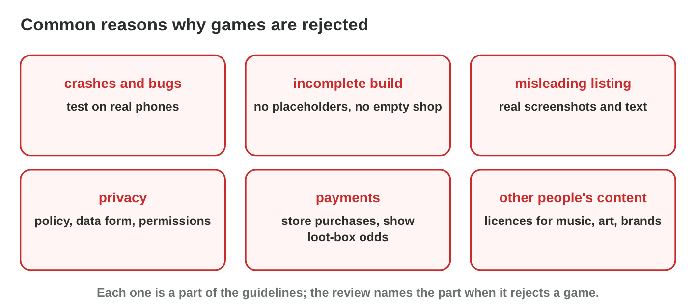

This page is the interactive version of the lesson notes (PDF). Each section
is one step of the seminar. It ends with a **Do it** task and one set of
questions. The full explanations, examples and exercises are in the notes.

## Key terms



## 18.1 The main parts of the guidelines

- **Safety:** content, children, chat and user content.
- **Performance:** complete, no crashes, a true listing.
- **Business:** purchases, ads, loot boxes.
- **Design:** no copies or spam, enough features.
- **Legal:** privacy, data, intellectual property.
- Read the official, dated page: the rules change often.

{width=90%}



::: {.callout-warning title="Watch out!"}
Old summaries on other websites may be wrong today.
:::

::: {.callout-note title="Do it · Find the parts"}
Open the official guidelines and find the part about in-app purchases.
Then sort all nine problems in **Guideline Sorter**.
:::

::: {.callout-tip title="Try it 1 · Which part?"}
Choose the part of the guidelines. You can use an answer more than once.

::: {.match extra="Weather|Music"}
A chat between players.
:   Safety

Gems sold for money.
:   Business

A privacy policy.
:   Legal

The game crashes on start.
:   Performance

20 copies of the same game.
:   Design
:::
:::

## 18.2 Common reasons for a rejection

- **Crashes and bugs** · **incomplete build** · **misleading listing**.
- **Privacy** problems · **payments** outside the store or loot boxes
  without odds.
- **Other people's content** without a licence.
- The rejection names the rule: read it, fix, answer clearly.

{width=90%}

::: {.callout-warning title="Watch out!"}
Read the named rule before you reply to a rejection.
:::

::: {.callout-note title="Do it · Judge two games"}
For two games you know, find one rule each must follow. Write the part and
the rule.
:::

::: {.callout-tip title="Try it 2 · Why rejected?"}
Choose the reason.

::: {.match extra="the price is too low|the icon is green"}
"Coming soon" on most buttons.
:   incomplete build

A mystery chest without odds.
:   loot-box odds not shown

Screenshots of another art style.
:   misleading listing

The heroes of a famous film, no licence.
:   other people's content
:::
:::

## 18.3 A pre-submission checklist

- One yes-or-no line for each common reason and each part that fits the
  game.
- Checked before **every** new build.
- Fit it to the game: chat needs reporting; purchases need store payments.

{width=90%}

::: {.callout-warning title="Watch out!"}
A copied checklist misses the risks of your own game.
:::

::: {.callout-note title="Do it · Your checklist"}
Write a checklist of at least eight lines for a game you know or plan, with
the part of the guidelines for each line.
:::

::: {.callout-tip title="Try it 3 · The checklist"}
Choose the right answer.

::: {.match extra="once a year|only for the first version"}
When does a studio check the list?
:   before every new build

A game has chat. Which line must the list have?
:   reporting and blocking

A game has no purchases. Does it need a loot-box line?
:   no

Rami finds a "Clans (soon)" button. What does he do?
:   hide it until the feature is ready
:::
:::

## Game challenge: Review Board {.challenge}

Work alone. Use every section of today.

Today you are the reviewer. Six games wait: **Pocket Quest**, **Sky Farm**,
**Gem Rush**, **Hero Wars X**, **Tiny Chat Pets** and **Speed Car 3**.



::: {.callout-tip title="Try it 4 · Decisions"}
Choose the decision.

::: {.match extra="reject: price too high|reject: icon too small"}
Pocket Quest: tested, real screenshots, policy, rating, store purchases.
:   approve

Tiny Chat Pets: children chat with strangers, no filter.
:   reject: unsafe user content

Speed Car 3: crashes on start on two phones.
:   reject: crashes

Gem Rush: a paid mystery chest, odds hidden.
:   reject: show the odds
:::
:::

::: {.callout-tip title="Try it 5 · The parts (harder)"}
Which part of the guidelines does each rejection use?

::: {.match extra="Weather|Sound"}
Tiny Chat Pets.
:   Safety

Speed Car 3.
:   Performance

Gem Rush.
:   Business

Hero Wars X.
:   Legal
:::
:::

## Summary {.summary}

- The guidelines have five main parts: Safety, Performance, Business,
  Design, Legal.
- Most rejections: crashes, incomplete builds, misleading listings,
  privacy, payments, other people's content.
- Read the official, dated rules and the rule named in a rejection.
- A checklist fitted to the game, checked before every build.
