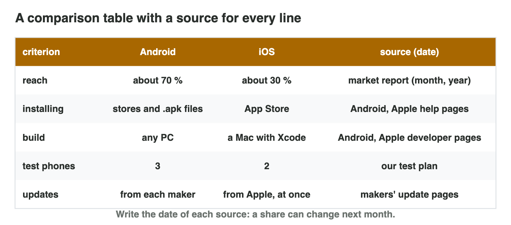

::: {.lead}
In Lecture 7 you compared Android and iOS: players, building and testing,
installing and updates, and reliable sources. Today you compare them for
one small studio. There are no new ideas: two short problems. Do each one
alone. The results of the activities are at the end of this worksheet.
:::

## Recall

- Android runs on many makers (**fragmentation**) and builds on any PC; iOS
  runs on a few iPhones and needs a **Mac** with Xcode.
- Android is open (apps from a file: **sideloading**) and is updated by each
  maker; iOS is closed and is updated by Apple for all iPhones at once.
- A **reliable source** has a known author, a date and its data; the best
  source for a platform fact is the maker's own page.

::: {.callout-tip title="Try it 1 · Recall"}
Choose the right answer.

::: {.match extra="any PC|a forum post"}
Which computer does an iOS build need?
:   a Mac

Why does an Android launch need more test phones?
:   fragmentation: many makers and models

Which source is best for a fact about iOS?
:   Apple's own page, with its date
:::
:::

## Activity 1 · A comparison table with sources

Two friends make *Star Garden*, a calm puzzle game. They have **one Windows
laptop**, two Android phones and no Mac. Their players are students in
**Jordan**, many with older phones. A comparison table puts the two
platforms side by side: one row per criterion, short facts (never opinions
such as "better"), and a **source (date)** in every row.

{width=90%}

::: {.callout-note title="Activity 1 · Four rows · 15 min"}
1. Copy the table with the columns criterion, Android, iOS, source (date),
   and the rows build computer, test phones, installing, updates.
2. Fill each cell with a short fact from Lecture 7. Write the best source
   for each row.

*Your product:* a table of four rows with a source in every row.

::: {.check}
| criterion | Android | iOS | source (date) |
|---|---|---|---|
| build computer | any PC | a Mac with Xcode | Android and Apple developer pages (2026) |
| test phones | several models | a few iPhones | the makers' pages (2026) |
| installing | stores and .apk files | App Store | Android and Apple help pages (2026) |
| updates | from each maker, often later | from Apple, all at once | the makers' update pages (2026) |

- ☐ Every cell is a fact, not an opinion.
- ☐ Every row has a source with its date.
:::
:::

::: {.callout-tip title="Try it 2 · The table"}
Choose the best answer.

::: {.match extra="cheaper|a forum post"}
Which cell fits "build computer" for iOS?
:   a Mac with Xcode

Which column does every row need?
:   source (date)

What is wrong with the cell "Android is better"?
:   it is an opinion, not a fact
:::
:::

## Activity 2 · Facts, myths and advice

Some lines from the Internet are facts with an official source, some are
facts that change (a share needs a dated report), and some are myths. Good
advice says **what** to do, **why** (two facts from the table) and **what
would change it**.



::: {.callout-note title="Activity 2 · Sort and advise · 15 min"}
1. In **Fact or Myth?**, decide for each of the six lines: an official
   fact, a fact that changes, or a myth.
2. Write three sentences of advice for *Star Garden*: what, why, and what
   would change it.

*Your product:* your score and three sentences.

::: {.check}
Fact or Myth?: "an iOS build needs a Mac" and "test Android on several
models" are official facts; "7 in 10 phones run Android" and "most players
in Jordan use Android" change and need a dated report; "Android games are
always slower" and "iPhones cannot get viruses" are myths. Good advice:
"Launch Star Garden on Android first. The studio has only a Windows laptop,
and an iOS build needs a Mac (Apple Developer, 2026). Add iOS when the
studio can rent a Mac."
:::
:::

::: {.callout-tip title="Try it 3 · Facts and advice"}
Choose the right answer.

::: {.match extra="a fact without a source|Android is the best"}
"Android games are always slower than iPhone games."
:   a myth

"About 7 in 10 phones run Android."
:   a fact that changes, with a dated report

Which three parts does good advice have?
:   what, why and what would change it

The studio gets a Mac. Which part of the advice changes?
:   the iOS part
:::
:::

## Exercises

1. What is sideloading?
2. Who updates an iPhone?
3. Name two signs of a reliable source.
4. Why is "Android is better" not a good cell in a table?

## Answers to the exercises

::: {.answers}
1. Installing an app from a file, not from a store (Android).
2. Apple, for all supported iPhones at once.
3. For example a known author, a date, its data.
4. It is an opinion, not a fact.
:::
