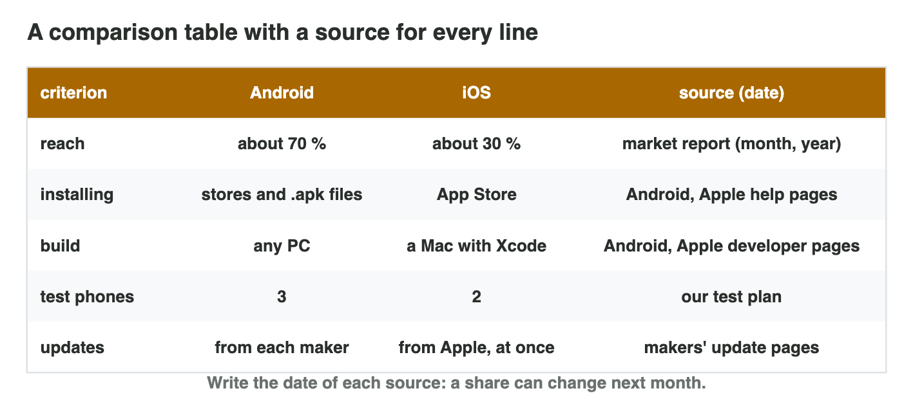

No new ideas today: two short problems on Lecture 7. Do each one alone. Tap,
sort or type your answer at every step: the page checks it at once and tells
you why.

## Recall

- Android runs on many makers (**fragmentation**) and builds on any PC; iOS
  runs on a few iPhones and needs a **Mac** with Xcode.
- Android is open (apps from a file: **sideloading**) and is updated by each
  maker; iOS is closed and is updated by Apple for all iPhones at once.
- A **reliable source** has a known author, a date and its data; the best
  source for a platform fact is the maker's own page.

::: {.callout-tip title="Try it 1 · Recall"}
Choose the right answer.

::: {.match extra="any PC|a forum post"}
Which computer does an iOS build need?
:   a Mac

    Why: Xcode, the tool for iOS builds, runs only on macOS.

Why does an Android launch need more test phones?
:   fragmentation: many makers and models

    Why: Android runs on many makers, screens, chips and versions.

Which source is best for a fact about iOS?
:   Apple's own page, with its date

    Why: The maker's official page is the best source for its platform.
:::
:::

## Activity 1 · A comparison table with sources

Two friends make *Star Garden*, a calm puzzle game. They have **one Windows
laptop**, two Android phones and no Mac. Their players are students in
**Jordan**, many with older phones. A comparison table puts the two
platforms side by side: one row per criterion, short facts (never opinions
such as "better"), and a **source (date)** in every row.

{width=90%}

::: {.callout-note title="Activity 1 · Four rows · 15 min"}
1. Copy the table with the columns criterion, Android, iOS, source (date),
   and the rows build computer, test phones, installing, updates.
2. Fill each cell with a short fact from Lecture 7. Write the best source
   for each row.

*Your product:* a table of four rows with a source in every row.

::: {.sort}
Step 2: which column does each fact go into? Sort them.

Android
:   build computer: any PC

    Why: Android builds work on Windows.

:   installing: stores and `.apk` files

    Why: Android is open.

:   updates: from each maker, often later

    Why: Each maker sends its own updates.

iOS
:   build computer: a Mac with Xcode

    Why: Xcode runs only on a Mac.

:   installing: the App Store

    Why: iOS is closed.

:   updates: from Apple, all at once

    Why: Apple updates all supported iPhones together.
:::

::: {.choice}
Which line may not go into the table?

- [x] "iOS is better for puzzle games."

  Why: It is an opinion with no source: the table holds facts.

- [ ] "an iOS build needs a Mac with Xcode (Apple Developer, 2026)"

  Why: A fact with a dated source from the maker.

- [ ] "updates from each maker, often later (the makers' update pages, 2026)"

  Why: A fact with its source and date.
:::
:::

::: {.callout-tip title="Try it 2 · The table"}
Choose the best answer.

::: {.match extra="cheaper|a forum post"}
Which cell fits "build computer" for iOS?
:   a Mac with Xcode

    Why: A cell is a short, exact fact.

Which column does every row need?
:   source (date)

    Why: Every fact needs a source that the reader can check.

What is wrong with the cell "Android is better"?
:   it is an opinion, not a fact

    Why: Opinions belong in the advice, with reasons.
:::
:::

## Activity 2 · Facts, myths and advice

Some lines from the Internet are facts with an official source, some are
facts that change (a share needs a dated report), and some are myths. Good
advice says **what** to do, **why** (two facts from the table) and **what
would change it**.



::: {.callout-note title="Activity 2 · Sort and advise · 15 min"}
1. In **Fact or Myth?**, decide for each of the six lines: an official
   fact, a fact that changes, or a myth.
2. Write three sentences of advice for *Star Garden*: what, why, and what
   would change it.

*Your product:* your score and three sentences.

::: {.sort}
Step 1: fact or myth? Sort the lines.

An official fact
:   An iOS build needs a Mac.

    Why: Apple's developer page says so.

:   Test Android on several models.

    Why: Google's testing page says so.

A fact that changes
:   7 in 10 phones run Android.

    Why: A share changes: it needs a dated report.

A myth
:   Android games are always slower.

    Why: "Always" is a warning sign; the phone decides the speed.

:   iPhones cannot get viruses.

    Why: No device is fully safe; update and install from known sources.
:::

::: {.choice}
Step 2: which advice is good: what, why, and what would change it?

- [x] "Launch Star Garden on Android first. The studio has only a Windows laptop, and an iOS build needs a Mac (Apple Developer, 2026). Add iOS when the studio can rent a Mac."

  Why: It says what to do, gives facts from the table as the reason, and what would change it.

- [ ] "Launch on iOS, because iPhone players spend more."

  Why: The studio has no Mac, so it cannot build for iOS now.

- [ ] "Android is better."

  Why: An opinion: no reason from the table, and nothing that would change it.
:::
:::

::: {.callout-tip title="Try it 3 · Facts and advice"}
Choose the right answer.

::: {.match extra="a fact without a source|Android is the best"}
"Android games are always slower than iPhone games."
:   a myth

    Why: Speed depends on the phone's chip; "always" is a warning sign.

"About 7 in 10 phones run Android."
:   a fact that changes, with a dated report

    Why: A share changes every month: keep the report and its date.

Which three parts does good advice have?
:   what, why and what would change it

    Why: The reader learns the advice, its reasons and its limits.

The studio gets a Mac. Which part of the advice changes?
:   the iOS part

    Why: With a Mac, an iOS build is possible.
:::
:::

## At home · Task with AI

::: {.callout-note .ai-task title="Task with AI · Android or iOS with one Windows laptop"}
An extra for the curious: let an AI assistant make the table. Copy the
prompt into an AI assistant that the university allows (for example
Microsoft Copilot with your university account), and look at the result.

::: {.prompt}
A small game studio has only one Windows laptop. Make a table with the
columns Android and iOS and three rows: build the game, install a test
version on a phone, upload the game to the store. In each cell, write one
short fact. Colour the cell green if the studio can do it with its Windows
laptop, and red if it needs a Mac.
:::

::: {.choice}
Which colours should the table show? The AI can be wrong: compare.

- [x] The Android column green, the iOS column red.

  Why: Android Studio runs on Windows; Xcode runs only on a Mac.

- [ ] Both columns green.

  Why: The iOS build, the test version and the upload need Xcode or a Mac.
:::

::: {.try-change}
**Change:** say that the studio also buys one Mac, and ask again.

::: {.choice}
What changes?

- [x] All cells turn green.

  Why: Xcode runs on the Mac, and Android Studio runs on a Mac too.

- [ ] The iOS cells turn green, and the Android cells turn red.

  Why: The Windows laptop still makes the Android version.
:::
:::

::: {.try-change}
**Change:** ask for one more row: the share of players in Jordan, with its source
and its date.

::: {.choice}
What do you check in the new row?

- [x] the source and the date of the number

  Why: A share changes every month: without a dated source it cannot go into the table.

- [ ] nothing: a number from the AI is always right

  Why: The AI can be wrong or old; check the source.
:::
:::

**Your own idea:** change one more number or word, and look again. The AI
can be wrong: compare its result with the answers.
:::

## Wrap-up {.summary}

- You can compare two platforms in a table with a fact and a dated source
  in every row.
- You can tell facts from myths and write advice with what, why and what
  would change it.
