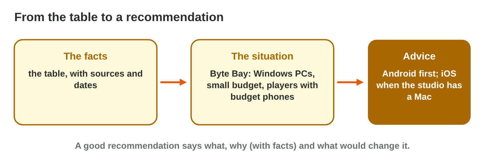

No new ideas today: you compare Android and iOS yourself, with what you
learned in Lecture 8. Do each activity alone, then open "Check your result".
Every question on this page has its answer: try first, then check.

## Recall

- Worldwide, about 7 in 10 phones run Android and 3 in 10 iOS; the share
  differs by country.
- Android runs on many makers (**fragmentation**) and builds on any PC; iOS
  runs on a few iPhones and needs a **Mac** with Xcode.
- Android is open (apps from a file: **sideloading**) and is updated by each
  maker; iOS is closed and is updated by Apple for all iPhones at once.
- A **reliable source** has a known author, a date and its data; the best
  source for a platform fact is the maker's own page.

::: {.callout-tip title="Try it 1 · Recall"}
Choose the right answer.

::: {.match extra="any PC|a forum post"}
Which computer does an iOS build need?
:   a Mac

    Why: Xcode, the tool for iOS builds, runs only on macOS.

Why does an Android launch need more test phones?
:   fragmentation: many makers and models

    Why: Android runs on many makers, screens, chips and versions.

Which source is best for a fact about iOS?
:   Apple's own page, with its date

    Why: The maker's official page is the best source for its platform.
:::
:::

## Activity 1 · Criteria for a small studio

Two friends make *Star Garden*, a calm puzzle game. They have **one Windows
laptop**, two Android phones and no money for a Mac. Their players are
students in **Jordan**, many with older phones. Before they compare the two
platforms, they choose the **criteria**: the points that matter for *their*
decision.

- Criteria come from the decision, not from a fixed list.
- Lecture 8 used five: reach, build computer, test phones, installing,
  updates.
- A criterion that does not change the decision can stay out.

{width=90%}

::: {.callout-note title="Activity 1 · Five criteria for Star Garden · 10 min"}
1. Choose five criteria for the *Star Garden* decision.
2. For each one, write one sentence: why does it matter for *this* studio?

*Your product:* five criteria, each with one reason.

::: {.check}
A good list looks like:

1. Reach **in Jordan**: the players are students in Jordan, not the whole
   world.
2. Build computer: the studio has only a Windows laptop.
3. Test phones: they own two Android phones and no iPhone.
4. Versions players use: many players have older phones.
5. Installing: friends test the game before it is in a store.

- ☐ Five criteria, each linked to a fact about Star Garden.
- ☐ No criterion without a reason.
:::
:::

::: {.callout-tip title="Try it 2 · Criteria"}
Choose the criterion.

::: {.match extra="the colour of the phones|the name of the game"}
The studio has only a Windows laptop. Which criterion does this fact belong to?
:   build computer

    Why: The build computer decides which builds the studio can make.

The players are students in Jordan. Which criterion needs the share in Jordan?
:   reach

    Why: Reach counts the players in the country of the game.

The studio owns two Android phones and no iPhone. Which criterion is this?
:   test phones

    Why: The test phones decide what the studio can test.
:::
:::

## Activity 2 · A comparison table with sources

A comparison table puts the two platforms side by side:

- one **row** per criterion; one **column** per platform;
- a **source (date)** column: the name of the source and its date;
- short, exact cells: facts ("a Mac with Xcode"), never opinions
  ("better").

{width=90%}

::: {.callout-warning title="Watch out!"}
"Better", "cheaper" and "good" are opinions. Keep them for the
recommendation.
:::

::: {.callout-note title="Activity 2 · Build the table · 15 min"}
1. In Word or Excel, make a table with the columns criterion, Android, iOS,
   source (date).
2. Fill one row for each of your five criteria. Find each fact on a
   reliable source and write its name and date.

*Your product:* a table of five rows, with a source and a date in every row.

::: {.check}
A good table looks like:

| criterion | Android | iOS | source (date) |
|---|---|---|---|
| reach in Jordan | the share from the report | the share from the report | a market report (month, year) |
| build computer | any PC | a Mac with Xcode | Android and Apple developer pages (2026) |
| test phones | 3: weak, typical, strong | 2: an older and a newer iPhone | our test plan |
| versions | many old versions in use | most on the last two | the makers' update pages (2026) |
| installing | stores and .apk files | App Store | Android and Apple help pages (2026) |

- ☐ Every cell is a fact, not an opinion.
- ☐ Every row has a source with its date.
:::
:::

::: {.callout-tip title="Try it 3 · The table"}
Choose the best cell.

::: {.match extra="cheaper|Android is better"}
Build computer for iOS?
:   a Mac with Xcode

    Why: A cell is a short, exact fact.

Reach of Android worldwide?
:   about 70 % (report, month, year)

    Why: A share changes, so the cell keeps its source and date.

Which column does every row need?
:   source (date)

    Why: Every fact needs a source that the reader can check.

What is wrong with the cell "Android is better"?
:   it is an opinion, not a fact

    Why: Opinions belong in the recommendation, with reasons.
:::
:::

## Activity 3 · A recommendation

- A good recommendation says **what** to do, **why** (two or three facts
  from the table) and **what would change it**.
- It fits the studio: its computers, its money and its players.
- Every "because" needs a fact from the table.

{width=90%}

::: {.callout-note title="Activity 3 · Advice for Star Garden · 10 min"}
1. Write three to five sentences of advice for *Star Garden*.
2. Underline the facts from your table.

*Your product:* a short recommendation with underlined facts.

::: {.check}
A good recommendation looks like: "Launch Star Garden on Android first.
The studio has only a Windows laptop, and an iOS build needs a Mac (Apple
Developer, 2026). Most of our players in Jordan have Android phones (a
market report, with its month). Add iOS when the studio can rent a Mac."

- ☐ It says what to do.
- ☐ It gives two or three facts from the table.
- ☐ It says what would change the advice.
:::
:::

::: {.callout-tip title="Try it 4 · The advice"}
Choose the right answer.

::: {.match extra="Android is the best|nothing"}
Which three parts does a good recommendation have?
:   what, why and what would change it

    Why: The reader learns the advice, its reasons and its limits.

The studio gets a Mac. Which part of the advice changes?
:   the iOS part

    Why: With a Mac, an iOS build is possible.

Where do the reasons of the advice come from?
:   facts in the table

    Why: Every "because" needs a fact with a source.
:::
:::

::: {.callout-note .ai-task title="Task with AI · A checked six-row table"}
**Goal:** a comparison table of Android and iOS with six criteria for *Star
Garden*, in which every cell is checked on a reliable source. By hand this
takes long; with AI you start from a draft and spend the time on checking.

1. **Ask the AI:** start with this prompt.

   ::: {.prompt}
   Make a table that compares Android and iOS for a small game studio with
   one Windows laptop and players in Jordan. Use six rows: reach in Jordan,
   build computer, test phones, versions in use, installing apps, system
   updates. Columns: criterion, Android, iOS, source. Write short facts,
   not opinions.
   :::

2. **Do it yourself:** for each cell, find the fact on a reliable source
   (the maker's page or a dated report) and write the source and its date.
   Mark each cell ✓ (right) or correct it.
3. **Check:** three facts you can check on the makers' pages: Xcode runs
   only on a Mac; "Install unknown apps" exists on Android; Apple updates all
   supported iPhones. The share in Jordan must come from a dated report.

*Your product:* the checked table, and one sentence on what the AI got wrong
or what you changed.

::: {.check}
A good product has six rows with a source and a date in every row, each
cell marked ✓ or corrected, and one sentence such as "The AI gave a share
without a date, so I took the share from a report of last month."

- ☐ No cell without a checked source.
- ☐ At least one change or one confirmed doubt, written down.
:::
:::

## Game challenge: Fact or Myth? {.challenge}

Work alone. Use every activity of today.

Rami's comparison table for *Pocket Quest* has six lines from the Internet:
an iOS build needs a Mac with Xcode; Android games are always slower than
iPhone games; about 7 in 10 phones run Android; most players in Jordan use
Android phones; iPhones cannot get viruses; and a game for Android must be
tested on several models. For each line he decides: a fact with an official
source, a fact that changes and needs a dated report, or a myth to remove.



::: {.callout-tip title="Try it 5 · The lines"}
Choose the right answer. You can use an answer more than once.

::: {.match extra="a fact without a source|an opinion to keep"}
“An iOS build needs a Mac with Xcode.”
:   a fact, with an official source

    Why: Apple's developer pages say that Xcode runs only on macOS.

“Android games are always slower than iPhone games.”
:   a myth

    Why: Speed depends on the phone's chip; "always" is a warning sign.

“About 7 in 10 phones run Android.”
:   a fact that changes, with a dated report

    Why: A share changes every month: keep the report and its date.

“Most players in Jordan use Android phones.”
:   a fact that changes, with a dated report

    Why: The share of one country changes too: it needs a dated report.
:::
:::

::: {.callout-tip title="Try it 6 · Check yourself (harder)"}
Choose the right answer.

::: {.match extra="the newest blog|keep it as it is"}
Two sources give different shares. Which do you use?
:   the newer report that shows its data

    Why: A dated report with data can be checked; the newer one is closer to today.

Which word in a claim is a warning sign?
:   always

    Why: Facts about phones depend on the model; "always" hides that.

Why write the date of every source?
:   facts like shares change

    Why: A reader must know how old a fact is.
:::
:::

## Wrap-up {.summary}

- You can choose the criteria of a comparison for one studio and one decision.
- You can build a comparison table with a fact and a dated, reliable source in every row.
- You can write a recommendation that says what, why and what would change it.
- You can check an AI draft against the makers' pages and dated reports.
