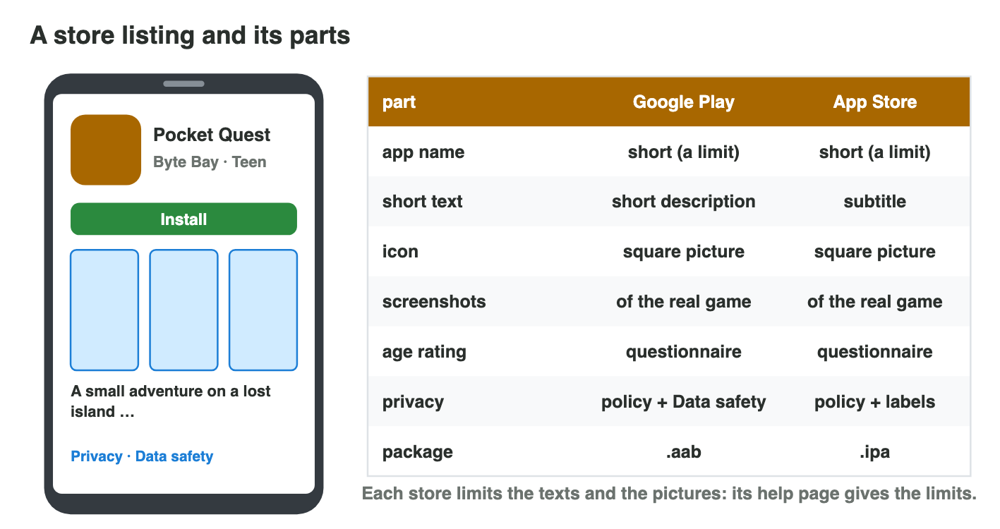
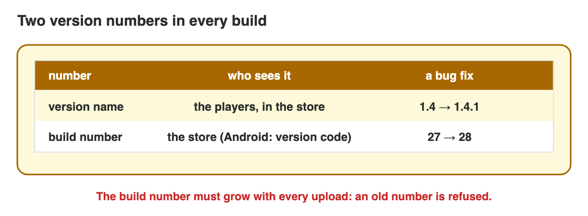
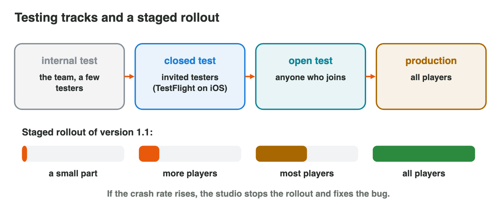

This page is the interactive version of the lesson notes (PDF). Each section
starts with a problem on the road to the store. Then it explains what the
store requires. It ends with a **Do it** task and one set of questions.
Every question on this page has its answer: try first, then check.

## Key terms



## 8.1 The road to the store

- **Account → build → listing → rating and privacy → review → release.**
- **Developer account:** Google Play about **25 USD once**; Apple about
  **99 USD every year**. Both stores keep a share of each sale (often
  15–30 %).
- Each step can stop the launch; accounts and the first review take days.
- Byte Bay starts three weeks before the launch day.

{width=90%}

::: {.callout-warning title="Watch out!"}
Do not open the accounts one day before the launch: identity checks take days.
:::

::: {.callout-note title="Do it · Plan the road"}
Write the six steps for your own small game, with one thing to prepare for
each step.

::: {.check}
A good answer looks like: "1. Account: a Google Play account (25 USD). 2.
Build: the .aab with a new build number. 3. Listing: a short name, an icon,
four screenshots of the real game. 4. Rating and privacy: the questionnaire
and a privacy policy page. 5. Review: send it two weeks before the launch.
6. Release: first to a small part of the players."

- ☐ Six steps, in this order.
- ☐ One real thing to prepare for each step.
:::
:::

::: {.callout-tip title="Try it 1 · The steps"}
Choose the right answer.

::: {.match extra="the players|a website"}
What is the first step?
:   a developer account

    Why: Without an account there is no upload.

Which step comes right before the release?
:   the review

    Why: The store checks the game before it goes live.

How much does the Apple Developer Program cost?
:   about 99 USD every year

    Why: Apple asks for a yearly fee; Google Play about 25 USD once.

Both stores for the first year: how much for the accounts?
:   124 USD

    Why: 25 + 99 = 124 USD.
:::
:::

## 8.2 The store listing

- Parts: **app name** (short), a short text (Google: short description;
  Apple: subtitle), a long description, an **icon**, **screenshots** of the
  **real** game, category, contact.
- Each store has **limits** for the texts and the pictures: its form shows
  them; check the help pages before a launch.
- "Bee Farm: Grow and Sell the Biggest Vegetables" is too long → "Bee Farm",
  and the rest goes into the short text.

{width=90%}



::: {.callout-warning title="Watch out!"}
Screenshots of a "nicer" game are a misleading listing.
:::

::: {.callout-note title="Do it · Make the listing ready"}
Fix every problem in **Store Listing Builder** for Google Play, then switch
to the App Store. Which line becomes a problem?

::: {.check}
For Google Play: a short name such as "Pocket Quest", the icon the form asks
for (512 × 512), 2 or more screenshots, the questionnaire done, a privacy
link and a higher build number. On the App Store the **icon** becomes a
problem: Apple asks for a bigger icon (1024 × 1024). Each store has its own
limits.
:::
:::

::: {.callout-tip title="Try it 2 · The listing"}
Choose the right answer.

::: {.match extra="a smaller font|any pictures of games"}
The store refuses an app name. What is the fix?
:   a shorter name, and the rest in the short text

    Why: The app name has a limit; the short text can say more.

What must the screenshots show?
:   the real game

    Why: Pictures of another game are a misleading listing.

What does the App Store call the short text?
:   the subtitle

    Why: Google Play calls it the short description.

Where do you find the limits of each part?
:   in the store's form and help pages

    Why: The limits change, so the store's own pages are the source.
:::
:::

## 8.3 Versions, age rating and privacy

- **Build number** grows with every upload (27 → 28); players see the
  **version name** 1.4 → 1.4.1.
- **Age rating:** from the studio's honest answers to a questionnaire.
- **Privacy:** a policy link + a data form (Data safety / privacy labels).

{width=90%}

::: {.callout-warning title="Watch out!"}
Wrong answers in the rating questionnaire can remove the game later.
:::

::: {.callout-note title="Do it · Rate a game"}
For a game you know: violence? bad language? purchases? chat with
strangers? Which age group do you expect?

::: {.check}
A good answer looks like: "Cartoon fights: yes; bad language: no;
purchases: yes (gems); chat with strangers: no. I expect a rating for about
12 and older."

- ☐ Four yes-or-no answers.
- ☐ An age group that fits them: more violence or open chat gives a higher age.
:::
:::

::: {.callout-tip title="Try it 3 · Behind the listing"}
Choose the right answer.

::: {.match extra="27 again|the players"}
Version 1.4 had build 27. Which build number for 1.4.1?
:   28

    Why: The build number must grow with every upload.

Which number do the players see?
:   the version name, such as 1.4.1

    Why: The build number is for the store.

Who answers the age-rating questionnaire?
:   the studio

    Why: The rating follows from the studio's answers.

What do both stores ask about privacy?
:   a policy link and a data form

    Why: Google calls the form Data safety, Apple privacy labels.
:::
:::

## 8.4 Review and release

- **App review:** every game and update is checked against the store's
  **guidelines**.
- Common reasons for a rejection: crashes, "coming soon" buttons, a
  misleading listing, no privacy policy.
- **Testing tracks:** internal, closed, open tests (iOS: TestFlight).
- **Staged rollout:** a small part of the players first, then more, then
  all; stop if the crash rate rises.

{width=90%}

::: {.callout-warning title="Watch out!"}
An update for everyone at once on a Friday night spreads a bug to all.
:::

::: {.callout-note title="Do it · A release plan"}
Write a release plan for version 1.2 of Pocket Quest: testing track, how
long, release steps.

::: {.check}
A good plan looks like: "1. Closed test with 20 testers for one week. 2.
Review, sent on Monday. 3. Staged rollout: a small part of the players
first. 4. If the crash rate stays low, more players, then all. 5. If it
rises: stop, fix, send 1.2.1."

- ☐ A testing track with a time.
- ☐ The review, then a release in steps.
- ☐ What to do if a bug appears.
:::
:::

::: {.callout-tip title="Try it 4 · Review and release"}
Choose the right answer.

::: {.match extra="delete the game|release to all"}
The crash rate rises in a staged rollout. What does the studio do?
:   stop the rollout and fix the bug

    Why: Only a small part of the players has the bug yet.

Which iOS app gives test builds to testers?
:   TestFlight

    Why: TestFlight is Apple's testing track.

What does the store check before a release?
:   every game and every update

    Why: The app review checks each new build against the guidelines.

A button says "Clans (coming soon)". Why is this a problem?
:   the build is incomplete

    Why: A feature that does not exist yet is a common reason for a rejection.
:::
:::

## Game challenge: Launch Day {.challenge}

Work alone. Use every section of today.

Byte Bay publishes **Pocket Quest 1.0**: the account, a used **version code
12**, an app name of **54 characters**, a listing with another art style,
the age rating, a rejection for **no privacy policy**, and a safe release of
**1.1**.



::: {.callout-tip title="Try it 5 · Launch day"}
Pocket Quest 1.0 on launch day. Choose the right step.

::: {.match extra="change the icon|a Mac"}
The upload fails: version code 12 was used.
:   upload with a higher version code

    Why: Every upload needs a higher build number.

The listing shows another art style.
:   use screenshots of the real game

    Why: A misleading listing is rejected.

Rejected: no privacy policy.
:   add the policy link and the data form

    Why: Both stores ask for both.

Version 1.1 may have a hidden bug.
:   a staged rollout

    Why: Only a small part of the players meets the bug first.
:::
:::

::: {.callout-tip title="Try it 6 · Check the listing (harder)"}
Pocket Quest's listing: is each part ready? Choose the right answer.

::: {.match extra="needs a new build number|too short"}
The app name "Pocket Quest" (12 characters).
:   ready for both stores

    Why: A short name fits the limit of both stores.

An icon of 512 × 512 on the App Store.
:   too small for Apple

    Why: Apple asks for 1024 × 1024 in its form.

The name "Pocket Quest: The Lost Island of the Seven Golden Keys".
:   too long: a shorter name

    Why: 54 characters is over the limit of the app name.

No privacy policy, but the game collects e-mail addresses.
:   not ready for either store

    Why: Both stores ask for a privacy policy.
:::
:::

## Summary {.summary}

- Publishing: account, build, listing, rating and privacy, review, release.
- Google Play costs about 25 USD once; Apple about 99 USD every year.
- The listing shows the real game; each store has its own limits.
- The build number grows with every upload; honest age rating; privacy
  policy and data form.
- Test in tracks, then release step by step.
